# 🌐 Rancangan Aplikasi Billing Internet — Microprovider / Mini ISP

> Versi: 0.4 — Tahap 1: Definisi Fitur
> Tanggal: 6 November 2026

Keputusan yang mengunci uang, isolir, peran, dan batas tahap awal ada di `docs/decisions/001-keputusan-review-spesifikasi.md`. Jika kalimat di bawah berbeda dengan keputusan itu, keputusan yang dipakai.

---

## 🏗️ Gambaran Arsitektur Sistem (Redundansi Jalur API Mikrotik)

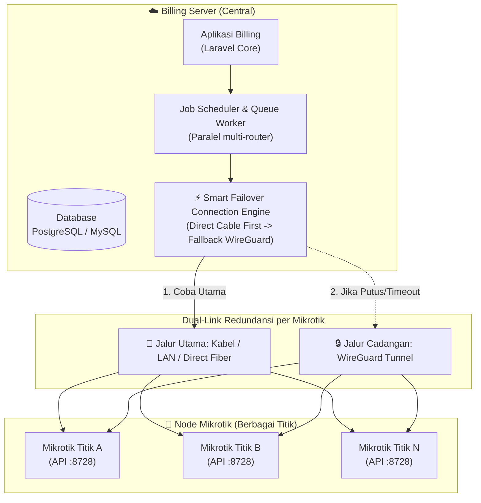

---

## 👥 Peran Pengguna (Role) & Hak Akses

| Role | Cakupan & Wewenang |
|---|---|
| **Super Admin** | Hak akses penuh: konfigurasi global, manajemen server/mikrotik, approval bypass, audit log, manajemen user. |
| **NOC (Network Operation)** | Monitoring link Mikrotik, cek status WireGuard, test koneksi API, log isolir, kontrol teknis jaringan. |
| **Admin Global** | Operasional menyeluruh lintas wilayah: verifikasi pembayaran transfer, generate tagihan, rekap keuangan global, verifikasi setoran kolektor. |
| **Admin Wilayah** | Mengelola pelanggan, kolektor, dan verifikasi tagihan hanya pada wilayah/area tertentu yang ditugaskan. |
| **Teknisi** | Input data pendaftaran pasang baru di lapangan (koordinat GPS, titik ODP), cek status redaman/link, menerima perintah kerja instalasi. |
| **Kolektor** | Menagih pelanggan yang ditugaskan (1, 2, custom list, atau global). Input pembayaran dengan hak akses bervariasi (lihat modul kolektor). |
| **Pelanggan** | Akses portal: cek tagihan, riwayat pembayaran, upload bukti transfer manual, informasi paket (login multi-identifier). |

---

## 📋 Modul & Fitur

### 1. 📌 Manajemen Pelanggan, Hierarki Wilayah, & Topologi Sambungan Fleksibel

| Field / Fitur | Keterangan |
|---|---|
| **Identitas & Kontak** | Nama, Alamat detail (RT/RW/No Rumah), No. HP, Email, No. Pelanggan unik (auto-generate, contoh: `CUST-00123`) |
| **Hierarki Wilayah** | Pengelompokan administratif berjenjang: **Kecamatan $\rightarrow$ Desa/Kelurahan $\rightarrow$ Dusun/Dukuh** (opsional pada form awal). |
| **Topologi Sumber Sambungan Fleksibel** | **Mengakomodasi Realita Lapangan RT/RW Net:** Pelanggan tidak dipaksa harus selalu dari tiang ODP resmi. Disediakan 4 pilihan sumber koneksi:<br>1. **ODP Tiang (Standar Fiber):** Tersambung ke tiang ODP resmi (pilih ODP dan Nomor Port).<br>2. **Splitter Rumah Tetangga (Sub-Splitter / Numpang):** Mengambil sinyal optik dari splitter kecil (misal ratio 1:2 atau 1:4) yang dititipkan di rumah tetangga terdekat (pilih nama tetangga *parent* & catatan posisi box di teras/atap).<br>3. **Estafet HTB / Switch LAN:** Pelanggan dicolok kabel LAN UTP dari media converter HTB / Switch Hub yang dititipkan di rumah warga atau tiang gang (pilih nama warga sumber HTB & port switch).<br>4. **Koneksi Langsung:** Ditarik langsung dari switch/router kantor pusat. |
| **Peta Pohon Dependensi (*Parent-Child Tree*)** | **Kunci Diagnosa Gangguan:** Jika 3 rumah estafet HTB mati bersamaan, sistem langsung menandai bahwa sumber masalahnya berasal dari **titik rumah induk (parent)** yang mati lampu atau adaptor HTB-nya tercabut, bukan kabel jalanan yang putus! |
| **Login Portal Pelanggan** | Mendukung login via: **Username, Email, No. HP, No. Pelanggan, atau Google OAuth (Google Login)** |
| **Data Kredensial & Teknis Modem** | **Rekam Data Teknis Lengkap per Pelanggan:**<br>• **User & Password PPPoE/Koneksi:** Username & Password sambungan internet.<br>• **Tipe & Merk Perangkat:** Misal: *ZTE F609 v3, Huawei HG8245H5, Fiberhome AN5506, VSOL V2801SG*.<br>• **Tanggal Instalasi:** Tanggal & jam resmi pemasangan perdana di rumah warga.<br>• **Foto Modem Pasca Instalasi:** Foto fisik modem terpasang rapi di dinding/meja pelanggan (bukti lampu indikator menyala & kerapian kabel).<br>• **SSID & Password WiFi:** Nama WiFi dan kata sandi pelanggan.<br>• **File Backup Config Modem:** Unggah/unduh file cadangan konfigurasi (`.xml` / `.cfg` / `.bin`) untuk *one-click restore* saat modem pelanggan diganti baru. |
| **Kredensial Superadmin Router (Role-Based Security)** | **User & Password Superadmin (Master):**<br>Kredensial login tingkat tinggi ke web GUI modem pelanggan (misal: `admin / telecomadmin` atau custom ISP).<br>• 🔒 **Teknisi DILARANG Mengakses:** Kolom disembunyikan/diberi tanda sensor hitam dari layar akun Teknisi demi keamanan (mencegah bocornya password master ISP).<br>• 🟢 **NOC / Super Admin DAPAT Mengakses:** Dibuka penuh untuk tim NOC saat remote konfigurasi. |
| **Akses Teknisi Saat Perbaikan & Tombol WA** | **Kemudahan Teknisi di Lapangan:**<br>Saat menerima tiket servis/perbaikan, teknisi dapat langsung membuka tab data teknis (melihat SSID, password WiFi, merk alat, tanggal pasang, dan mengunduh file backup config).<br>• **Tombol `[📲 Hubungi Pelanggan via WA]`:** Satu sentuhan di HP teknisi langsung membuka chat WhatsApp ke pelanggan bersangkutan untuk konfirmasi janji temu atau laporan kedatangan. |
| **Alur Request Penggantian SSID & Password WiFi** | **Prosedur Terverifikasi Anti-Salah Setting:**<br>1. **Pengajuan:** Admin Wilayah atau Teknisi di lapangan membuka form *Request Ubah WiFi* $\rightarrow$ input SSID Baru & Password Baru $\rightarrow$ status `menunggu_verifikasi_noc`.<br>2. **Validasi & Eksekusi NOC:** NOC memvalidasi permintaan, lalu mengeksekusi via API TR-069 GenieACS (atau konfigurasi manual).<br>3. **Pembaruan Otomatis:** Begitu NOC menekan **`[Verifikasi & Simpan]`**, data SSID & password baru otomatis tersimpan permanen di database pelanggan dan dicatat dalam riwayat perubahan. |
| **Status Cuti / Suspend Sementara (*Seasonal Freeze*)** | Selama `cuti_mulai` sampai `cuti_selesai` (kedua tanggal termasuk), scheduler tidak menerbitkan tagihan langganan dan tidak mengevaluasi isolir. Tidak ada biaya sewa port tersembunyi. Besok setelah `cuti_selesai`, tagihan dan isolir berjalan normal. |
| **Paket Layanan** | Harga paket adalah integer rupiah yang sudah termasuk PPN. Itu nominal yang ditagih, dipotong dompet, dan dicetak. Tidak ada perhitungan PPN kedua di kasir. |
| **Mikrotik (Many-to-Many)** | Terhubung ke 1 atau banyak Mikrotik via tabel pivot `pelanggan_mikrotik` (IP statis per link) |
| **Mode Isolir** | Pelanggan baru: `isolir_enabled = true` dan `mode_isolir = custom3` (isolir bila tagihan langganan belum lunas mencapai 2). Opsi lain: `custom1`, `custom2`, `custom4`. Tidak ada mode bernama `default`. Rincian ada di `docs/logika-isolir.md`. |
| **Jatuh Tempo & Prorata** | Jatuh tempo default tanggal 11 pukul 00:00 Asia/Jakarta. Prorata pelanggan pasang baru: `harga_paket x hari_layanan / jumlah_hari_periode`, dibulatkan ke rupiah terdekat (0,5 ke atas). Hari pemasangan dihitung. Tagihan berikut memakai harga penuh. |

---

### 2. 📝 Mekanisme Registrasi Pasang Baru & Urutan Form Input

| Fitur | Keterangan |
|---|---|
| **Penginput Data** | **Admin Wilayah**, **Teknisi**, dan **Reseller** dapat menginput pendaftaran calon pelanggan baru. |
| **Urutan Form Proporsional** | **Bagian 1: Identitas Utama**<br>1. Nama Lengkap `[WAJIB]`<br>2. Nomor HP / WhatsApp `[WAJIB]`<br><br>**Bagian 2: Lokasi & Alamat**<br>3. Alamat Detail (Jalan / RT / RW / Patokan Rumah) `[WAJIB]`<br>4. Kecamatan `[OPSIONAL]` (Dropdown)<br>5. Desa / Kelurahan `[OPSIONAL]` (Dropdown cascading)<br>6. Dusun / Dukuh `[OPSIONAL]` (Dropdown cascading)<br>7. Titik Koordinat GPS `[OPSIONAL]` (Tombol deteksi GPS ponsel)<br><br>**Bagian 3: Layanan & Finansial**<br>8. Paket yang Dipilih `[OPSIONAL]` (Dropdown paket)<br>9. Biaya Pemasangan / Instalasi `[OPSIONAL]` (Nominal Rp)<br><br>**Bagian 4: Lampiran Dokumen & Fisik**<br>10. Foto KTP / Identitas `[OPSIONAL]` (Upload/Kamera)<br>11. Foto Lokasi Rumah / Depan `[OPSIONAL]` (Upload/Kamera) |
| **Kunci Reseller Otomatis** | Jika diinput oleh Reseller, sistem otomatis mengunci `reseller_id` ke akun mitra tersebut. |
| **Status Awal** | Masuk ke antrean verifikasi: `menunggu_verifikasi_pusat`. |
| **Verifikasi Admin Global** | **Admin Global memvalidasi kelayakan dan menetapkan aspek teknis:**<br>1. Alokasi Mikrotik (atau multi-Mikrotik)<br>2. Alokasi IP statis pelanggan<br>3. Verifikasi paket resmi dan mode isolir (default `custom3`)<br>4. Verifikasi biaya pasang baru.<br>Persetujuan ditolak bila paket masih kosong. |
| **Otomatisasi Pasca Approval** | Begitu disetujui Admin Global:<br>1. Status menjadi `siap_pasang`. Isolir otomatis belum berjalan karena `tanggal_instalasi` masih kosong.<br>2. Nomor pelanggan unik terbit.<br>3. Akun portal pelanggan terbit.<br>4. Satu invoice perdana terbit, dengan baris prorata langganan dan, bila ada, baris biaya pasang. Biaya pasang tidak dihitung sebagai tunggakan isolir.<br>5. Email sambutan terkirim. WhatsApp hanya lewat tombol `wa.me` yang diklik staf. |
| **Berita Acara Digital & Tanda Tangan HP (*Digital Handover*)** | **Validasi Resmi Penyerahan Perangkat Pasca Pasang Baru:**<br>Saat instalasi selesai di rumah warga, teknisi membuka form Berita Acara di HP:<br>1. **Scan / Pilih SN Modem:** Teknisi memilih Serial Number modem dari stok tasnya.<br>2. **Tanda Tangan Digital Pelanggan:** Pelanggan menandatangani berita acara langsung di layar sentuh HP teknisi (*Digital Signature Pad*).<br>3. **Klausul Pinjam Pakai Milik ISP:** Dokumen memuat klausul hukum resmi bahwa modem/ONT berstatus **Pinjam Pakai Milik ISP** (bukan hak milik pelanggan).<br>4. **PDF berita acara:** Sistem menerbitkan PDF bernomor unik. Staf menekan tombol `wa.me` bila pelanggan minta tautannya. PDF menyimpan hash dokumen, nama penanda tangan, waktu, dan IP perangkat. Tanda tangan di layar adalah bukti serah terima operasional, bukan pengganti akta. |

---

### 3. 🗺️ Manajemen Lokasi & Mikrotik (Dual-Path Failover)

> [!NOTE]
> **Pemisahan Tanggung Jawab Jaringan:**
> Konfigurasi peering, routing, dan autentikasi WireGuard dikelola secara independen di level OS server Linux/Mikrotik oleh tim jaringan Anda. Aplikasi billing **tidak perlu mengelola file config / key WireGuard**, melainkan cukup menginputkan **IP Jalur Utama (Kabel)** dan **IP Jalur Cadangan (IP WireGuard)** beserta kredensial API Mikrotik.

| Fitur | Keterangan |
|---|---|
| **Data Titik Mikrotik** | Nama lokasi/node, Username API, Password API, Port API (default: 8728). |
| **IP Jalur Utama (Kabel/LAN)** | Cukup ketik IP koneksi langsung / kabel fisik / fiber lokal (contoh: `192.168.10.1`). |
| **IP Jalur Cadangan (WireGuard)** | Cukup ketik IP tunnel WireGuard yang sudah aktif di OS (contoh: `10.200.0.2`). |
| **Mekanisme Smart Failover** | **1. Coba Jalur Utama:** Aplikasi menembak API port 8728 ke IP Jalur Utama.<br>**2. Otomatis Pindah ke IP Cadangan:** Jika IP utama timeout (3 detik), aplikasi otomatis menembak API port 8728 ke IP Cadangan.<br>**3. Retry 10x:** Jika kedua IP gagal dihubungi, barulah masuk antrean retry 10x tiap 5 menit + kirim alert. |
| **Native Watchdog Alert (Anti-Zabbix Down)** | **Jika Kabel Fisik Putus, WireGuard Hidup, & Zabbix Sedang Error/Mati:**<br>Billing memiliki watchdog internal independen (`RouterOsFailoverService`):<br>1. **Deteksi Mandiri:** Billing mendeteksi `ip_primary` timeout (3 detik) namun `ip_secondary` (WireGuard) sukses tersambung.<br>2. **Validasi Port Fisik via WireGuard:** Melalui tunnel WireGuard, billing langsung menembak API Mikrotik: `/interface ethernet print where name="sfp1"` $\rightarrow$ membaca bahwa port fisik memang `running=no` (validasi kabel putus).<br>3. **Alert darurat:** Tanpa menunggu Zabbix, billing mengirim Telegram ke NOC: "[FAILOVER AKTIF] Kabel fisik putus, router beralih ke jalur cadangan." WhatsApp tidak dipakai untuk alert otomatis.<br>4. **Auto-Generate Tiket Internal:** Billing otomatis menerbitkan tiket investigasi lapangan ke tim teknisi.<br>5. **Status Visual:** Node di dashboard/peta berubah menjadi 🟡 **Kuning (Failover Aktif)** dan jalur kabel fisik menjadi 🔴 **Merah**. |
| **Nama Address-List Isolir** | Nama list isolir di mikrotik tersebut (contoh: `isolir`). |
| **Monitoring Dashboard NOC** | Status indikator real-time per titik router (Hijau = IP Utama UP, Kuning = Failover ke IP Cadangan, Merah = Kedua IP Unreachable). |
| **Test Koneksi Dual-Path** | Tombol uji ping & API socket untuk kedua IP secara mandiri. |
| **SFP Optical Monitor & Kontrol Laser OTDR (NOC Only)** | **Menu Khusus Maintenance Jaringan:**<br>1. **Monitor Sinyal (DDM via SNMP Wajib):** Membaca RX Power, TX Power, suhu, voltase, dan bias current port SFP/SFP+ secara standar dan super cepat via **SNMP (MikroTik Enterprise MIB OID `mtxrOptical` / UDP port 161)**.<br>2. **Remote Disable / Enable SFP (Pengukuran OTDR via RouterOS API):** NOC dapat mematikan laser port SFP tertentu (**Disable SFP**) dari web billing saat teknisi hendak menembakkan laser alat OTDR untuk mencari titik putus kabel. **Penting:** Mencegah sensor optik alat OTDR yang mahal terbakar/rusak akibat laser aktif dari router.<br>3. **Proteksi & Konfirmasi Modal:** Dilengkapi modal konfirmasi peringatan sebelum disable, banner status kuning *"SFP sedang dimatikan untuk OTDR"*, tombol **`[🟢 Aktifkan SFP Kembali]`**, dan catatan jejak audit forensik. |
| **Deteksi Putus Kabel Topologi Ring (*Ring Degradation Watchdog*)** | **Solusi Masalah 'Silent Break' pada Jaringan Cincin (Ring):**<br>Pada topologi ring (RSTP/ERPS/OSPF), saat 1 kabel fisik putus, internet tetap jalan normal via arah sebaliknya sehingga ping router tetap sukses (tidak terdeteksi mati).<br>**Mekanisme Deteksi Billing:**<br>1. **Binding Port Fisik per Segmen:** Segmen kabel di peta ditautkan ke pasangan port SFP (`Node A:sfp2` $\leftrightarrow$ `Node B:sfp1`).<br>2. **SNMP Per-Interface Link & DDM Monitor:** Billing/Zabbix memantau status fisik port SFP tersebut (bukan sekadar ping IP router). Begitu kabel putus, SNMP mendeteksi `sfp2 = running:no` dan `Rx = -40 dBm`.<br>3. **Visual Peta Instan:** Segmen kabel yang putus di peta **berubah menjadi 🔴 Merah Berkedip**, sementara router tetap menyala 🟡 Kuning (Status: *Ring Degraded / Redundansi Hilang*).<br>4. **Alert Kritis Sebelum Ring Putus Total:** Mengirim alarm darurat Telegram: *"Segmen Ring Ropoh-Gawis PUTUS! Segera perbaiki sebelum jalur kedua ikut putus!"* |

---

### 4. 💰 Manajemen Tagihan, Invoice Publik, & Pengiriman WhatsApp

| Fitur | Keterangan |
|---|---|
| **Format No. Tagihan** | `INV-YYYY-MM-XXXX` (contoh: `INV-2026-11-0001`). Nomor diambil dari sequence per periode di dalam transaksi database. Nomor yang sudah terbit tidak dipakai ulang, termasuk tagihan yang dibatalkan. |
| **Generate Otomatis & Manual** | 1. **Otomatis bulanan:** satu tagihan `langganan` per pelanggan per periode. Unique `(pelanggan_id, periode, tipe_invoice)` menolak tagihan ganda.<br>2. **Invoice manual:** biaya di luar langganan (penggantian router, denda) menjadi tagihan `manual` dan tidak dihitung Custom 1 atau Custom 3.<br>3. Tagihan punya baris. `nominal` adalah jumlah baris. `sisa` selalu `nominal - terbayar`, dijaga constraint. |
| **Link Invoice Publik** | Token acak 128 bit, unik, dan dapat diputar bila bocor. Contoh bentuk: `https://billing.isp.com/inv/` diikuti 32 karakter hex. Halaman tanpa login hanya menampilkan nomor tagihan, nama depan, nominal, status, dan jatuh tempo. |
| **Aksi "Kirim Invoice" (Direct WA)** | Di halaman admin, terdapat tombol **[📲 Kirim Invoice]**: Saat diklik, browser **langsung membuka aplikasi WhatsApp** (atau WhatsApp Web) ke nomor HP pelanggan dengan pesan siap kirim yang sudah terisi otomatis (nama, rincian tagihan, batas bayar, dan link invoice publik). |
| **Riwayat Lengkap di Portal** | Seluruh riwayat tagihan masa lalu (lunas, belum bayar, cicilan) tersusun rapi di **Portal Pelanggan** setelah pelanggan melakukan login. |
| **Jatuh Tempo Default** | Tanggal 11 pukul 00:00 Asia/Jakarta. Nilainya kolom `date`, bukan timestamp UTC. |
| **Status Tagihan** | `belum_bayar`, `sebagian`, `menunggu_verifikasi`, `lunas`, `batal`. Batal wajib menulis audit nilai sebelum dan sesudah. |
| **Mekanisme Parsial** | `nominal`, `terbayar`, dan `sisa` disimpan sebagai integer rupiah dan diubah dalam satu transaksi. |
| **Status Tunggakan** | Tagihan langganan berstatus `belum_bayar`, `sebagian`, atau `menunggu_verifikasi` masing-masing dihitung satu tunggakan sampai lunas. |

---

### 5. 💳 Manajemen Pembayaran & Gateway Abstraction

#### A. Metode Pembayaran

| Metode | Alur Verifikasi | Eksekusi Buka Isolir |
|---|---|---|
| **Cash (Kolektor)** | Langsung tercatat atas nama kolektor. Titik GPS disimpan sebagai catatan lokasi, bukan sebagai satu-satunya pengendali. Setiap simpan memakai `idempotency_key` supaya klik ganda tidak membuat dua pembayaran. | Isolir scheduler dibuka hanya bila syarat mode gugur. Isolir manual tidak terbuka karena pembayaran. |
| **Transfer Manual (Pelanggan)** | Pelanggan mengunggah bukti. Status tagihan menjadi `menunggu_verifikasi` dan tetap dihitung tunggakan. | Setelah Admin Global atau Admin Wilayah menyetujui dan syarat mode gugur. |
| **Transfer Manual (Admin)** | Admin Global atau Admin Wilayah mengunggah bukti. Tagihan langsung `lunas`. | Syarat mode dievaluasi ulang. Isolir manual tidak ikut terbuka. |
| **Transfer Manual (Kolektor)** | Mengikuti level wewenang kolektor. Bukti wajib. | Sama dengan level kolektor, dan tetap menunggu syarat mode. |
| **Payment Gateway (API)** | Adapter disiapkan untuk gateway yang dipilih nanti. Callback kedua dengan `gateway_transaction_id` yang sama tidak membuat pembayaran baru. | Setelah lunas dan syarat mode gugur. |

---

### 6. 👷 Manajemen Kolektor & Level Wewenang Input

Setiap kolektor memiliki konfigurasi penugasan dan wewenang transaksi tersendiri:

#### Penugasan Pelanggan (Assignment Scope)
* **Spesifik / Custom:** Ditugaskan ke pelanggan tertentu saja (bisa 1 pelanggan, 2 pelanggan, atau daftar puluhan pelanggan pilihan).
* **Wilayah / Area:** Menangani semua pelanggan di wilayah kerjanya.
* **Global:** Dapat menagih pelanggan manapun tanpa batasan area.

#### Level Wewenang Input Pembayaran (Custom per Kolektor)
1. **Level 1 (Cash Only):** Hanya bisa menerima & input pembayaran uang tunai.
2. **Level 2 (Cash + Transfer Verifikasi Admin):** Bisa input pembayaran transfer + wajib upload bukti, namun status tagihan menjadi `menunggu_verifikasi` admin. Isolir belum terbuka sampai admin menyetujui.
3. **Level 3 (Cash + Transfer Auto-Approve):** Kolektor terpercaya dapat mencatat transfer beserta bukti tanpa antrean verifikasi. Isolir terbuka hanya bila syarat mode gugur. Isolir manual tidak terbuka. Pengaju tidak menyetujui bypass-nya sendiri.

---

### 7. 🚫 Isolir via Address-List (Multi-Mikrotik)

> [!IMPORTANT]
> - `isolir_enabled` default-nya true dan hanya menahan scheduler. Reaktivasi tidak membaca flag ini.
> - Jika pelanggan terhubung ke lebih dari satu Mikrotik, perintah jalan ke semua router. Status pelanggan menjadi `diisolir` atau `aktif` hanya setelah semua router sukses.
> - IP selalu diambil dari `pelanggan_mikrotik.ip_address`. Tidak ada cabang IP sesi PPPoE atau Hotspot.

#### Flow Isolir — Multi-Mikrotik Paralel

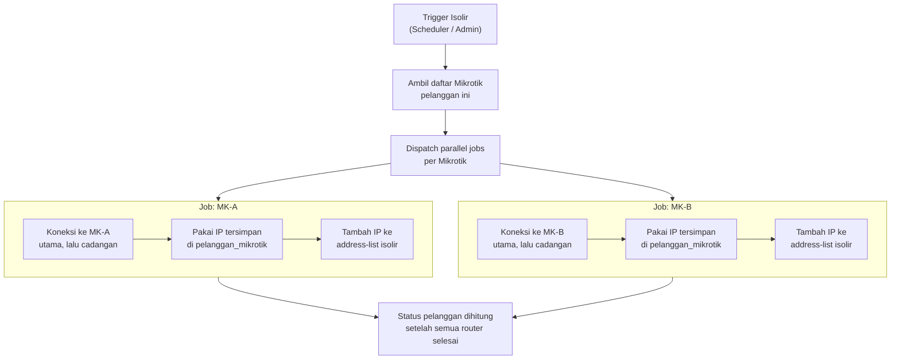

#### Flow Reaktivasi — Multi-Mikrotik Paralel

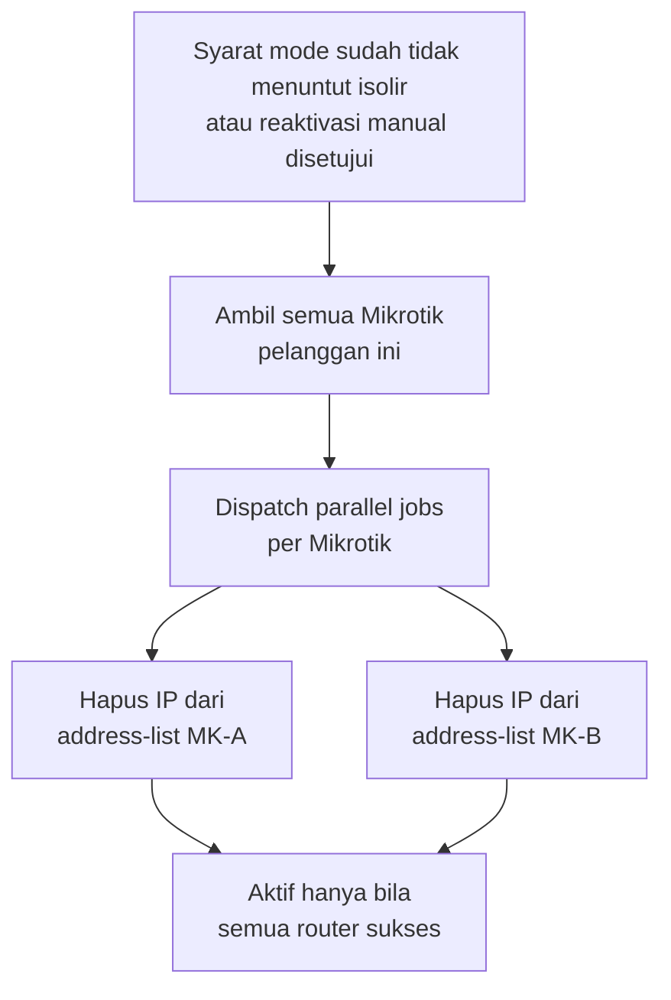

#### Komponen Isolir

| Komponen | Keterangan |
|---|---|
| **Flag per pelanggan** | `isolir_enabled` default true. Hanya menahan isolir otomatis. |
| **Isolir manual** | Menulis `sumber_isolir = manual`. Pembayaran tidak membuka isolir ini. |
| **Isolir otomatis** | Job 00:05 Asia/Jakarta menurut `docs/logika-isolir.md`, setelah pelanggan terpasang. |
| **Reaktivasi otomatis** | Saat syarat mode gugur, termasuk bila `isolir_enabled` sudah false. |
| **Reaktivasi manual** | Admin Global, dengan keterangan. Bypass sementara butuh persetujuan Admin Global yang bukan pengaju. |
| **Log isolir** | Satu baris per Mikrotik: waktu, IP, status API, pemicu. |

---

### 8. 👷 Manajemen Kolektor & Setoran Kas

| Fitur | Keterangan |
|---|---|
| **Data Kolektor** | Nama, user login, wilayah penugasan, dan batas kas gantung dalam rupiah. Penerimaan tunai baru ditolak bila saldo ditambah nominal itu melewati batas. |
| **Buku Kas Gantung** | Saldo uang tunai fisik yang sedang dipegang kolektor (bertambah setiap terima cash) |
| **Input Pembayaran** | Sesuai level wewenang (Cash only, Cash+Transfer pending, Cash+Transfer auto). **Wajib menangkap koordinat GPS realtime** perangkat saat transaksi dicatat. |
| **Peta Penagihan (Tracking)** | Admin dapat melihat titik lokasi penagihan kolektor di peta (Google Maps/OpenStreetMap) untuk memvalidasi apakah kolektor benar-benar menagih di rumah pelanggan atau di tempat lain. |
| **Pengajuan Setoran** | Kolektor input nominal uang yang disetor ke admin fisik/rekening penampung |
| **Verifikasi Setoran** | Admin memvalidasi setoran. Saldo kas gantung berkurang sebesar nominal yang diterima. Selisih tetap menjadi saldo dan muncul di laporan. Setoran tidak boleh membuat saldo minus. |
| **Laporan Kolektor** | Tagihan tertagih vs kas gantung vs riwayat setoran |

---

### 9. 🤝 Modul Kemitraan Reseller & Dompet Komisi

> [!NOTE]
> Reseller adalah entitas terpisah dari Kolektor. Pelanggan dapat ditautkan ke seorang Reseller. Setiap kali tagihan pelanggan tersebut lunas, komisi otomatis masuk ke saldo dompet reseller.

| Fitur | Keterangan |
|---|---|
| **Data Reseller** | Nama mitra, kontak, nomor rekening bank/e-wallet untuk pencairan dana |
| **Penetapan Komisi** | Berbasis persentase (%) atau nominal flat per pelanggan/paket (contoh: 40% dari tagihan) |
| **Auto-Credit Dompet** | Saldo reseller bertambah saat tagihan langganan `lunas`, lewat baris mutasi. Pembayaran sebagian tidak mencairkan komisi. Pembatalan menulis mutasi balik. Komisi yang sudah dicairkan menjadi piutang reseller dan tidak memaksa saldo minus. |
| **Mutasi Saldo** | Riwayat detail keluar-masuk saldo dompet per transaksi tagihan |
| **Portal Reseller** | Reseller dapat login untuk melihat daftar klien mereka, status bayar, saldo, dan riwayat komisi |
| **Pengajuan Pencairan (Payout)**| Reseller mengajukan penarikan saldo komisi |
| **Approval & Bukti Payout** | Admin/Keuangan memproses transfer bank, upload bukti transfer -> saldo dompet terpotong resmi |

---

### 10. 👛 Modul Dompet Pelanggan & Auto-Pay

| Fitur | Keterangan |
|---|---|
| **Saldo Dompet** | Dompet digital internal dalam mata uang Rupiah (Rp). Saldo tidak kedaluwarsa & tidak boleh minus. |
| **Fungsi Auto-Pay** | Default aktif. Saat tagihan terbit, pemotongan dompet dan pembayaran lain mengunci saldo. Dompet tidak boleh minus. Autopay yang gagal karena saldo kurang tidak mengubah tagihan. |
| **Top-up Saldo** | **Admin Global** dapat melakukan top-up langsung. Pelanggan (via portal), Admin Wilayah, dan Kolektor dapat melakukan **pengajuan/request top-up** yang wajib diverifikasi & disetujui Admin Global. Aturan ini dapat dikustomisasi Super Admin. |
| **Kredit Kompensasi** | Saldo kompensasi gangguan koneksi diinput manual oleh Admin Global / diajukan Admin Wilayah dengan metode top-up kredit dompet. |

---

### 11. 🏅 Modul Sistem Poin & Referral Pelanggan

> [!NOTE]
> Sistem poin adalah mata uang loyalitas terpisah dari Dompet Rupiah untuk menjaga kebersihan akuntansi. **1 Poin = Rp 25.000**.

| Fitur | Aturan & Mekanisme |
|---|---|
| **Sifat Referral Pelanggan** | **One-time bonus:** Pelanggan A mereferensikan Pelanggan B -> Pelanggan A mendapat **1 poin** setelah Pelanggan B aktif dan membayar tagihan perdana. **Tidak ada recurring** untuk pelanggan biasa. |
| **Recurring Referral** | **Hanya berlaku untuk Reseller** (komisi bulanan per tagihan lunas, masuk ke Dompet Reseller). |
| **Input Poin Manual** | Hanya **Admin Global** yang memiliki hak input poin langsung. Admin Wilayah dapat mengajukan draf perolehan poin dan menunggu approval pusat. |
| **Konversi Poin → Dompet** | 1 poin dikonversi sebesar kurs yang berlaku saat disetujui. Mutasi menyimpan jumlah poin dan rupiah saat itu, sehingga perubahan kurs tidak menulis ulang histori. Persetujuan dilakukan Admin Global. |
| **Masa Berlaku Poin** | Poin tidak pernah kedaluwarsa. |

---

### 12. 🔄 Multi-Peran dalam 1 Akun (Admin, Kolektor, Reseller)

> [!IMPORTANT]
> Sistem mendukung konsep **Multi-Peran Terpadu**:
> Seorang staf/pengguna (**User**) dengan 1 akun login (1 username/email & password) dapat merangkap sekaligus sebagai:
> 1. **Admin** (Super Admin / Admin Global / Admin Wilayah): Menjalankan fungsi manajerial dan approval.
> 2. **Kolektor**: Dapat ditugaskan menagih pelanggan di lapangan dan memiliki buku **Kas Gantung Kolektor** tersendiri.
> 3. **Reseller**: Memiliki pelanggan binaan dan memiliki buku **Dompet Komisi Reseller** tersendiri.
>
> **Prinsip Isolasi Keuangan:**
> Meskipun diakses dalam 1 akun yang sama, buku kasnya **terpisah 100%**:
> * Kas Gantung Kolektor (kewajiban setor ke kantor) tidak akan pernah otomatis terpotong atau bercampur dengan Dompet Komisi Reseller (hak pencairan dana).
> * UI dashboard menyediakan tampilan/tab yang jelas untuk memisahkan wewenang Admin, tugas Kolektor, dan saldo Reseller.
> * Peran disimpan banyak-ke-banyak lewat Spatie, bukan satu kolom `users.role`. Admin wilayah hanya melihat dusun yang ada di `user_wilayah`.

---

### 13. 🌐 Portal Pelanggan

> [!NOTE]
> Portal pelanggan masuk dalam scope pengembangan. Fitur inti tersedia di fase awal; integrasi ACS dikembangkan di fase berikutnya.

| Fitur | Fase | Keterangan |
|---|---|---|
| Login portal | **Awal** | Username, email, nomor HP, dan nomor pelanggan unik. Google hanya menaut ke akun yang emailnya sudah sama. Nomor HP yang bentrok ditolak saat simpan. |
| Lihat tagihan & riwayat bayar | **Awal** | Daftar tagihan per bulan, status lunas/belum/sebagian |
| Upload Bukti Transfer | **Awal** | Pelanggan upload bukti transfer untuk diverifikasi admin |
| Manajemen Dompet & Poin | **Awal** | Cek saldo dompet, request top-up, cek saldo poin, request konversi poin |
| Lihat status akun | **Awal** | Aktif / Diisolir / Nonaktif |
| Lihat paket berlangganan | **Awal** | Nama paket, kecepatan |
| Ganti password portal | **Awal** | — |
| **Integrasi ACS (TR-069)** | *Future* | Monitor jumlah user aktif, ganti password WiFi |
| Pembayaran online | *Future* | Integrasi payment gateway (Tripay/Xendit) |

---

### 14. 📢 Notifikasi & Komunikasi (Email & Telegram Alert, WhatsApp Direct-Only)

> [!NOTE]
> **Kebijakan WhatsApp Anti-Ban:**
> Sistem **TIDAK menggunakan fitur broadcast massal otomatis** untuk menghindari risiko nomor WhatsApp ISP diblokir/banned oleh WhatsApp. Komunikasi WhatsApp dilakukan secara terarah menggunakan **One-Click Direct Chat (`wa.me`)** per invoice.

| Saluran | Mekanisme & Konten |
|---|---|
| **WhatsApp Direct Link (Bukan Broadcast)** | Tombol **[📲 Kirim Invoice]** satu-klik yang langsung membuka obrolan WhatsApp ke nomor pelanggan dengan template invoice publik permanen yang siap kirim. Aman, bebas biaya langganan gateway bulanan, dan 100% anti-banned. |
| **Email Notifikasi** | Template HTML profesional (invoice resmi terlampir PDF, rincian pembayaran, tombol direct link ke portal pelanggan). |
| **Telegram Bot Alert (Internal Staf & NOC)** | Khusus peringatan sistem internal: **Alert kritis kegagalan API Mikrotik, status failover kabel $\rightarrow$ WireGuard, laporan replikasi database kantor $\leftrightarrow$ VPS, dan notifikasi approval bypass.** |
| **Template Pesan Dinamis** | Teks pesan WhatsApp/Email dapat dikustomisasi dengan placeholder variabel dinamis (`{nama}`, `{no_tagihan}`, `{nominal}`, `{sisa}`, `{jatuh_tempo}`, `{link_portal}`). |

---

### 15. 🖨️ Desain & Kustomisasi Cetak (Tagihan & Kuitansi Bluetooth)

Sistem dirancang fleksibel dan hemat kertas sesuai kebutuhan lapangan kolektor:

| Fitur | Keterangan |
|---|---|
| **Cetak Tagihan (Belum Bayar)** | Admin dan Kolektor **dapat mencetak lembar tagihan fisik meskipun belum dibayar**. Berguna untuk dititipkan ke rumah pelanggan/instansi sebagai surat pemberitahuan tagihan jatuh tempo. |
| **Cetak Kuitansi Bersifat Opsional** | Tidak ada auto-print paksa. Setelah transaksi pembayaran berhasil diinput, sistem menyediakan opsi: <br>• **[🖨️ Cetak Kuitansi]** (jika pelanggan meminta struk fisik)<br>• **[✅ Selesai Tanpa Cetak]** (hemat kertas thermal jika pelanggan tidak butuh kuitansi). |
| **Default Tipe Printer** | Android dapat mencetak ESC/POS 58mm atau 80mm lewat intent saat halaman pembayaran terbuka. iOS mengunduh PDF. Browser tidak memegang koneksi Bluetooth di latar belakang. |
| **Editor Template Cetak** | Admin dapat mengatur: Logo ISP (monochrome), Header (Nama ISP, Alamat, No Telp CS), Body detail, dan Catatan Footer (pesan jatuh tempo, doa/terima kasih). |
| **Multi-Model Layout** | Tersedia beberapa pilihan model struk yang dapat dipilih saat mencetak: <br>1. **Model Tagihan / Invoice Belum Lunas (Thermal 58mm):** Format surat tagihan mini untuk diserahkan saat nagih.<br>2. **Model Kuitansi Lunas Ringkas (Thermal 58mm):** Hemat kertas, khusus bukti bayar cepat.<br>3. **Model Kuitansi Rinci (Thermal 80mm):** Menampilkan rincian histori cicilan & sisa tagihan lengkap.<br>4. **Model Dokumen Formal (PDF/A4/Struk Kantor):** Invoice/kuitansi resmi untuk pelanggan korporat/instansi atau kasir kantor. |
| **Direct Print Kolektor** | Kolektor Android mencetak dari halaman yang sedang terbuka. Kolektor iOS memakai PDF. |

---

### 16. 📊 Laporan, Indikator Dashboard, & Manajemen Tunggakan

Dashboard utama menyediakan pemantauan keuangan presisi tinggi dengan **memisahkan 2 kelompok tunggakan secara tegas**:

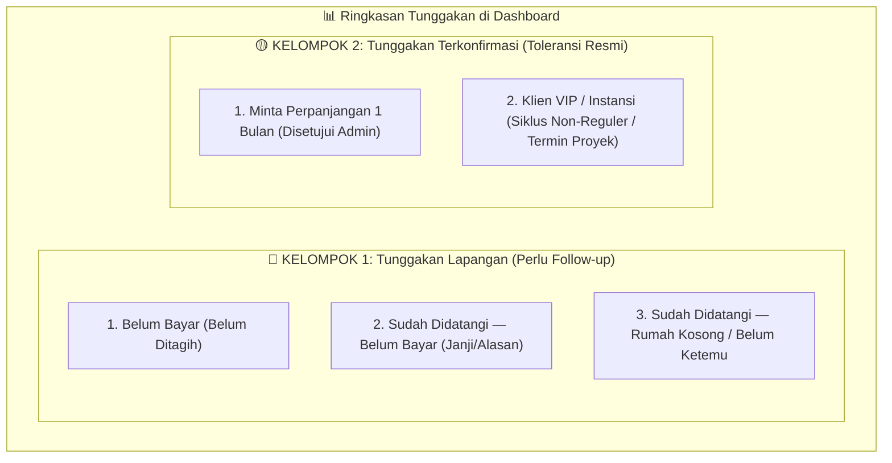

| Kelompok Tunggakan | Status Lapangan | Perlakuan & Tampilan Dashboard |
|---|---|---|
| **Kelompok 1: Tunggakan Lapangan (Risiko Piutang)** | • `belum_ditagih`<br>• `didatangi_belum_bayar`<br>• `didatangi_belum_ketemu` | **Kartu Merah di Dashboard:** Menampilkan total nominal rupiah dan jumlah pelanggan yang harus segera ditindaklanjuti kolektor. Dilengkapi tombol tracking kunjungan kolektor & GPS lokasi saat didatangi. |
| **Kelompok 2: Tunggakan Terkonfirmasi (Toleransi Resmi)** | • `perpanjangan_tempo_1_bulan`<br>• `vip_siklus_non_reguler` | **Kartu Kuning/Slate di Dashboard (Dipisah 100%):** Memuat piutang yang sudah terkonfirmasi aman karena pelanggan resmi mengajukan perpanjangan tempo atau instansi/VIP yang membayar per termin khusus. Piutang ini **tidak mencemari metrik kinerja kolektor**. |

#### Fitur Pencatatan Kunjungan Kolektor di Lapangan:
* Saat kolektor datang ke rumah pelanggan namun **tidak terjadi pembayaran**, kolektor dapat memilih tombol status cepat:
  1. **[🚪 Rumah Kosong / Tidak Ketemu]** $\rightarrow$ status otomatis menjadi `didatangi_belum_ketemu` + rekam GPS & jam kunjungan.
  2. **[⏳ Belum Bayar / Minta Datang Lagi]** $\rightarrow$ input catatan alasan (misal: "gajian tgl 25") $\rightarrow$ status menjadi `didatangi_belum_bayar`.
  3. **[📝 Pengajuan Perpanjangan 1 Bulan]** $\rightarrow$ masuk antrean verifikasi Admin Global $\rightarrow$ jika di-approve, berpindah ke **Kelompok 2 (Tunggakan Terkonfirmasi)**.

---

### 17. 💾 Manajemen Data (Export/Import) & Backup-Restore Database

Sistem billing ISP dengan ribuan klien wajib memiliki mekanisme migrasi data cepat dan proteksi bencana data (*disaster recovery*):

> [!IMPORTANT]
> **Standar Wajib Seluruh Fitur Import:**
> Setiap menu import di dalam aplikasi (Pelanggan, Tagihan Masa Lalu, Wilayah) **WAJIB menyediakan tombol `[📥 Download Template Contoh (.xlsx)]`** yang sudah terisi contoh data riil dan panduan format kolom. Ini menjamin proses migrasi data tertata rapi, seragam, dan bebas dari salah penempatan kolom.

#### A. Export & Import Data Pelanggan (Excel / CSV)
* **Import Pelanggan Massal (Migrasi Data Awal):**
  * Disediakan tombol **[📥 Download Template Pelanggan (.xlsx)]** dengan panduan kolom.
  * Mendukung impor ribuan pelanggan sekaligus (nama, no hp, alamat, dusun/desa, paket, IP statis, mikrotik).
  * **Validasi Cerdas Baris per Baris:** Menampilkan laporan baris mana yang sukses dan baris mana yang gagal beserta alasannya secara spesifik.
  * Pemrosesan impor ribuan baris dijalankan via **Background Queue** agar browser tidak mengalami *HTTP Timeout*.
* **Export Data Pelanggan:**
  * Dapat difilter berdasarkan: Wilayah (Kecamatan/Desa/Dusun), Titik Mikrotik, Paket Langganan, Reseller, atau Status (Aktif/Terisolir). Format ekspor: **Excel (.xlsx), CSV, dan PDF**.

#### B. Export & Import Invoice / Tagihan Masa Lalu (Histori Transaksi Lama)
* **Import Tagihan Masa Lalu (Migrasi Pembukuan Sebelum Ada Aplikasi Ini):**
  * Disediakan tombol **[📥 Download Template Invoice Masa Lalu (.xlsx)]**.
  * Memungkinkan admin memasukkan seluruh rekam jejak keuangan lama:
    * Tagihan yang sudah **LUNAS** di masa lalu (sebagai arsip riwayat pelanggan).
    * Tagihan langganan yang belum lunas dari bulan sebelumnya. Setiap pelanggan impor punya `isolir_mulai_evaluasi`. Scheduler mengabaikan pelanggan itu sampai tanggal tersebut, supaya malam pertama setelah migrasi tidak mengisolir massal.
  * Kolom mencakup: `no_pelanggan` (atau no HP), `no_tagihan_lama`, `periode_bulan`, `nominal`, `terbayar`, `sisa`, `status`, `tanggal_bayar_lama`, `metode_bayar`, dan `kolektor`.
* **Export Rekap Tagihan & Pembukuan:**
  * Admin dapat mengekspor rekap tagihan per periode bulan, per kolektor, per metode (Cash/Transfer), atau daftar piutang belum bayar ke format **Excel (.xlsx) dan PDF**.

#### C. Backup & Restore Database Otomatis & Manual
* **Backup Terjadwal Otomatis:**
  * Scheduler Laravel menjalankan pencadangan penuh database secara otomatis setiap malam (contoh: **pukul 02:00 WIB**).
  * File database dikompresi menjadi format hemat ruang: `.sql.gz`.
  * **Kebijakan Retensi (*Auto-Clean*):** Sistem menyimpan 7 backup harian terakhir, 4 backup mingguan, dan 6 backup bulanan agar harddisk server tidak penuh.
  * **Notifikasi Status Backup:** Sukses atau gagalnya backup dikirim ke grup Telegram Admin/NOC.
* **Backup Manual Satu-Klik (Super Admin):**
  * Di menu dashboard Super Admin, tersedia tombol **[⚡ Buat Backup Sekarang]**. File backup bisa langsung diunduh ke komputer lokal admin.
* **Restore database:**
  * Aplikasi tidak menerima unggahan file SQL. Pemulihan dilakukan di server oleh prosedur infrastruktur, di luar Laravel.
  * Backup malam tetap jalan pukul 02:00 Asia/Jakarta. Unduh backup dari aplikasi hanya untuk Super Admin dan tercatat di audit.

---

### 18. 🛠️ Manajemen Komplain Pelanggan, Triage NOC, & Tugas Teknisi

Sistem penanganan gangguan dirancang dengan alur **triage profesional** untuk mencegah penugasan teknisi yang sia-sia saat terjadi kendala jaringan massal:

#### A. Widget Dashboard: "Teknisi Siaga / Berangkat Hari Ini"
* Di dashboard utama bersama, terdapat panel status kehadiran: **Daftar Teknisi yang Berangkat Hari Ini** (otomatis muncul seketika setelah teknisi melakukan absensi masuk via GPS & selfie di pagi hari).
* Memudahkan NOC dan Admin Global melihat siapa saja tim lapangan yang sedang siap menerima penugasan.

#### B. Papan Komplain Bersama (*Shared Helpdesk Feed*)
* Seluruh keluhan yang masuk (dari Portal Pelanggan, input Kolektor di lapangan, Reseller, maupun telepon kantor) bermuara di satu **Papan Komplain Terbuka** yang dapat dipantau oleh seluruh tim (Admin, NOC, dan semua Teknisi).
* **Aturan Penting: Komplain Masuk TIDAK Otomatis Menjadi Tugas Lapangan.** Sering kali 20 keluhan pelanggan di satu desa disebabkan oleh **1 kabel backbone putus atau listrik OLT/Mikrotik padam (Kendala Massal)**. Menugaskan 20 teknisi terpisah untuk kasus ini adalah pemborosan.

#### C. Triage NOC: Pengelompokan "Agenda Gangguan Massal Multi-Area"
Gangguan massal sering kali terjadi di beberapa wilayah berbeda secara bersamaan (misal: akibat badai, FO putus di Area A dan tiang roboh di Area B). NOC/Super Admin dapat membuat dan mengelompokkan tiket ke dalam **Agenda Gangguan Massal Berbasis Area & Tim Lapangan**:

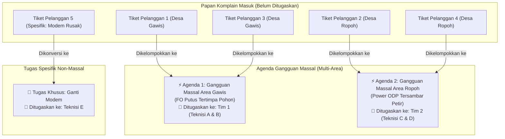

| Fitur Agenda Massal | Cara Kerja & Keuntungan Lapangan |
|---|---|
| **Pembuatan Agenda Insiden Multi-Area** | NOC dapat membuka beberapa Agenda Gangguan sekaligus (contoh: *Agenda Area Gawis*, *Agenda Area Ropoh*, dsb) lengkap dengan catatan kendala teknis. |
| **Grouping Tiket Pelanggan (Bulk Bundling)** | Tiket komplain pelanggan yang masuk cukup dicentang dan dimasukkan ke Agenda area terkait. Tidak ada tiket berceceran. |
| **Penugasan Tim Paralel** | Setiap Agenda Massal memiliki tim teknisi penanggung jawab masing-masing (Tim 1 untuk Gawis, Tim 2 untuk Ropoh). Tim bergerak paralel dan fokus pada wilayahnya. |
| **Penutupan Massal Sekali Klik (*Bulk Auto-Close*)** | Begitu Tim 1 (Teknisi A & B) selesai menyambung kabel di Gawis dan mengklik *"Selesai"*, **seluruh tiket pelanggan yang tergabung di Agenda Gawis otomatis berubah status menjadi SELESAI** secara serentak tanpa perlu teknisi menutup tiket satu per satu. |

#### D. Penugasan Tugas Spesifik (Bisa Multi-Teknisi)
* **Penetapan Personel:** NOC/Admin menentukan siapa saja teknisi yang wajib berangkat (contoh: tugas penarikan kabel baru diberikan ke tim: *Teknisi Budi & Joko*).
* **Transparansi Tim:** Tugas spesifik ini tampil di papan tugas bersama, dengan label tegas: *"Ditugaskan kepada: Budi & Joko"*. Seluruh teknisi lain dan admin dapat melihat siapa yang sedang menangani apa, sehingga koordinasi lapangan rapi dan tidak tumpang tindih.
* **Penyelesaian Lapangan:** Teknisi yang bertugas membuka tiket di HP, upload foto hasil perbaikan di rumah pelanggan, dan mengklik *"Selesai"*. Bonus payroll hanya timbul untuk tiket spesifik yang ditutup teknisi itu. Tiket yang tertutup karena agenda massal tidak menghasilkan bonus.

#### E. Toolbox Diagnosa Koneksi Pelanggan ala Netwatch (Tanpa Telegraf)
Untuk mendeteksi status koneksi pelanggan secara instan tanpa perlu software pihak ketiga yang berat (seperti Telegraf/InfluxDB), aplikasi dilengkapi **Live Netwatch & ARP Inspector**:

| Fitur Diagnosa | Cara Kerja & Keunggulan Lapangan |
|---|---|
| **Mikrotik Proxy Ping (One-Click)** | Di setiap halaman tiket komplain dan detail pelanggan, terdapat tombol **`[⚡ Cek Status Koneksi]`**.<br>Aplikasi memerintahkan Mikrotik lokal terkait untuk menge-ping IP statis pelanggan sebanyak 3 kali dan mengembalikan status: *🟢 ONLINE (Latency 2ms)* atau *🔴 OFFLINE (RTO 100%)*. |
| **Inspeksi Fisik via Tabel ARP** | Selain ping, aplikasi membaca tabel `/ip arp` di Mikrotik. Jika MAC Address modem pelanggan hilang, sistem menampilkan peringatan: *"Kemungkinan kabel drop optik putus atau modem pelanggan mati lampu"*. |
| **Validasi Pasca Gangguan Massal (Multi-Ping Batch)** | Saat teknisi selesai memperbaiki gangguan massal di suatu area (misal Area Gawis), ada tombol **`[🔍 Tes Koneksi Semua Pelanggan Terdampak]`**.<br>• Sistem otomatis memvalidasi seluruh pelanggan di area tersebut.<br>• Jika ada 1-2 pelanggan yang masih merah/offline (misal kabel drop rumahnya tersangkut truk), tersedia tombol **`[✂️ Pisahkan Jadi Tugas Spesifik]`** agar teknisi di lapangan langsung diarahkan ke rumah pelanggan tersebut sebelum meninggalkan lokasi. |

#### F. Buku Rekam Jejak Gangguan Pelanggan Terpadu (*Customer Incident Timeline*)
Untuk menjawab komplain pelanggan yang merasa *"Internet saya kok sering kendala?"*, profil setiap pelanggan dilengkapi **Timeline Riwayat Gangguan Otomatis** yang menggabungkan seluruh catatan kendala teknis masa lalu:

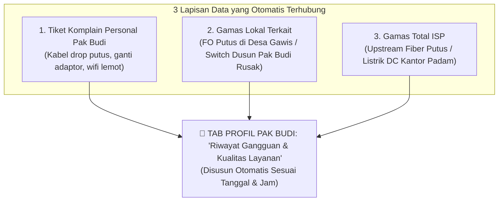

| Jenis Kejadian | Cara Sistem Mengidentifikasi Dampak | Tampilan di Profil Pelanggan |
|---|---|---|
| **Tiket Personal** | Pelanggan pernah lapor tiket atau didatangi teknisi khusus ke rumahnya. | 🔧 **Tiket Personal #TCK-0012**<br>• Waktu: 18 Okt 2026, 14:10 - 15:30 WIB (Durasi: 1 jam 20 mnt)<br>• Masalah: Adaptor Modem Tersenggol Rusak<br>• Teknisi: Budi Santoso<br>• Solusi: Ganti Adaptor Baru 12V 1A |
| **Gamas Lokal** | Gamas yang menargetkan **Dusun, Desa, atau Router Mikrotik** yang menjadi tempat tinggal Pak Budi. | ⚡ **Gangguan Massal Lokal (Area Gawis)**<br>• Waktu: 02 Nov 2026, 09:00 - 12:20 WIB (Durasi: 3 jam 20 mnt)<br>• Penyebab: Kabel FO Utama Tertimpa Pohon Tumbang<br>• Status: Selesai diperbaiki oleh Tim 1 Lapangan |
| **Gamas Total** | Gangguan besar tingkat sentral ISP (misal: kabel upstream putus) yang berdampak ke seluruh klien. | 🌐 **Gangguan Sentral Total (Semua Wilayah)**<br>• Waktu: 05 Okt 2026, 01:15 - 02:00 WIB (Durasi: 45 mnt)<br>• Penyebab: Pemeliharaan Upstream Backbone Telkom/Indosat<br>• Catatan: Otomatis kompensasi saldo dompet Rp 5.000 |

#### Keunggulan untuk Layanan Pelanggan (Customer Service):
* Saat Pak Budi menelepon dengan nada kesal: *"Kenapa wifi saya sering mati?!"*
* Admin/CS cukup membuka data Pak Budi dan langsung membaca data otentik di layar:
  > *"Selamat siang Pak Budi. Berdasarkan rekam jejak sistem kami dalam 30 hari terakhir, rumah Bapak terdampak 1 kali gangguan kabel putus di area Gawis pada 2 November (3 jam), dan tanggal 18 Oktober teknisi kami sempat mengganti adaptor modem di rumah Bapak. Kami memahami kekecewaan Bapak dan seluruh data ini tersimpan rapi untuk evaluasi kualitas jaringan kami."*
* Pelanggan langsung merasa dilayani oleh **perusahaan profesional dengan data nyata**, bukan operator amatir yang saling lempar alasan!

#### G. Manajemen Kredensial, Diagnosa, & Pemantauan Kesehatan ACS Server (TR-069 / GenieACS)

Aplikasi billing dilengkapi modul terpadu untuk mengelola koneksi API ke server ACS (GenieACS) serta memantau kesehatan server ACS secara *real-time*:

##### 1. Konfigurasi Kredensial & Pengujian Koneksi ACS
* **URL NBI API:** Input endpoint GenieACS Northbound Interface (contoh: `http://10.200.0.5:7557` atau `https://acs.isp.com:7557`).
* **Autentikasi (Opsional):** Username & Password (HTTP Basic Auth) atau API Key / Bearer Token.
* **Socket Timeout:** Default `3` detik (menjamin web billing tidak terblokir jika server ACS sedang lambat).
* **Tombol `[🔌 Uji Koneksi API ACS]`:** Melakukan handshake test instan ke API ACS, menampilkan status HTTP, waktu respons latency (ms), dan versi software GenieACS.

##### 2. Pemantauan Kondisi ACS Server (Health Check Watchdog)
* **Pemeriksaan Berkala (Heartbeat Background Worker):** Scheduler billing mengecek kesehatan endpoint ACS setiap **1 menit**.
* **Indikator Live di Dashboard NOC:**
  * 🟢 **Online:** Terhubung normal, latency respons di bawah 500 ms. Menampilkan total perangkat CPE online: `1.240 / 1.350 CPE Terdaftar`.
  * 🟡 **Degraded / High Latency:** Terhubung namun respons 500 ms atau lebih.
  * 🔴 **Offline / Down:** Port tidak merespons, connection refused, atau timeout.
* **Alert Otomatis jika Server ACS Down:**
  Jika server ACS mati/tidak merespons 3x berturut-turut, sistem billing langsung menembakkan notifikasi darurat ke **Telegram NOC**:
  `⚠️ [PERINGATAN: SERVER ACS DOWN] Server GenieACS (10.200.0.5:7557) tidak merespons API health check. Diagnosa redaman modem pelanggan via TR-069 sementara tidak tersedia.`
* **Ketahanan Sistem (*Graceful Degradation* & Proteksi Anti-False Alarm):**
  1. **Dilarang Berubah Merah di Peta:** Jika server ACS bermasalah/mati, pin lokasi pelanggan di peta **DILARANG BERUBAH MENJADI MERAH**. Server ACS mati bukan berarti kabel optik putus atau internet warga padam. Warna pin tetap mengacu pada status konektivitas Mikrotik (jika sesi PPPoE/IP pelanggan masih aktif, pin tetap 🟢 Hijau).
  2. **Sembunyikan Nilai Redaman ACS:** Di jendela popup pin peta, nilai redaman otomatis disembunyikan dan digantikan teks keterangan abu-abu netral: `[ℹ️ Redaman: ACS Server Offline]`.
  3. **Tombol Live Disable Sementara:** Tombol cek modem via ACS dinonaktifkan sementara dengan status badge informatif.
  4. **Nol Crash:** Sistem billing **tidak akan pernah hang, crash, atau melempar fatal error** saat server ACS padam.

##### 3. Diagnosa Redaman Optik via ACS Server (Opsional per Pelanggan)
Karena di lapangan tipe router/modem pelanggan sangat beragam (tidak semua modem mendukung protokol TR-069/ACS), integrasi ACS dibuat **bersifat opsional dan adaptif per pelanggan**:

| Kondisi Perangkat Pelanggan | Perlakuan di Aplikasi Billing |
|---|---|
| **Modem Support ACS & Sudah Terintegrasi** | • **Informasi Redaman Otomatis Tampil:** Muncul indikator sinyal optik *real-time* (contoh: `🟢 -19.4 dBm`) lengkap dengan voltase, suhu modem, dan tombol refresh sinyal.<br>• **Fitur Tambahan Aktif:** Tombol ganti password/SSID WiFi dan tombol remote reboot modem terbuka di portal admin dan portal pelanggan. |
| **Modem Belum / Tidak Support ACS** | • Informasi redaman ACS otomatis disembunyikan agar tidak membingungkan staf lapangan.<br>• Profil pelanggan berlabel *Non-ACS (Router Standar)*.<br>• Tersedia form opsional: **`[Tautkan Serial Number ACS]`** jika suatu saat pelanggan melakukan upgrade modem ke tipe yang mendukung TR-069. |

##### 4. Alternatif & Cadangan Emas: Cek Redaman Langsung via SNMP OLT (Direct Hardware Query)
Selain ACS TR-069, aplikasi billing menyediakan jalur diagnosa langsung ke perangkat **OLT (Optical Line Terminal)** menggunakan protokol **SNMP v2c/v3**. Ini adalah metode paling stabil, universal, dan menjadi standar emas di ISP:

* **Mengapa SNMP OLT Sangat Direkomendasikan?**
  1. **Universal untuk Seluruh Merk Modem:** Modem ONT apapun (ZTE, Huawei, Fiberhome, VSOL, XPON murah/OEM) redamannya **tetap dapat dibaca secara akurat**, karena redaman diukur di level optik fisik via protokol **OMCI** (GPON) atau **OAM** (EPON) oleh OLT, bukan oleh sistem operasi router pelanggan.
  2. **Kecepatan Tinggi (Sub-Detik):** Query UDP SNMP hanya membutuhkan waktu **$\sim 30 - 80\text{ ms}$** (jauh lebih cepat dan ringan dibanding HTTP REST API).
  3. **Cadangan Sempurna Saat ACS Down (*Smart Diagnostic Fallback*):**
     * Jika server ACS down atau modem tidak mendukung TR-069, tombol **`[⚡ Cek Redaman Live]`** secara cerdas otomatis beralih menembak SNMP ke IP OLT terkait.
     * Teknisi tiang dan NOC tetap mendapatkan angka redaman valid seketika tanpa terputus.

* **Dukungan Merk & MIB OLT Populer:**
  * **ZTE OLT (C300, C320, C600):** Query OID Rx Power ONU via MIB `zteGponOnuAnRxPower` (`.1.3.6.1.4.1.3902.1082...`).
  * **Huawei OLT (MA5608T, MA5683T, MA5800):** Query OID `hwGponDeviceOntOpticalInfoRxPower` (`.1.3.6.1.4.1.2011.6.128...`).
  * **VSOL / HSGQ / BDCom / OEM:** Query MIB Enterprise optical diagnostic bawaan vendor.

* **Data OLT yang Dikelola di Billing:**
  * Form Master OLT: `nama_olt`, `ip_address`, `snmp_supported` (boolean Ya/Tidak), `snmp_community` (read-only), `snmp_port` (161), `tipe_merk_olt`.
  * Form Penugasan di Pelanggan: `olt_id`, `pon_port` (contoh: `1/1/2`), `onu_id` (contoh: `12`), atau Serial Number (`onu_sn`).

##### 5. Kebijakan Prioritas Pengecekan Redaman (ACS Default, SNMP OLT Opsional Masa Depan)
Sesuai arahan operasional jaringan Anda, sistem billing menetapkan **ACS Server (GenieACS / TR-069) sebagai metode DEFAULT utama**, dengan SNMP OLT disiapkan sebagai opsi cadangan untuk pengembangan masa depan:

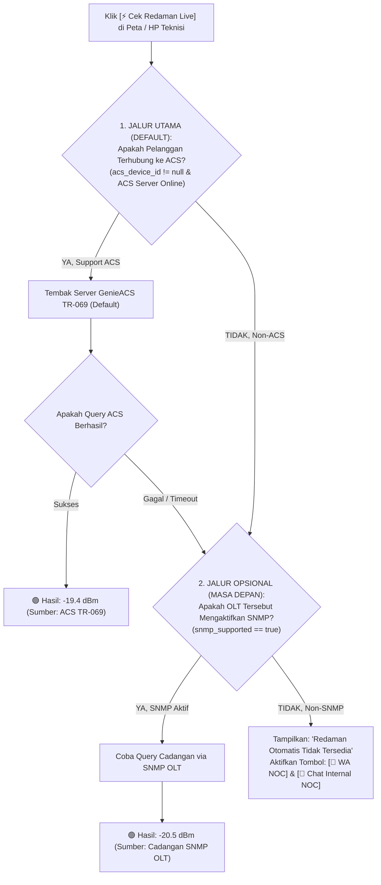

* **Manfaat Pengaturan Ini:**
  1. **Fokus Operasional Bersih:** Sistem secara *default* langsung mengandalkan GenieACS TR-069 untuk seluruh modem pelanggan tanpa kebingungan konfigurasi OLT.
  2. **Siap untuk Masa Depan (*Future-Proof*):** Jika di masa mendatang Anda menambah atau meng-upgrade unit OLT yang sudah mendukung SNMP (misal ZTE C320 atau Huawei), Anda cukup mencentang `snmp_supported = true` pada OLT tersebut, dan sistem akan langsung dapat memanfaatkannya tanpa perlu merombak kode aplikasi!
  3. **Human-Assisted Fallback:** Jika perangkat belum terhubung ke ACS dan OLT belum support SNMP, tombol bantuan cepat WhatsApp dan Chat Internal NOC selalu siap memfasilitasi komunikasi.

#### H. Widget Monitor Redaman Live di Layar Teknisi (*Self-Service Splicing Monitor*)
Fitur revolusioner untuk memangkas komunikasi berulang antara teknisi tiang dan ruang NOC saat proses penyambungan kabel (*splicing*):

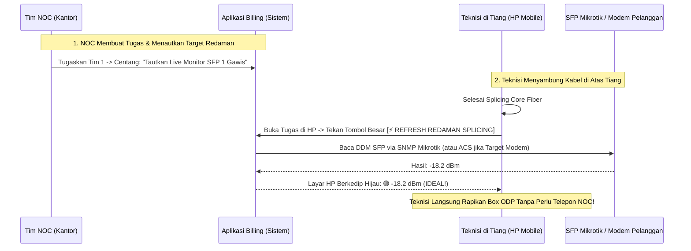

| Fitur | Keterangan & Manfaat Nyata |
|---|---|
| **Penautan Target oleh NOC (*Triage Attachment*)** | Saat NOC menerbitkan tugas (baik Tugas Spesifik maupun Agenda Gamas), NOC dapat memilih target redaman yang relevan:<br>• **Target Port SFP Backbone:** (misal: *Mikrotik Gawis - sfp-sfpplus1*) untuk kasus FO putus.<br>• **Target Modem Pelanggan:** (misal: *Modem Pak Budi*) untuk kasus penarikan kabel drop baru. |
| **Widget Khusus Layar HP Teknisi** | Di halaman rincian tugas teknisi, muncul kartu pemantau sinyal berukuran besar dengan tombol sentuh ramah jempol: **`[⚡ CEK REDAMAN SPLICING]`**. |
| **Umpan Balik Visual Instan (Anti-Telepon NOC)** | Begitu teknisi di atas tiang menekan tombol, sistem langsung menembak API dan menampilkan angka dBm secara *real-time*:<br>• 🟢 **-18.2 dBm (IDEAL):** Teknisi langsung membungkus *protection sleeve* & menutup ODP.<br>• 🔴 **-32.0 dBm (BURUK/BOCOR):** Teknisi tahu sambungan core-nya belum pas, sehingga bisa langsung memotong dan menyambung ulang saat itu juga tanpa perlu telepon/chat WhatsApp ke NOC! |
| **Kunci Keamanan Tiket Tertutup (*Auto-Lock on Closed*)** | **Aturan Ketat Keamanan Jaringan:**<br>Teknisi **DILARANG dan TIDAK BISA** mengakses tombol baca redaman maupun mematikan/menyalakan port SFP **pada tiket atau agenda yang statusnya sudah SELESAI / CLOSED**.<br>• Begitu tiket ditutup, seluruh tombol kontrol optik otomatis terkunci/hilang dari layar teknisi untuk mencegah salah pencet atau mematikan link backbone yang sudah normal beroperasi.<br>• Hanya **NOC / Super Admin** yang memiliki akses permanen dari menu NOC Tools. |

#### I. Integrasi NMS Eksternal: Webhook Trigger Zabbix & LibreNMS (Automated Incident)
Sistem billing dapat dihubungkan ke server NMS eksternal (Zabbix atau LibreNMS) menggunakan protokol **Webhook HTTP POST terenkripsi**:

| Fitur Integrasi NMS | Cara Kerja & Manfaat Lapangan |
|---|---|
| **Penerbitan Tiket Otomatis via Webhook** | Saat Zabbix mendeteksi router mati, link backbone putus, atau suhu OLT kritis, Zabbix otomatis menembak webhook ke billing:<br>`POST /api/v1/webhook/monitoring/zabbix`<br>• Sistem billing seketika membuatkan **Agenda Gangguan Massal** otomatis tanpa staf NOC harus mengetik dari nol.<br>• Judul tiket terisi otomatis: `[ZABBIX ALERT] Link sfp-sfpplus1 Area Gawis DOWN`. |
| **Keterkaitan Tiket Mandiri Pelanggan (*Linked but Independent*)** | **Aturan Ketat Integritas Tiket:**<br>Keluhan pelanggan (misal: Pak Budi & Bu Ani) yang masuk saat gamas **tetap tercatat resmi sebagai tiket komplain mandiri/terpisah** (memiliki nomor tiket dan histori sendiri di profil pelanggan), namun ditautkan ke Agenda Gamas Zabbix tersebut.<br>• **Pemeriksaan Pasca Gamas Wajib:** Saat perbaikan kabel Zabbix selesai, teknisi menekan tombol: **`[🔍 Periksa Pelanggan Terdampak]`**.<br>• **Jika Pelanggan Sudah Normal (🟢 UP):** Tiket komplain pelanggan otomatis ditutup dengan keterangan: *"Normal kembali pasca perbaikan backbone"*.<br>• **Jika Pelanggan Masih Mati (🔴 DOWN):** Tiket komplain pelanggan **DILARANG DITUTUP OTOMATIS**. Tiket langsung dielevasi menjadi **Tugas Wajib Kunjungan Rumah** (teknisi di lapangan wajib mendatangi rumah tersebut untuk cek kabel drop / adaptor). |
| **Proteksi Anti-Flapping (Anti-Tiket Berceceran)** | Jika link optik mengalami kondisi putus-nyambung berulang dalam hitungan detik (*flapping*), billing menyatukannya ke dalam 1 tiket yang sama dengan riwayat timestamp kedap-kedip, mencegah terciptanya puluhan tiket duplikat. |
| **Deduplikasi Saat Zabbix Re-Up (*Late-Arrival Event Correlation*)** | **Anti-Tabrakan Jika Zabbix Hidup Terlambat:**<br>Jika watchdog billing sudah lebih dulu membuat tiket & membunyikan alarm saat kabel putus, lalu server Zabbix baru menyala dan mengirim webhook:<br>1. **Korelasi Aset & Status:** Sistem billing mengecek `asset_key` (`mikrotik_id` + `interface`). Jika sudah ada tiket berstatus `open`/`dikerjakan`, billing **DILARANG membuat tiket baru** dan **DILARANG mengirim notifikasi ulang** (tidak ada blast pesan Telegram, WA, atau suara alarm baru).<br>2. **Tautkan Event ID Zabbix & Tampilkan di Dashboard Aktif:** Billing meng-update tiket eksisting dengan menyematkan `zabbix_event_id` dan menyisipkan jejak audit langsung ke **Timeline / Card Tiket yang sedang dikerjakan** secara real-time (Livewire/WebSocket):<br>`[14:15 WIB] ℹ️ Zabbix Online Validation: Server Zabbix kembali UP & menautkan Event ID #10842 ke tiket ini. Sensor eksternal tersinkronisasi.`<br>Staf NOC / teknisi yang sedang memantau dashboard langsung melihat update tersebut tanpa terganggu notifikasi ganda. Saat kabel selesai disambung, webhook `RESOLVED` dari Zabbix tetap bisa menutup tiket secara otomatis! |
| **Auto-Resolve (Penutupan Tiket Otomatis)** | Saat kabel selesai disambung dan link kembali hidup, Zabbix mengirim event `RESOLVED`. Tiket di aplikasi billing otomatis bertransisi menjadi hijau (*Normal Kembali*). |
| **Deteksi Cerdas: Mati Lampu PLN vs. Kabel Optik Putus (*Power Outage vs Fiber Cut*)** | **Membedakan Pemadaman Listrik Warga dari Kerusakan Fisik Kabel:**<br>1. **Sinyal Dying Gasp (TR-069 ACS):** Saat listrik rumah warga padam, sisa daya kapasitor modem ONT memancarkan sinyal darurat terakhir (*Dying Gasp: Power Off*) ke ACS sebelum mati total.<br>2. **Korelasi Kluster Wilayah:** Jika $\ge 3$ modem di satu RT/RW/Dusun serentak mengirim sinyal mati daya dalam rentang waktu 3 menit, sistem **DILARANG menerbitkan tiket kabel putus**.<br>3. **Status Peta Otomatis:** Sistem menyematkan status khusus pada peta GIS: `[⚡ MATI LAMPU PLN - Area Dusun Krajan]`. Garis kabel fiber tetap hijau, ikon rumah diberi badge petir kuning.<br>4. **Pencegahan False-Alarm:** Mencegah teknisi panik disuruh memanjat tiang mencari kabel putus padahal gardu PLN setempat sedang padam! |
| **Keamanan Endpoint Webhook** | Dilindungi dengan header rahasia `X-Monitoring-Secret` dan pembatasan IP pengirim (hanya menerima data dari IP server Zabbix/LibreNMS Anda). |

#### J. Arsitektur Pemantauan Redaman Optik: Polling, Histori, & Alerting (Zabbix vs. LibreNMS vs. Native Billing)

Memantau redaman optik (RX/TX Power dBm) untuk ribuan pelanggan (ONT/ONU) menuntut arsitektur yang efisien agar server tidak mengalami kelambatan fatal (*bottleneck*).

##### 1. Matriks Analisis Komparasi Arsitektur

| Parameter Evaluasi | 1. Native Polling di Laravel (PHP Cron) | 2. LibreNMS | 3. Zabbix + Webhook Billing (Rekomendasi Utama) |
|---|---|---|---|
| **Kapasitas Polling Massal** | ❌ **Sangat Buruk.** Polling SNMP/API ke ribuan ONU tiap 5 menit menyebabkan PHP socket worker kehabisan thread, timeout, dan server CPU 100%. | ⚠️ **Terbatas untuk ONT.** Sangat kuat untuk switch/router/port OLT agregat, namun kaku dan berat jika harus mengelola ribuan entitas ONU individual yang dinamis di bawah PON port. | 🟢 **Terbaik & Teruji.** Memiliki engine C/C++ super cepat dengan **Zabbix Proxy**. Mendukung SNMP Low-Level Discovery (LLD) untuk ribuan ONU OLT tanpa membebani server aplikasi sama sekali. |
| **Penyimpanan Data Histori (Time-Series)** | ❌ **Database Bloat.** MySQL/PostgreSQL billing akan meledak jutaan baris time-series setiap hari. Query tagihan, invoice, dan laporan keuangan akan menjadi lambat. | ⚠️ Menggunakan format RRDTool (bagus untuk grafis, namun sulit di-query relasional dengan data pelanggan billing). | 🟢 **Time-Series Native.** Memiliki arsitektur partitioned database, TimescaleDB hypertable, dan **Housekeeping otomatis** (data mentah di-downsample menjadi tren mingguan/tahunan secara efisien). |
| **Evaluasi Alert "Drop Mendekati Batas Aman"** | ❌ Rumit. Memerlukan query perbandingan histori yang berat di database relasional aplikasi. | ⚠️ Berorientasi pada threshold interface kaku (misal: alert if status down). | 🟢 **Trigger Expression Canggih.** Mampu mendeteksi **ambang mutlak** (`< -24 dBm`) DAN **lonjakan penurunan mendadak (*drop delta*)** (`diff() > 3 dBm` dalam 1 jam, indikasi kabel kejepit/bengkok). |
| **Peran Ideal dalam Ekosistem** | **Penerima Event (Consumer) & Visualizer Peta.** | **Monitor Core Router & Switch Backbone.** | **Mesin Polling, Penyimpan Histori Time-Series, & Engine Alerting.** |

##### 2. Skema Alur Integrasi Hibrida (Clean Separation of Concerns)

```mermaid
flowchart TD
    subgraph POLLING_TIER["1. Polling & Monitoring Engine (Eksternal)"]
        OLT["OLT (ZTE / Huawei / VSOL / HSGQ)\n& GenieACS TR-069"] -->|SNMP LLD Polling Tiap 5-10 Mnt| ZABBIX["Server Zabbix / Zabbix Proxy"]
        ZABBIX -->|Time-Series Database| Z_DB["Zabbix History & Trends Storage\n(Housekeeping Terisolasi)"]
    end

    subgraph TRIGGER_ENGINE["2. Evaluasi Ambang Batas Redaman (Zabbix Triggers)"]
        ZABBIX --> EVAL{"Evaluasi Nilai RX Power ONU:\n- Normal: lebih baik dari -23.0 dBm\n- Warning: -23.0 sampai sebelum -27.0 dBm\n- Kritis: -27.0 dBm atau lebih buruk\n- LOS: -35.0 dBm atau lebih buruk"}
    end

    subgraph WEBHOOK_BRIDGE["3. Webhook Alerting Bridge"]
        EVAL -->|Status Warning / Kritis / Anjlok| WH["Webhook HTTP POST\n/api/v1/webhook/monitoring/optical-alert\n(Payload: ONU SN, MAC, RX dBm, Delta)"]
    end

    subgraph BILLING_APP["4. Aplikasi Billing & Operasional Lapangan (Zero-Storage Time-Series)"]
        WH --> APP_INGEST["Update 'latest_rx_power' & 'optical_status' di Tabel Pelanggan\n(Hanya simpan status terakhir, database bebas bloat!)"]
        APP_INGEST --> MAP["🗺️ Peta GIS: Pin Pelanggan Berubah Kuning / Merah"]
        APP_INGEST --> PREVENTIVE["🔧 Auto-Generate 'Tiket Pemeliharaan Preventif'\n(Disposisi Teknisi Sebelum Komplain Datang)"]
        
        NOC_LIVE["NOC / Teknisi Klik [⚡ Cek Redaman Live] di Peta"] -->|On-Demand Query 1 Pelanggan| OLT
        NOC_SPARK["NOC / Teknisi Klik [📈 Tren 7 Hari] di Peta"] -->|On-Demand Zabbix API: trend.get\n(Cache Laravel 60 Mnt)| ZABBIX
    end
```

##### 3. Standar Semantik Ambang Batas Redaman Optik (Optical Health Standard)

| Status | Rentang Rx Power (dBm) | Warna Peta | Dampak Jaringan | Tindakan Sistem Billing |
|---|---|---|---|---|
| **Normal / Prima** | lebih besar dari $-23.0$ dBm sampai $-15.0$ dBm | 🟢 **Emerald (Hijau)** | Koneksi sangat stabil, tidak ada jitter/packet loss. | Status normal, update timestamp monitoring. |
| **Warning (Drop Mendekati Batas)** | $-23.0$ dBm sampai lebih besar dari $-27.0$ dBm | 🟡 **Amber (Kuning)** | Masih hidup tapi rentan fluktuatif saat hujan/suhu tinggi (margin aman menipis). | Marker peta berubah kuning. Terbitkan **Tiket Preventif** jika bertahan > 30 menit. |
| **Kritis (Over-Limit / Rusak)** | $\le -27.0\text{ dBm}$ | 🔴 **Rose (Merah)** | ONT mengalami link drop berulang (*frequent disconnect*), paket loss tinggi, throughput anjlok. | Marker peta merah berkedip. Prioritas darurat perbaikan tiang/kabel drop. |
| **LOS / Putus Total** | $\le -35.0\text{ dBm}$ atau Link Down | ⚫ **Zinc (Abu-abu Gelap)** | Sinyal hilang total (core putus, konektor tercabut, atau listrik padam). | Marker abu-abu. Cek apakah induk ODP atau rumah tetangga terdampak bersamaan. |

---

#### K. Peta GIS: Visualisasi Redaman Pelanggan (*Optical Power Quality Map*)

Peta GIS Leaflet.js di billing tidak hanya menampilkan sebaran lokasi geografis, melainkan menjadi **alat visual diagnosa kesehatan jaringan optik secara holistik**:

##### 1. Fitur Interaktif Lapisan Redaman (*Optical Layer Map*)

* **Pin Marker Dinamis Berbasis Status Redaman:** Setiap pin rumah pelanggan di peta memiliki cincin warna semantik (🟢 Hijau, 🟡 Kuning, 🔴 Merah, ⚫ Abu-abu) yang mencerminkan kondisi redaman mutakhir.
* **Filter Khusus Sinyal Optik (*Quick Fault Filter*):**
  * `[ ] Semua Pelanggan`
  * `[ ] Tampilkan Hanya Redaman Warning & Kritis (≤ -23 dBm)` $\rightarrow$ **Fitur Diagnosa Sakti:** Seketika di peta hanya muncul rumah-rumah yang sinyalnya sekarat.
  * *Manfaat Nyata:* Jika NOC melihat ada 6 rumah dalam 1 gang sama-sama berwarna kuning/merah, NOC langsung menyimpulkan bahwa **splitter atau kabel feeder gang tersebut tertekuk**, bukan masalah di dalam rumah pelanggan!
* **Popup Marker Utilitarian (Monospace & Aksi Cepat):**
  Saat pin pelanggan diklik, jendela informasi ringkas menampilkan:
  * **Nama & No. Pelanggan:** `Pak Budi (CUST-00123)`
  * **Sumber Jalur:** `ODP-KRJ-03 (Port 4)` atau `Sub-Splitter Rumah Pak RT`
  * **Nilai Redaman:** `RX: -24.8 dBm` (🟡 Amber) | `TX: 2.1 dBm` (Diperbarui: 5 mnt lalu).<br>*Jika Server ACS Bermasalah/Offline:* Baris angka redaman disembunyikan dan digantikan badge netral: `[ℹ️ Redaman: ACS Server Offline]`. Pin pelanggan **TIDAK berubah menjadi merah** (warna pin tetap hijau jika sesi internet di Mikrotik masih UP) demi mencegah kepanikan dan alarm palsu (*anti-false alarm*).
  * **Tombol Aksi Ramah Lapangan:**
    * **`[⚡ Cek Redaman Live]`**: Mengirim query *on-demand* ke OLT/GenieACS untuk membaca redaman saat itu juga (umpan balik instan 1 detik).
    * **`[📲 Minta Bantuan Cek (WA)]`**: 1-Klik membuka WhatsApp ke nomor NOC dengan pesan terformat otomatis lengkap (Nama, ID Pelanggan, OLT, Port PON, ONU ID, dan Alamat).
    * **`[📋 Salin Format Teks]`**: Menyalin teks instruksi permohonan cek redaman ke clipboard untuk dikirim manual lewat channel apapun.
    * **`[💬 Kirim ke Chat Internal NOC]`**: Mengirim permintaan data interaktif langsung ke panel Chat Internal NOC di dalam aplikasi billing.
    * **`[📈 Riwayat Sinyal 7 Hari]`**: Menampilkan popover grafik mini sparkline tren naik-turunnya redaman selama 7 hari terakhir (168 titik rata-rata per jam). **Arsitektur Pilihan 1 (Zero-Storage di Billing):** Data ditarik secara *on-demand* via Zabbix Trends API (`trend.get`) lalu di-cache oleh Laravel selama 60 menit. Database aplikasi billing bebas 100% dari jutaan baris data time-series, menjamin performa query tagihan dan keuangan tetap sangat cepat.
    * **`[🎫 Buat Tiket Teknisi]`**: Langsung membuka form tiket terisi otomatis dengan koordinat dan nilai redaman yang drop.

---

#### L. Peta GIS: Integrasi KML Rute Kabel & Kalkulator Titik Putus OTDR Multi-Jalur (*Smart OTDR Breakpoint Locator*)
Peta Leaflet.js di dalam billing dilengkapi kalkulator cerdas yang mendukung **percabangan banyak kabel di satu titik (Multi-Span Branching)**:

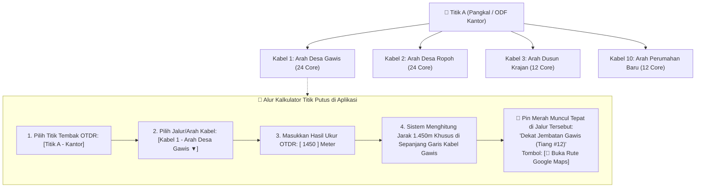

| Fitur Kalkulator Multi-Kabel | Cara Kerja & Keunggulan Lapangan |
|---|---|
| **Pemilihan Jalur Spesifik (Branch Selector)** | Jika di Titik A terdapat 10 tarikan kabel ke arah yang berlainan, sistem menyediakan **Dropdown Pemilihan Segmen Kabel**:<br>• Teknisi memilih arah kabel yang sedang diukur (contoh: *Pilih Jalur: [Kabel 24C - Arah Gawis]*).<br>• Sistem hanya akan menghitung dan menelusuri lekukan koordinat pada garis kabel yang dipilih tersebut, sehingga **mustahil salah arah atau nyasar ke desa lain**. |
| **Estimasi Tiang & ODP Terdekat** | Selain menampilkan titik pin GPS di peta, sistem memberikan informasi kontekstual lapangan:<br>*"Estimasi lokasi putus: 1.450m dari Kantor (di antara Tiang #11 dan ODP-Gawis-02)"*. |
| **Integrasi KML Multi-Layer** | File KML dari Google Earth Pro dapat memuat banyak folder/nama rute kabel (misal: *Jalur Gawis, Jalur Ropoh, Jalur Krajan*), dan billing otomatis membaca setiap nama jalur menjadi pilihan di kalkulator. |
| **Manajemen & Editor Rute Kabel (In-Browser & Tanpa Google Earth)** | **Fleksibilitas Pengelolaan Jalur:**<br>1. **Tidak Wajib Google Earth:** Admin/NOC dapat mengedit rute kabel langsung dari browser web billing (**In-Browser Route Editor**) dengan menggeser titik belokan kabel (*drag-and-drop*) lalu klik Simpan.<br>2. **Manajemen Layer:** Setiap jalur kabel dapat disembunyikan/ditampilkan (*Toggle ON/OFF*), diunduh (*Download KML*), diperbarui (*Update KML*), atau dihapus permanen (*Delete Layer*). |
| **Visualisasi Segmen Topologi Ring (*Ring Health Layer*)** | **Deteksi Cerdas Jalur Cincin yang Putus Sebelah:**<br>Setiap bentangan kabel ring di peta memiliki status live berbasis SNMP port SFP kedua ujungnya:<br>• 🟢 **Hijau Solid (Ring Normal):** Seluruh port SFP kedua ujung link menyala normal, proteksi cincin aktif 100%.<br>• 🟡 **Kuning Putus-Putus (Redaman SFP Drop):** Kabel belum putus namun redaman laser SFP anjlok ($\le -24\text{ dBm}$), memberi alarm dini sebelum link down.<br>• 🔴 **Merah Berkedip (Segmen Putus / Broken Link):** Port SFP di segmen tersebut mendeteksi link-down / LOS (-40 dBm). Garis kabel segmen tersebut seketika memerah di peta Leaflet, meskipun internet warga tetap menyala via arah sebaliknya!<br>• **Banner Peringatan:** Peta memunculkan banner status: *"Ring Segmen Ropoh-Gawis Terbuka (Degraded). Redundansi Jaringan Hilang!"*. |
| **Monitoring Segmen Non-DDM / HTB (*Traffic & L2 Ring Watchdog*)** | **Solusi untuk Kabel Media Converter (HTB) / SFP Non-DDM di Ring Bridge (Non-OSPF):**<br>Jika Segmen 3 menggunakan HTB non-DDM dan berada dalam 1 Layer 2 Bridge Ring (RSTP), ping antar IP router akan **tetap UP** (memutar lewat Segmen 1 & 2) dan lampu HTB tetap nyala. Untuk mendeteksi putusnya Segmen 3 secara presisi 100%, sistem menyediakan 3 metode deteksi:<br>1. **Pemantauan Bandwidth SNMP Real-Time:** Membaca counter 64-bit (`ifHCInOctets`/`ifHCOutOctets`) pada port fisik Segmen 3. Saat kabel putus, trafik anjlok mendadak ke $\sim 0\text{ bps}$ (*Traffic Flatline*).<br>2. **Mikrotik Neighbor Discovery (MNDP / LLDP) per-Port Fisik:** Sistem membaca daftar `/ip neighbor` khusus pada interface fisik Segmen 3. Begitu kabel optik putus, Router B seketika **HILANG** dari tetangga fisik port tersebut $\rightarrow$ Segmen 3 terkonfirmasi putus!<br>3. **Status Port RSTP (SNMP BRIDGE-MIB):** Di ring bridge, ada port cadangan yang di-blokir (`discarding`). Saat Segmen 3 putus, port cadangan otomatis berubah menjadi `forwarding`.<br>4. **Isolated Probe VLAN (Trik Terbaik ISP):** Memasang VLAN uji khusus (misal VLAN 999) hanya di fisik port Segmen 3 di luar Bridge utama dengan IP `/30`. Paket uji ini mustahil memutar lewat ring, sehingga seketika RTO saat kabel optik putus $\rightarrow$ garis segmen di peta langsung berubah **🔴 Merah**! |
| **Form Konfigurasi Segmen Kabel & Auto-Sync ke Zabbix** | **Cara Menentukan Metode Pengecekan di Aplikasi & Memberitahu Zabbix:**<br>1. **Form Segmen di Peta:** Admin mengklik garis kabel di peta $\rightarrow$ Form: `Node Asal: Mikrotik A (ether1)`, `Node Tujuan: Mikrotik B (ether1)`, `Tipe Media: [HTB Non-DDM ▼]`, `Metode Cek: [MNDP Neighbor Check ▼]`.<br>2. **Tombol `[🚀 Sinkronkan ke Zabbix]`:** Backend billing otomatis memanggil Zabbix API untuk membuat Item SNMP (`mikrotik.neighbor.identity[ether1]`) dan Trigger ekspresi: `last(/Mikrotik A/mikrotik.neighbor.identity[ether1]) <> "Mikrotik B"`.<br>3. **Zero-Configuration:** Staf NOC tidak perlu login manual ke dashboard Zabbix; Zabbix langsung tahu bahwa ether1 Mikrotik A wajib bertetangga dengan Mikrotik B! |
| **Analisa Cerdas Estafet Multi-Mikrotik (*Neighbor Baseline & Fault Isolation*)** | **Solusi Kasus Nyata: 1 Port ether1 Terhubung ke Switch / HTB Estafet yang Membawahi Banyak Mikrotik (Mikrotik 2, 3, 4):**<br>1. **Fitur Pelajari Tetangga (*Auto-Baseline Learning*):** Admin cukup menekan tombol **`[🔍 Scan & Kunci Baseline Tetangga]`** pada port tersebut. Sistem otomatis membaca `/ip/neighbor/print where interface=ether1` dan mengunci daftar resmi router yang sah terhubung di belakang port tersebut (misal: terdaftar Mikrotik 2, 3, dan 4). Teknisi/NOC tidak perlu menebak atau menghafal manual.<br>2. **Mesin Diagnosa Akar Masalah (*Root Cause Isolation*):**<br>• **Pola A: SEMUA Router Hilang Serentak (0/3 Aktif):** Sistem menyimpulkan: *"Kabel Feeder Utama dari Mikrotik 1 Putus, atau Switch HTB di tengah mati lampu/rusak!"* (Garis utama di peta memerah).<br>• **Pola B: SEBAGIAN Router Hilang (Misal Mikrotik 3 Hilang, Mikrotik 2 & 4 Masih Normal):** Sistem menyimpulkan: *"Kabel Utama & Switch Normal. Gangguan HANYA pada kabel tarikan cabang dari Switch menuju Mikrotik 3!"* (Garis utama tetap hijau, hanya cabang Mikrotik 3 yang memerah). Teknisi tidak membuang waktu mengecek kabel utama! |
| **Korelasi Silang Ring Kompleks (*Multi-Router Ring Fault Pinpointing*)** | **Solusi Ring: Mikrotik 1 ↔ Switch A (Mikrotik 2,3,4) ↔ Mikrotik 5 ↔ Mikrotik 1:**<br>Jika Segmen 1 (antara Mikrotik 1 dan Switch A) putus, seluruh router tetap bisa saling ping lewat Segmen 3 & 2 (trafik ring memutar). Sistem menentukan bahwa **Segmen 1 yang putus** lewat 3 fakta korelasi silang:<br>1. **Fakta Mikrotik 1 (ether1):** Port `ether1` mendadak kehilangan SELURUH tetangga (Mikrotik 2,3,4 hilang dari `ether1`) dan trafik `ether1` anjlok ke 0 bps.<br>2. **Fakta Mikrotik 1 (ether2):** Port `ether2` MASIH mendeteksi Mikrotik 5 dan trafik melonjak membawa failover ring.<br>3. **Fakta Mikrotik 2 (di Switch A):** Mikrotik 2 kehilangan Mikrotik 1, TAPI masih bertetangga dengan Mikrotik 3, 4, dan 5 (membuktikan Switch A dan Segmen 2 hidup!).<br>• **Hasil Diagnosa Otomatis:** Sistem 100% yakin **HANYA Segmen 1 (Mikrotik 1 ↔ Switch A) yang putus** $\rightarrow$ Garis Segmen 1 di peta seketika menyala 🔴 Merah Berkedip! |

#### M. Manajemen Aset ODP & Alur Pengajuan ODP Baru (*New ODP Onboarding*)
Untuk perluasan jaringan kabel fiber optik ke gang/wilayah baru, sistem menyediakan alur berjenjang pendaftaran ODP:

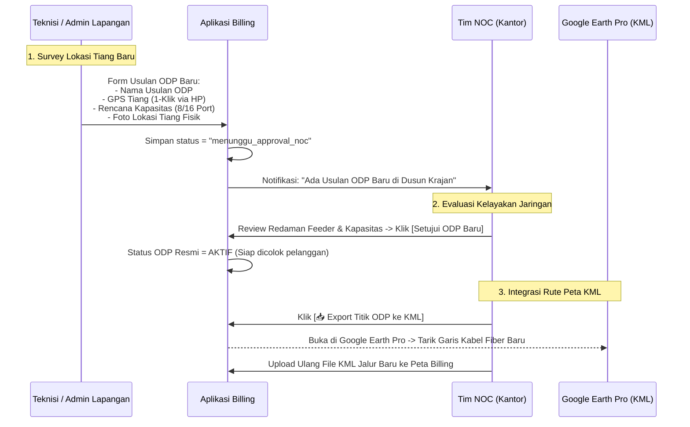

| Tahapan Pengajuan ODP | Aktor & Mekanisme Sistem |
|---|---|
| **1. Pengajuan Calon ODP (Survey)** | **Teknisi atau Admin Lapangan** menemukan potensi pelanggan baru di suatu gang dan mendirikan/menandai tiang:<br>• Membuka form *Usul ODP Baru* di HP.<br>• Tombol **`[📍 Ambil Koordinat GPS Tiang]`**.<br>• Memilih rencana kapasitas (8 atau 16 port).<br>• Mengunggah foto tiang fisik dan patokan lokasi. |
| **2. Verifikasi & Approval NOC** | **NOC / Super Admin** mengevaluasi kelayakan kabel feeder dan alokasi splitter:<br>• Jika layak, NOC klik **`[Setujui ODP]`** $\rightarrow$ kode ODP resmi terbit (misal: `ODP-KRJ-05`) dan langsung bisa dipilih saat teknisi mendaftarkan pelanggan baru. |
| **3. Pembuatan Rute KML oleh NOC** | NOC mengunduh titik koordinat ODP baru tersebut dalam format **KML Google Earth**, menarik garis kabel fiber penghubung di Google Earth Pro, lalu mengunggah rute kabel KML tersebut kembali ke billing agar peta Leaflet selalu mutakhir. |

#### N. Kolaborasi Operasional: Chat Internal NOC & Tombol Bantuan Cepat (*Operational Dispatch Chat*)

Untuk mempercepat koordinasi antara teknisi di tiang/lapangan dengan operator NOC di kantor tanpa salah ketik data teknis, disediakan **dua jalur komunikasi terintegrasi**:

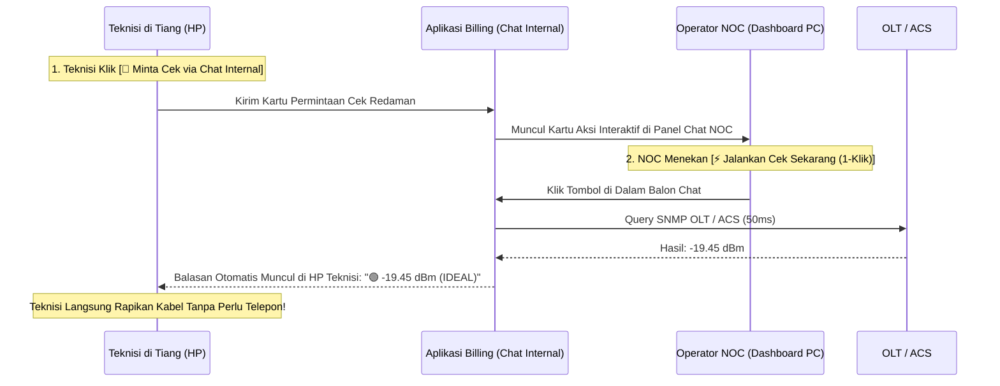

##### 1. Jalur A: Tombol 1-Klik WhatsApp & Salin Instruksi Cepat (Quick WA / Clipboard)
Fitur ini sangat fleksibel saat teknisi berada di area dengan sinyal internet tipis atau lebih nyaman menggunakan WhatsApp grup koordinasi:
* **Tombol `[📲 Minta Bantuan Cek (WA)]`:** Satu kali klik langsung membuka aplikasi WhatsApp (atau WhatsApp Web) ke nomor kontak hotline NOC dengan template pesan terformat rapi:
  ```text
  Halo Tim NOC, tolong bantu cek redaman pelanggan berikut:
  • Nama Pelanggan : Pak Budi (CUST-00123)
  • Alamat Rumah   : Dusun Krajan RT 02 (Desa Gawis)
  • Sumber Jalur   : ODP-KRJ-03 (Port 4)
  • Data OLT       : OLT-ZTE-Pusat (10.10.10.2)
  • PON / ONU ID   : gpon-olt_1/1/2 | ONU ID: 14
  • SN Modem       : ZTEGC892123
  • Teknisi Lapangan: Joko Supriyanto (di tiang)
  Mohon infokan hasil redamannya, terima kasih!
  ```
* **Tombol `[📋 Salin Format Teks]`:** Menyalin teks berformat di atas ke clipboard ponsel secara instan, siap dipaste ke grup koordinasi manapun.

##### 2. Jalur B: Chat Operasional Internal Aplikasi (*In-App Operational Dispatch Chat*)
Fitur obrolan real-time yang tertanam langsung di aplikasi billing (menggunakan Livewire & WebSockets) dengan keunggulan **Kartu Aksi Cepat Interaktif (*Interactive Action Cards*)**:
* **Kartu Permintaan Cek Data Otomatis:** Saat teknisi menekan tombol minta cek di peta/tiket, pesan yang muncul di layar chat NOC **bukan sekadar teks mati**, melainkan sebuah kartu interaktif:
  ```text
  ┌──────────────────────────────────────────────────────────────┐
  │ 🔔 PERMINTAAN CEK REDAMAN PELANGGAN                          │
  │ Dari       : Teknisi Joko (Dusun Krajan)                     │
  │ Pelanggan  : Pak Budi (CUST-00123)                           │
  │ OLT / PON  : OLT-ZTE-Pusat | PON 1/1/2 | ONU ID: 14          │
  │                                                              │
  │ [⚡ JALANKAN CEK SEKARANG (1-KLIK)]                          │
  └──────────────────────────────────────────────────────────────┘
  ```
* **Auto-Reply Seketika (Zero-Re-Typing):** Operator NOC di kantor **tidak perlu membuka tab OLT atau mengetik ulang angka**. Cukup klik tombol `[⚡ Jalankan Cek Sekarang]` di kartu chat tersebut. Sistem seketika menembak SNMP OLT/ACS dan hasilnya **otomatis terbalas ke ruang chat teknisi**:
  ```text
  ┌──────────────────────────────────────────────────────────────┐
  │ 🟢 HASIL DIAGNOSA REDAMAN RESMI (SISTEM)                     │
  │ Nilai Rx   : -19.45 dBm (Status: PRIMA / IDEAL)              │
  │ Nilai Tx   : +2.10 dBm | Waktu Baca: 14:28:15 WIB            │
  │ Sumber     : SNMP OLT ZTE C320 (Latensi: 42ms)               │
  │ Operator   : Dikonfirmasi oleh NOC Ahmad                     │
  └──────────────────────────────────────────────────────────────┘
  ```
* **Konteks Tiket & Riwayat Forensik (*Threaded Chat*):** Setiap ruang obrolan terikat langsung dengan nomor tiket komplain atau tugas instalasi pelanggan, sehingga rekaman komunikasi tersimpan rapi sebagai jejak audit pengerjaan tugas.

---

### 19. 📍 Presensi, Live GPS Tracking Teknisi, & Smart Dispatch

| Fitur | Keterangan & Mekanisme Lapangan |
|---|---|
| **Absensi Mobile (Self-Service)** | Teknisi, kolektor, dan staf lapangan melakukan absensi masuk (*Clock-in*) dan pulang (*Clock-out*) langsung dari handphone masing-masing dengan validasi GPS dan foto selfie wajah. |
| **Lokasi teknisi** | Koordinat dikirim hanya saat halaman tugas terbuka, sekitar 1–2 menit. Halaman web tidak melacak ponsel yang terkunci. Setelah clock-out, lokasi tidak dikirim. Pelacakan latar belakang butuh aplikasi native dan berada di luar tahap awal. |
| **Peta Armada Teknisi di Dashboard NOC** | Di peta Leaflet.js NOC, terdapat lapisan live: **`[🛵 Peta Posisi Tim Lapangan]`**:<br>• Ikon motor teknisi bergerak sesuai koordinat terakhir.<br>• Menampilkan status: *Nama Teknisi, Tugas yang sedang dikerjakan, dan Waktu Update terakhir (misal: 'Update 45 detik lalu')*. |
| **Disposisi Cerdas: Cari Teknisi Terdekat (*Smart Proximity Dispatch*)** | Saat ada tiket komplain darurat masuk di suatu desa, NOC cukup mengklik tombol: **`[📍 Cari Teknisi Terdekat]`**:<br>• Sistem otomatis mengukur jarak GPS seluruh teknisi yang sedang bertugas.<br>• Rekomendasi otomatis: *"Teknisi Budi & Joko berada paling dekat (berjarak 750 meter dari rumah pelanggan). Disposisikan tugas ini ke mereka?"*<br>• **Hemat Waktu & Bensin:** Mencegah menugaskan teknisi yang posisinya berada di ujung wilayah yang jauh. |

---

### 20. 💼 Payroll, Bonus Teknisi, & Buku Kas Pegawai / Mitra

Modul penggajian menyeluruh yang mencakup Teknisi, Reseller, dan Pegawai Tetap:

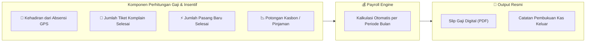

| Kelompok Staf / Mitra | Skema Perhitungan Gaji & Insentif |
|---|---|
| **Teknisi Lapangan** | • **Gaji Pokok / Uang Kehadiran:** Dihitung dari jumlah hari hadir di modul absensi.<br>• **Bonus Pekerjaan (*Job Commission*):** Bonus per unit pasang baru sukses (misal: Rp 50.000/pelanggan baru) + Bonus per tiket komplain yang berhasil diselesaikan.<br>• **Buku Kas Operasional:** Catatan klaim bensin, beli konektor RJ45/patchcord darurat. |
| **Reseller** | • **Buku Bagi Hasil Reseller:** Catatan komisi recurring bulanan per pelanggan lunas.<br>• **Riwayat Pencairan (Payout):** Rekap dana komisi yang sudah ditarik/ditransfer oleh kantor beserta bukti bayar admin. |
| **Kolektor** | • **Insentif Penagihan:** Bonus nominal per tagihan yang berhasil ditarik lunas.<br>• **Pemisahan:** Gaji/insentif kolektor dicairkan lewat payroll resmi, terpisah dari Kas Gantung setoran. |
| **Pegawai Kantor / NOC** | Gaji pokok bulanan, tunjangan jabatan, lembur piket NOC, dan potongan kasbon. |
| **Slip Gaji Digital** | Setiap pegawai dapat melihat rincian gaji dan mengunduh **Slip Gaji resmi berformat PDF** dari portal akun masing-masing. |

---

### 21. ⚙️ Konfigurasi Sistem, Pengaturan Global, & Maintenance Mode

| Konfigurasi | Keterangan |
|---|---|
| **Manual Maintenance Mode (Super Admin)** | **Tombol Saklar Pemeliharaan Sistem:** Super Admin dapat mengaktifkan / menonaktifkan *Maintenance Mode* langsung dari dashboard web (tanpa perlu login SSH terminal):<br>• **Pesan Kustom:** Admin dapat mengetik pesan pengumuman (contoh: *"Sedang ada pemeliharaan server database hingga pukul 02:00 WIB. Layanan internet pelanggan tetap aktif normal"*).<br>• **Akses Khusus (Bypass):** Super Admin tetap bisa mengakses seluruh menu dashboard selama mode pemeliharaan aktif.<br>• **Tampilan Pengguna:** Kolektor dan Pelanggan yang membuka web/portal akan melihat halaman status pemeliharaan resmi yang elegan dan informatif. |
| **Paket Layanan** | CRUD paket langganan (nama, harga nominal Rp, kecepatan upload/download). |
| **Siklus & Tanggal Tagihan** | Hari generate invoice bulanan otomatis & tanggal jatuh tempo default (tanggal 11 pukul 00:00). |
| **Toleransi Isolir Global** | Pengaturan default mode isolir pelanggan baru (Custom 3). |
| **Template Cetak Kuitansi** | Pemilihan model kuitansi default (Thermal Bluetooth 58mm/80mm) dan teks kop/footer. |
| **Integrasi notifikasi** | SMTP email dan token bot Telegram. Tidak ada API key gateway WhatsApp untuk pesan otomatis ke pelanggan. |
| **Integrasi & Kredensial Server ACS (GenieACS)** | Form input URL NBI (`http://ip:7557`), username/password atau API Key token, timeout socket (default 3 detik), dan tombol **`[🔌 Uji Koneksi API ACS]`**. Menyimpan riwayat status health check live. |

---

### 22. 📦 Manajemen Inventaris, Serial Number (SN) Perangkat, & Logistik Teknisi

Modul pelacakan aset fisik perangkat jaringan dari pengadaan, penugasan ke teknisi, terpasang di pelanggan, hingga penarikan kembali (*dismantle*):

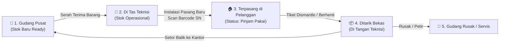

| Fitur Inventaris | Keterangan & Mekanisme Lapangan |
|---|---|
| **Master Data Perangkat & Barang** | Pencatatan aset: **Modem ONT / ONU**, **Router WiFi**, **Media Converter HTB**, **Switch Hub**, **SFP Transceiver**, dan **Kabel Dropcore (Meteran Roll)**. |
| **Status Siklus Hidup Aset (*Lifecycle*)** | Setiap unit perangkat memiliki status tunggal yang jelas:<br>• `gudang_utama`: Siap digunakan di kantor.<br>• `dibawa_teknisi`: Sedang dibawa oleh teknisi tertentu.<br>• `terpasang_pelanggan`: Beroperasi aktif di rumah pelanggan.<br>• `ditarik_bekas`: Hasil bongkaran di tangan teknisi.<br>• `rusak_servis`: Menunggu klaim garansi atau perbaikan.<br>• `afkir_musnah`: Rusak permanen / terbakar petir. |
| **Alur Distribusi Logistik ke Teknisi** | Admin gudang memilih staf teknisi (misal: Teknisi Joko) dan mengalokasikan 5 unit ONT $\rightarrow$ status 5 ONT seketika berpindah menjadi `dibawa_teknisi` (atas nama Joko). |
| **Kunci Validasi Tiket Pasang Baru** | **Anti-Lupa Catat SN:** Saat teknisi menyelesaikan tiket instalasi di HP, form penyelesaian tiket **MEWAJIBKAN scan barcode / memilih Serial Number (SN)** dari daftar modem yang ada di tasnya. Sistem otomatis mengaitkan SN modem tersebut ke profil pelanggan. |
| **Alur Penarikan Pelanggan Berhenti (*Dismantle*)** | Saat pelanggan berhenti berlangganan, admin menerbitkan tiket bongkar perangkat $\rightarrow$ teknisi menarik modem $\rightarrow$ status perangkat berubah menjadi `ditarik_bekas` (tanggung jawab teknisi). |
| **Pengembalian & Rekonsiliasi Gudang** | Saat teknisi kembali ke kantor, admin gudang menekan tombol **`[Terima Pengembalian Alat]`** untuk mengembalikan modem bekas ke stok kantor. |
| **Audit Saldo Stok Teknisi (*Accountability Dashboard*)** | Supervisor dapat melihat saldo fisik alat per teknisi secara *real-time*: *"Teknisi Joko saat ini memegang: 2 unit ONT Baru, 1 unit ONT Bekas, dan 150 meter sisa kabel dropcore"*. Mencegah kebocoran aset puluhan juta Rupiah! |
| **Riwayat Penggantian Alat (*Device Replacement Log*)** | **Rekam Jejak Kronologis Pergantian Modem Pelanggan:**<br>Saat modem pelanggan rusak (misal tersambar petir / port LAN mati / upgrade perangkat):<br>1. Teknisi memilih modem pengganti baru dari tasnya.<br>2. Sistem mencatat: *Tanggal Penggantian, Modem Lama (SN & Merk), Modem Baru (SN & Merk), Alasan Penggantian, dan Nama Teknisi Eksekutor*.<br>3. Status modem lama otomatis berubah menjadi `rusak_servis` atau `ditarik_bekas`, dan modem baru langsung terkunci ke pelanggan.<br>4. Seluruh riwayat tampil urut waktu di profil pelanggan untuk riwayat forensik servis. |

---

---

## 🗂️ Data Model (Entitas Utama)

```mermaid
erDiagram
    KECAMATAN {
        int id
        string nama
    }

    DESA {
        int id
        int kecamatan_id
        string nama
    }

    DUSUN {
        int id
        int desa_id
        string nama
    }

    ODP {
        int id
        string kode_odp
        string nama_odp
        int dusun_id
        decimal latitude
        decimal longitude
        int kapasitas_port
        string foto_tiang
        string status
        int diusulkan_oleh_user_id
        int approved_by_user_id
        datetime approved_at
    }

    OLT {
        int id
        string nama_olt
        string ip_address
        string tipe_merk
        bool snmp_supported
        string snmp_community
        int snmp_port
        string status
    }

    PELANGGAN {
        int id
        string nama
        string alamat_detail
        int dusun_id
        int desa_id
        int kecamatan_id
        string tipe_sumber_koneksi
        int odp_id
        int odp_port
        int parent_pelanggan_id
        string catatan_sumber_koneksi
        int olt_id
        string pon_port
        int onu_id
        string onu_sn
        string no_hp
        string email
        string no_pelanggan
        int paket_id
        int reseller_id
        int referred_by_id
        string referral_code
        bigint saldo_dompet
        int saldo_poin
        bool auto_pay_enabled
        bool isolir_enabled
        string mode_isolir
        string status_isolir
        string sumber_isolir
        date masa_aktif_hingga
        date isolir_mulai_evaluasi
        date bypass_until
        bigint bypass_approved_by
        date next_isolir_at
        string acs_device_id
        decimal latitude
        decimal longitude
        decimal latest_rx_power
        decimal latest_tx_power
        string optical_status
        datetime optical_updated_at
        string username_koneksi
        string password_koneksi
        string tipe_merk_alat
        datetime tanggal_instalasi
        string foto_instalasi
        string ssid_wifi
        string password_wifi
        string file_backup_config
        string status_langganan
        date cuti_mulai
        date cuti_selesai
        string status
    }

    PERANGKAT_INVENTARIS {
        int id
        string serial_number
        string mac_address
        string tipe_merk
        string jenis_perangkat
        string status
        int posisi_user_id
        int pelanggan_id
        string superadmin_username
        string superadmin_password
        string catatan
        datetime created_at
    }

    RIWAYAT_PENGGANTIAN_ALAT {
        int id
        int pelanggan_id
        int perangkat_lama_id
        int perangkat_baru_id
        int teknisi_user_id
        string alasan
        int tiket_komplain_id
        datetime tanggal_penggantian
    }

    REQUEST_PERUBAHAN_WIFI {
        int id
        int pelanggan_id
        int requested_by_user_id
        string ssid_baru
        string password_baru
        string alasan
        string status
        int approved_by_user_id
        datetime created_at
        datetime executed_at
    }

    BERITA_ACARA_INSTALASI {
        int id
        int pelanggan_id
        int teknisi_user_id
        int perangkat_id
        string nomor_dokumen
        string tanda_tangan_pelanggan
        string tanda_tangan_teknisi
        string file_pdf
        datetime disahkan_pada
    }

    DOMPET_PELANGGAN_MUTASI {
        int id
        int pelanggan_id
        string tipe
        bigint nominal
        bigint saldo_akhir
        string sumber
        int referensi_id
        string keterangan
    }

    POIN_MUTASI {
        int id
        int pelanggan_id
        string tipe
        int jumlah_poin
        int saldo_akhir
        string sumber
        string keterangan
    }

    REQUEST_APPROVAL {
        int id
        string jenis_request
        int pelanggan_id
        int requester_user_id
        string requester_role
        bigint nominal
        int poin
        string status
        int approved_by_user_id
        datetime approved_at
        text keterangan
    }

    PELANGGAN_MIKROTIK {
        int id
        int pelanggan_id
        int mikrotik_id
        string tipe_koneksi
        string username_mk
        string ip_address
    }

    MIKROTIK {
        int id
        string nama_lokasi
        string ip_primary
        string ip_secondary
        int port_api
        string username_api
        string password_api
        string address_list_name
        string snmp_community
        int snmp_port
        string status_koneksi
    }

    PAKET {
        int id
        string nama
        int harga
        string kecepatan
    }

    TAGIHAN {
        int id
        int pelanggan_id
        string no_tagihan
        string public_token
        string tipe_invoice
        string periode
        bigint nominal
        bigint terbayar
        bigint sisa
        date jatuh_tempo
        string status
        string kategori_tunggakan
        string status_penagihan
        text catatan_penagihan
        datetime terakhir_dikunjungi_at
    }

    BARIS_TAGIHAN {
        bigint id
        bigint tagihan_id
        string jenis
        bigint nominal
        string keterangan
    }

    TRANSAKSI_PEMBAYARAN {
        int id
        int tagihan_id
        bigint nominal_bayar
        string metode_bayar
        int kolektor_id
        string bukti_transfer
        string status_verifikasi
        string idempotency_key
        string gateway_transaction_id
        bigint reverses_id
        int verified_by_user_id
        decimal latitude
        decimal longitude
        datetime tanggal_bayar
    }

    KOLEKTOR {
        int id
        int user_id
        string nama
        string area
    }

    SETORAN {
        int id
        int kolektor_id
        date tanggal
        bigint nominal
        string status_verifikasi
        int admin_id
    }

    LOG_ISOLIR {
        int id
        int pelanggan_id
        int mikrotik_id
        string aksi
        string ip_diisolir
        datetime waktu
        string trigger_by
        string status
        string keterangan
    }

    AGENDA_GANGGUAN_MASSAL {
        int id
        string kode_agenda
        string judul
        string nama_area
        string tipe_cakupan
        int cakupan_id
        int mikrotik_id
        text deskripsi_gangguan
        string status
        int dibuat_oleh_user_id
        string target_monitor_tipe
        int target_mikrotik_id
        string target_sfp_interface
        int target_pelanggan_id
        datetime waktu_mulai
        datetime waktu_selesai
        text catatan_solusi
        string foto_bukti_selesai
    }

    AGENDA_TEKNISI_ASSIGNMENT {
        int id
        int agenda_gangguan_id
        int teknisi_user_id
        string nama_tim
    }

    TIKET_KOMPLAIN {
        int id
        string no_tiket
        int pelanggan_id
        int pelapor_user_id
        string kategori_gangguan
        text deskripsi
        string foto_kendala
        string tipe_kasus
        int agenda_gangguan_id
        string target_monitor_tipe
        int target_mikrotik_id
        string target_sfp_interface
        int target_pelanggan_id
        string status
        int verified_by_user_id
        datetime waktu_mulai
        datetime waktu_selesai
        text solusi_teknisi
        string foto_penyelesaian
    }

    TIKET_TEKNISI_ASSIGNMENT {
        int id
        int tiket_komplain_id
        int teknisi_user_id
        bool is_penanggung_jawab
    }

    ABSENSI {
        int id
        int user_id
        date tanggal
        time jam_masuk
        time jam_pulang
        decimal latitude_masuk
        decimal longitude_masuk
        string foto_masuk
        string status
    }

    PAYROLL_RECORD {
        int id
        int user_id
        string periode
        bigint gaji_pokok
        bigint bonus_pekerjaan
        bigint uang_kehadiran
        bigint potongan
        bigint total_bersih
        string status_bayar
        string slip_pdf_path
        datetime dibayar_at
    }

    USER_WILAYAH {
        bigint id
        bigint user_id
        bigint dusun_id
    }

    AUDIT_LOG {
        bigint id
        bigint user_id
        string auditable_type
        bigint auditable_id
        string action
        text before_values
        text after_values
        datetime created_at
    }

    USERS {
        bigint id
        string name
        string email
        decimal last_latitude
        decimal last_longitude
        datetime last_location_at
    }

    RESELLER {
        int id
        int user_id
        string nama
        string no_hp
        string nama_bank
        string no_rekening
        string atas_nama
        bigint saldo_dompet
    }

    DOMPET_RESELLER_MUTASI {
        int id
        int reseller_id
        int tagihan_id
        int pencairan_id
        string tipe
        bigint nominal
        bigint saldo_akhir
        string keterangan
    }

    PENCAIRAN_RESELLER {
        int id
        int reseller_id
        bigint nominal
        string status
        string bukti_transfer
        int admin_id
        datetime approved_at
    }

    AGENDA_GANGGUAN_MASSAL ||--o{ TIKET_KOMPLAIN : "mengelompokkan tiket pelanggan"
    AGENDA_GANGGUAN_MASSAL ||--o{ AGENDA_TEKNISI_ASSIGNMENT : "ditugaskan ke tim teknisi"
    USERS ||--o{ AGENDA_TEKNISI_ASSIGNMENT : "personel tim"
    PELANGGAN ||--o{ TIKET_KOMPLAIN : "mengalami"
    TIKET_KOMPLAIN ||--o{ TIKET_TEKNISI_ASSIGNMENT : "memiliki penugasan teknisi"
    USERS ||--o{ TIKET_TEKNISI_ASSIGNMENT : "mengerjakan tugas"
    USERS ||--o{ ABSENSI : "melakukan absensi"
    USERS ||--o{ PAYROLL_RECORD : "menerima gaji"
    KECAMATAN ||--o{ DESA : "membawahi"
    DESA ||--o{ DUSUN : "membawahi"
    DUSUN ||--o{ ODP : "memiliki tiang"
    ODP ||--o{ PELANGGAN : "port distribusi kabel drop"
    OLT ||--o{ PELANGGAN : "distribusi PON"
    DUSUN ||--o{ PELANGGAN : "bertempat di"
    PELANGGAN ||--o{ DOMPET_PELANGGAN_MUTASI : "memiliki mutasi dompet"
    PELANGGAN ||--o{ POIN_MUTASI : "memiliki mutasi poin"
    PELANGGAN ||--o{ REQUEST_APPROVAL : "subjek request"
    PELANGGAN ||--o{ PELANGGAN_MIKROTIK : "terhubung ke"
    PELANGGAN }o--o| RESELLER : "milik mitra"
    PELANGGAN }o--o| PELANGGAN : "direferensikan oleh"
    RESELLER ||--o{ DOMPET_RESELLER_MUTASI : "memiliki"
    RESELLER ||--o{ PENCAIRAN_RESELLER : "mengajukan"
    MIKROTIK ||--o{ PELANGGAN_MIKROTIK : "menampung"
    PELANGGAN }o--|| PAKET : "berlangganan"
    PELANGGAN ||--o{ TAGIHAN : "punya"
    TAGIHAN ||--o{ TRANSAKSI_PEMBAYARAN : "memiliki riwayat bayar"
    TRANSAKSI_PEMBAYARAN }o--o| KOLEKTOR : "diterima oleh"
    KOLEKTOR ||--o{ SETORAN : "menyetor"
    PELANGGAN ||--o{ LOG_ISOLIR : "tercatat"
    MIKROTIK ||--o{ LOG_ISOLIR : "dicatat dari"
    PERANGKAT_INVENTARIS }o--o| USERS : "dibawa oleh"
    PERANGKAT_INVENTARIS }o--o| PELANGGAN : "terpasang di"
    PELANGGAN ||--o{ BERITA_ACARA_INSTALASI : "memiliki dokumen"
    USERS ||--o{ BERITA_ACARA_INSTALASI : "disahkan teknisi"
    PERANGKAT_INVENTARIS ||--o{ BERITA_ACARA_INSTALASI : "diserahterimakan"
    USERS ||--o| KOLEKTOR : "akun"
    USERS ||--o| RESELLER : "akun portal"
    USERS ||--o| PELANGGAN : "akun portal"
    TAGIHAN ||--o{ BARIS_TAGIHAN : "memiliki rincian"
    USERS ||--o{ USER_WILAYAH : "bertugas di dusun"
    USERS ||--o{ AUDIT_LOG : "mencatat aksi"
```

> [!NOTE]
> Tabel pivot `pelanggan_mikrotik` adalah kunci dari arsitektur multi-Mikrotik. Tiap baris menyimpan tipe koneksi dan credential spesifik pelanggan **di Mikrotik tersebut** — karena username/IP bisa berbeda antar Mikrotik.

---

## 🛡️ Standar Keamanan Aplikasi (Security Architecture)

Aplikasi dirancang memenuhi standar **OWASP ASVS** untuk aplikasi jaringan dan finansial:

| Lapisan Keamanan | Implementasi Teknis |
|---|---|
| **Enkripsi rahasia** | Password API Mikrotik, SNMP community, PPPoE, WiFi, dan superadmin modem disimpan dengan `Crypt::encryptString`. Ekspor pelanggan tidak memuat rahasia. Menyembunyikan kolom di layar tidak menggantikan Policy. |
| **Dua akun API Mikrotik** | Akun isolir hanya boleh membaca dan menulis address-list. Akun NOC terpisah yang boleh mengubah interface hanya dipakai untuk matikan laser SFP, dan setiap aksi itu diaudit. |
| **Integritas Finansial & Concurrency** | Mutasi uang (bayar, top-up, komisi) wajib dibungkus `DB::transaction()` dan **Pessimistic Locking (`lockForUpdate()`)** untuk kebal dari race condition / klik ganda. |
| **Perlindungan Berkas Privat (KTP & Foto)** | Foto KTP dan berkas fisik disimpan di **Private Storage Disk**. Hanya dapat diakses lewat *Temporary Signed URL* bertenggat waktu oleh admin yang terotentikasi. |
| **Pencegahan akses liar** | Policy membatasi kolektor dan admin wilayah ke `user_wilayah`. Halaman invoice publik memakai token acak 128 bit yang bisa diputar, bukan hash pendek. |
| **Penyekatan Port Jaringan** | Port API 8728 di Mikrotik difilter via firewall RouterOS: hanya menerima koneksi dari IP lokal kabel server dan IP tunnel WireGuard server. |
| **Audit Trail Forensik** | Semua aksi sensitif (isolir manual, approval bypass, perubahan komisi, approval top-up) tercatat di tabel audit log beserta user ID, IP address, dan timestamp. |

---

## 🏢 Arsitektur Redundansi Multi-Server (High Availability & Zero Downtime)

Untuk mengantisipasi jika server utama mengalami kerusakan hardware, mati listrik, atau sistem crash, sistem dirancang dengan skema **Dual-Server Hot-Standby (Active-Passive)** dengan sinkronisasi database dan file secara *real-time*.

### 🏗️ Diagram Skema Multi-Server

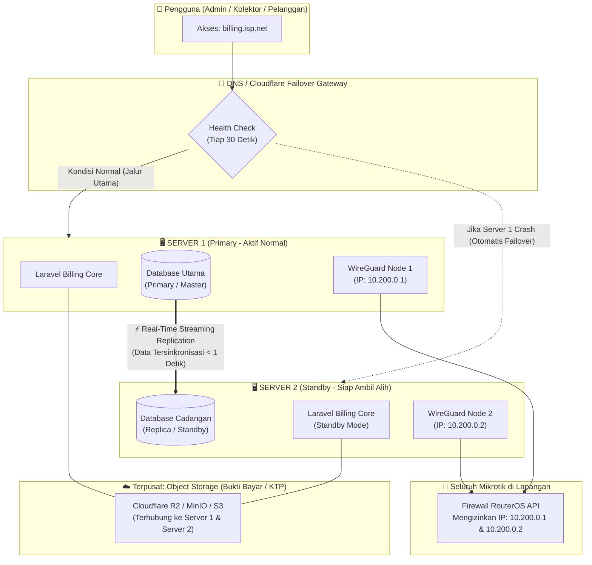

---

### ⚙️ Detail Mekanisme 4 Lapisan Redundansi:

#### 1. Sinkronisasi Database Real-Time (*Database Streaming Replication*)
* **PostgreSQL / MySQL Streaming Replication:**
  * **Server 1 (Primary - Proxmox Kantor):** Melayani seluruh transaksi read & write harian.
  * **Server 2 (Standby Replica - Cloud VPS):** Menerima salinan data dari server utama. Jeda replikasi asinkron bisa lebih dari satu detik.
  * Replikasi asinkron dapat kehilangan transaksi terakhir. Dokumen ini tidak menjanjikan nol kehilangan data.

#### 1B. Failover adalah prosedur infrastruktur

Aplikasi tidak mempromosikan database, tidak mengklon data dari browser, dan tidak menutup split-brain. Replikasi, DNS, dan WireGuard dioperasikan di server. Pembayaran menyimpan `idempotency_key` unik supaya pengiriman ulang tidak membuat dua jurnal. Antrian isolir memakai database queue agar job yang belum selesai ikut salinan database. Alert pergantian server, bila ada, dikirim lewat Telegram oleh pemantau infrastruktur, bukan oleh tombol di Laravel.

#### 2. Sinkronisasi File & Lampiran (Foto KTP & Bukti Transfer)
* Menggunakan **S3-Compatible Object Storage** (seperti Cloudflare R2 / MinIO / AWS S3):
  * Foto KTP, bukti transfer bank, dan PDF struk tidak disimpan di harddisk lokal server yang rentan rusak, melainkan di storage awan terisolasi.
  * Baik Server 1 maupun Server 2 terhubung ke storage yang sama, sehingga saat failover, seluruh foto bukti bayar dan dokumen kuitansi langsung bisa diakses tanpa perlu transfer file antar server.

#### 3. Mekanisme Pengalihan Trafik (*Traffic Failover*)
* **Jalur Otomatis (Cloudflare Load Balancing / Health Check):**
  * Pengguna selalu mengakses nama domain yang sama: `billing.isp.net`.
  * Sistem pemantau (*health check*) mengecek kesehatan Server 1 tiap 30 detik.
  * Jika Server 1 tidak merespons (crash/mati), trafik otomatis dialihkan ke IP Server 2 dalam hitungan detik tanpa perlu admin mengubah settingan HP kolektor.
* **Jalur Manual Kilat:**
  * Admin cukup mengubah *DNS A Record* domain `billing.isp.net` mengarah ke IP Server 2.

#### 4. Kesiapan Mikrotik: Bersifat Pasif & Agnostik (Zero Configuration di Router)
* **Mikrotik Tidak Perlu Tahu Server Mana yang Mengontrol:**
  * Mikrotik di tiang/lapangan tidak perlu mengetahui apakah perintah isolir/buka isolir datang dari **Proxmox Kantor** atau **Cloud VPS**.
  * **Satu Identitas Tunggal:** Kedua server menggunakan kredensial API yang sama persis dan berbagi identitas IP billing yang sama (via subnet WireGuard tunggal atau *Virtual Floating IP*).
  * Di seluruh Mikrotik, aturan firewall dan user API **hanya disetel satu kali saja** di awal instalasi:
    ```routeros
    /ip service set api address=10.200.0.0/24 disabled=no port=8728
    ```
  * **Hasilnya:** Saat kantor mati dan VPS mengambil alih, ratusan Mikrotik tidak perlu disentuh sama sekali. Mikrotik hanya menerima perintah API seperti biasa tanpa peduli siapa di balik layar yang mengeksekusinya.

---

## 🛠️ Tech Stack

| Layer | Pilihan |
|---|---|
| **Backend** | Laravel (PHP) |
| **Frontend Admin/Kolektor** | Livewire + Tailwind CSS |
| **Frontend Portal Pelanggan** | Livewire + Tailwind CSS *(atau Vue.js SPA di fase lanjut)* |
| **Database** | MySQL / PostgreSQL |
| **Job Scheduler** | Laravel Scheduler + Queue (untuk paralel job isolir) |
| **Mikrotik API** | `evilfreelancer/routeros-api-php` |
| **Auth & Role** | Laravel Breeze + Spatie Laravel Permission |
| **Queue Driver** | Database queue untuk isolir dan pembayaran, supaya job ikut replikasi database. |
| **Server** | VPS dengan WireGuard aktif |

---

## 🔭 Extensibility

| Fitur | Catatan |
|---|---|
| **Notifikasi** | Email boleh otomatis. WhatsApp pelanggan tetap tombol `wa.me`, bukan listener kirim massal. |
| **Portal ACS (TR-069)** | Endpoint terpisah dari portal pelanggan yang sudah ada |
| **Pembayaran Online** | Tambahkan payment gateway sebagai metode baru di tabel tagihan |
| **Multi-site / Franchise** | Arsitektur sudah modular per lokasi Mikrotik |

---

## 📌 Tahapan Pengembangan

| Tahap | Fokus | Status |
|---|---|---|
| **Tahap 1** | Definisi fitur & rancangan sistem | ✅ Selesai |
| **Tahap 2** | Setup project Laravel, migrasi, autentikasi tujuh peran, dan tabel `user_wilayah` | Berikutnya |
| **Tahap 3** | CRUD Pelanggan, Mikrotik (many-to-many), Paket |  |
| **Tahap 4** | Modul Tagihan & Generate Bulanan |  |
| **Tahap 5** | Modul Pembayaran (Cash + Transfer) |  |
| **Tahap 6** | Modul Kolektor & Setoran |  |
| **Tahap 7** | Isolir & Reaktivasi — Paralel ke Multi-Mikrotik via Address-List |  |
| **Tahap 8** | Portal Pelanggan (inti) |  |
| **Tahap 9** | Dashboard, Laporan, Export |  |
| **Tahap 10** | Testing, hardening, deployment |  |
