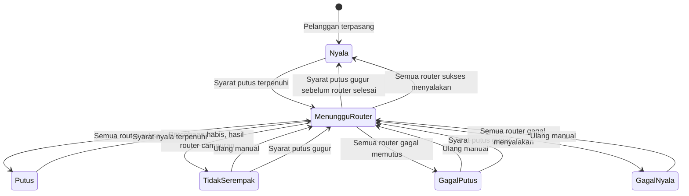

# Spesifikasi Logika Isolir

> Versi: 2.21 | Tanggal: 7 November 2026
> Sistem: pra-bayar
> Mekanisme: IP statis dimasukkan ke address-list Mikrotik. Semua pelanggan memakai IP statis. Kolom `tipe_koneksi` hanya catatan teknis dan tidak mengubah cara isolir.

Aturan di dokumen ini mengalahkan diagram atau kalimat lama yang masih memakai `isolir_enabled`, `bypass_until`, `isolir_sementara`, `masa_aktif_hingga`, atau `prepaid_30hari`.

## Dua pengaturan

Isolir hanya memutus atau menyalakan layanan. Prorata, diskon, biaya aktivasi, dan prorata aktivasi prabayar diatur di `docs/cara-kerja.md` sebagai hutang mengendap. Jumlah itu tidak dihitung sebagai tunggakan. Tagihan langganan yang dihitung isolir adalah periode penuh. Bulan tanpa tagihan tidak punya kuitansi dan tidak membuka isolir.

Pelanggan baru: `batas_tunggakan = 2`, `siklus_tagihan = tanggal_tetap`.

| Pengaturan | Nilai | Arti |
|---|---|---|
| `batas_tunggakan` | `null`, `1`, `2` | `null` berarti scheduler tidak pernah memutus. `1` memutus bila ada satu tagihan langganan lewat jatuh tempo. `2` adalah bawaan. |
| `siklus_tagihan` | `tanggal_tetap`, `prabayar` | `tanggal_tetap` tidak menggeser `hari_isolir`. `prabayar` menghitung sisa hari nyala dari tanggal suspend asli. Hari mati setelah batas perpanjangan tidak menjadi bonus. |

`batas_tunggakan = null` tampil di layar sebagai Tidak pernah. Isolir manual tetap menunggu nyala manual.

Scheduler hanya memutus bila tanggal hari ini di Asia/Jakarta sudah mencapai `next_isolir` dan syarat siklus terpenuhi. `hari_isolir` adalah angka 1 sampai 31 yang dipakai untuk menghitung tanggal itu. Bila bulan tujuan lebih pendek, dipakai hari terakhir bulan itu. `next_isolir` adalah satu-satunya tanggal putus yang dibaca scheduler.

Scheduler melewati pelanggan bila salah satu ini berlaku:

- `tanggal_instalasi` masih kosong
- ada `RIWAYAT_SUSPEND` berjenis `cuti` yang `selesai`-nya masih kosong. Pada saat itu `status_langganan` adalah `tunda_isolir`. Baris isolir yang belum selesai tidak membuat scheduler melewati pelanggan.

Pada tanggal `next_isolir` sendiri, job mengisolir bila syarat siklus terpenuhi. Pembayaran yang masuk kemudian pada hari yang sama tetap diproses dan dapat menyalakan layanan lagi.

Pada tanggal 1, generate tagihan dan autopay dompet mulai pukul 00:01 Asia/Jakarta dengan `withoutOverlapping()`. Job isolir tanggal 1 dimulai oleh job itu setelah autopay terakhir commit. Job isolir tidak memakai jam 00:05 pada tanggal 1. Hari lain, job isolir berjalan pukul 00:05 dengan `withoutOverlapping()`. Autopay yang membuat tagihan lunas selesai sebelum antrean putus ditulis.

Job isolir membandingkan tanggal kalender Jakarta, bukan tanggal UTC.

`status_langganan` menjadi `isolir` hanya saat `status_layanan` menjadi `putus`. `menunggu_router`, `gagal_putus`, dan `tidak_serempak` meninggalkan `status_langganan` pada `aktif`. Pada saat `putus`, `last_suspend` dan `last_suspend_note` diisi `isolir`, satu baris `RIWAYAT_SUSPEND` berjenis `isolir` dibuat dengan `selesai` kosong, dan satu baris `RIWAYAT_ISOLIR` dibuat. `selesai` dan `nyala_kembali` diisi saat `status_layanan` menjadi `nyala`, bersama `last_active` dan catatan `buka isolir`.

Cuti membuat satu baris `RIWAYAT_SUSPEND` berjenis `cuti` saat cuti dimulai. `status_langganan` menjadi `tunda_isolir`. `last_suspend` diisi dari `mulai` baris itu. Catatan dapat `cuti sementara` atau teks lain. Permintaan pelanggan dapat menyertakan `bukti_percakapan`. Cuti tidak menulis `RIWAYAT_ISOLIR` dan tidak mengubah `status_layanan`. Saat cuti berakhir, `selesai` pada baris yang sama diisi. Bila layanan sedang `putus`, `status_langganan` kembali `isolir`. Bila layanan `nyala`, `status_langganan` menjadi `aktif` dan `last_active` diisi dengan catatan `selesai cuti`. Tidak ada kolom `cuti_mulai` atau `cuti_selesai`. Satu pelanggan hanya punya satu baris terbuka per `jenis`. `next_isolir` tetap tanggal yang dibaca scheduler.

## Tiga fungsi

`hitung_isolir_berikutnya` hanya menghitung tanggal dan jumlah tunggakan. Pembayaran, cuti, toleransi, bypass, dan tombol simulasi memanggil fungsi ini. Fungsi ini tidak menghubungi Mikrotik.

`alokasi_pembayaran` adalah satu-satunya fungsi yang membagi uang ke tagihan. Satu penerimaan uang membuat satu baris `PEMBAYARAN` dengan `idempotency_key` unik. `gateway_transaction_id` yang terisi juga unik. Baris `ALOKASI_PEMBAYARAN` mencatat nominal per tagihan. Uang melunasi tagihan `langganan` yang belum lunas, urut `jatuh_tempo` terlama, lalu `layanan_mulai`. Sisa uang yang tidak menutup tagihan berikutnya tetap `sebagian` pada tagihan itu. `N` adalah jumlah tagihan `langganan` yang menjadi `lunas` oleh pembayaran ini dan, untuk transfer, sudah bertanda `sudah_diverifikasi`. Tagihan `konversi` tidak menambah `N`. Tidak ada pilihan `N` di layar. Pembayaran yang tidak membuat satu tagihan langganan pun lunas tidak menggeser `next_isolir`. Tagihan, pembayaran, dan pelanggan dikunci `lockForUpdate` di transaksi yang sama.

`putuskan_layanan` dan `nyalakan_layanan` adalah satu-satunya fungsi yang menulis address-list. Keduanya mencatat hasil per router. Status pelanggan menjadi `putus` atau `nyala` hanya setelah semua router yang dituju sukses. `nyalakan_layanan` membatalkan baris putus yang belum dijalankan untuk pelanggan dan router yang sama, supaya antrean lama tidak memutus lagi setelah pelanggan bayar.

## Status yang dihitung tunggakan

Hanya tagihan `langganan` dengan `periode_penuh = true` yang dihitung isolir. `periode_penuh` berarti nominalnya utuh sebesar harga paket pada saat tagihan terbit. Tagihan `konversi`, biaya pasang, denda, dan invoice `manual` diperlakukan sama: dapat ditagih, tidak dihitung di `jumlah`, dan tidak memperpanjang siklus `prabayar`. Saldo mengendap tidak dihitung. Bulan yang tidak diterbitkan tidak dihitung lunas dan tidak menyalakan layanan.

Satu tagihan penuh dihitung tunggakan hanya bila `terbayar = 0` dan statusnya `belum_bayar` atau `menunggu_verifikasi`. Tagihan penuh yang sudah dibayar sebagian tidak dihitung, walaupun `sisa` masih ada. Status invoice tetap `sebagian`. Bukti transfer pada mode `tidak_wajib` membuat tagihan `lunas` dan dapat menyalakan layanan, tetapi belum menambah `N` sebelum tanda `sudah_diverifikasi`. Mode `wajib`, tanda pelanggan, atau kolektor level 2 membuat status `menunggu_verifikasi` dan belum menyalakan layanan.

Pelanggan yang punya `sisa > 0` pada tagihan yang tidak dihitung isolir mendapat tanda `tidak_tertib`. Tanda itu berarti tidak tertib administrasi atau ada tunggakan nonbulanan. Tanda dihitung saat profil dibuka, bukan disimpan terpisah. Bila siklusnya masih `tanggal_tetap`, profil menampilkan rekomendasi untuk menjadikannya pelanggan `prabayar`. Rekomendasi tidak mengubah siklus.

## Siklus tanggal_tetap

`batas_tunggakan = null` membuat scheduler melewati putus otomatis. Bila putus sebelumnya berasal dari scheduler, jalan berikutnya menyalakan layanan. Putus manual tidak ikut terbuka.

```
jumlah = jumlah tagihan langganan periode_penuh yang terbayar = 0 dan jatuh temponya sudah sampai

Jika batas_tunggakan berisi 1 atau 2 dan hari ini >= next_isolir:
    Jika jumlah >= batas dan status_layanan salah satu dari nyala, gagal_putus:
        putuskan_layanan
    Jika jumlah < batas dan sumber_putus = scheduler dan status_layanan bukan nyala:
        nyalakan_layanan
```

Tagihan penuh yang sudah dibayar sebagian tidak menambah `jumlah`. Contoh tagihan Rp100.000 dibayar Rp50.000 tetap berstatus `sebagian`, tetapi untuk isolir dianggap tidak menunggak. Pelanggan itu mendapat tanda `tidak_tertib`.

Tagihan lama yang `periode_penuh` dan masih `terbayar = 0` ikut dihitung. Satu tagihan September yang belum dibayar sama sekali memutus pelanggan dengan batas 1, walaupun tagihan bulan ini sudah lunas. Pada batas 2, `jumlah` turun di bawah 2 bila salah satu tagihan penuh sudah ada pembayarannya, termasuk pembayaran sebagian. `hari_isolir` tidak bergeser.

Tombol simulasi hanya pratinjau. Simulasi tidak mengubah `status_layanan` dan tidak menyimpan `next_isolir`.

## Siklus prabayar

Di luar penundaan toleransi, perpanjangan adalah `N x 30` hari kalender, bukan tambah satu bulan. Contoh: 31 Januari ditambah 30 hari menjadi 2 Maret. 15 Februari 2026 ditambah 30 hari menjadi 17 Maret 2026.

```
Jika hari ini >= next_isolir dan pelanggan belum putus:
    putuskan_layanan

Jika pelanggan masih nyala saat bayar dan N >= 1:
    next_isolir = next_isolir + (N x 30 hari)
Jika N >= 1 dan sumber_putus bukan manual dan status_layanan salah satu dari putus, tidak_serempak, gagal_putus, gagal_nyala, menunggu_router dan baris RIWAYAT_ISOLIR terbuka tidak beralasan toleransi:
    next_isolir = tanggal pembayaran + (N x 30 hari)
    nyalakan_layanan
```

Pada tanggal `next_isolir` itu sendiri, job pukul 00:05 WIB sudah memutus. Contoh:

```
15 September bayar 1 bulan saat putus
    next_isolir = 15 Oktober
    layanan dinyalakan

10 Oktober bayar 1 bulan saat masih nyala
    next_isolir = 14 November

14 November, job 00:05 WIB
    hari ini >= 14 November -> putus

20 November bayar 1 bulan saat putus
    next_isolir = 20 Desember
    layanan dinyalakan
```

`N` hanya dihitung oleh `alokasi_pembayaran`. Sisa tagihan yang belum lunas tetap menunggak. `batas_tunggakan` tidak dibaca selama siklus ini. Bila siklus dikembalikan ke `tanggal_tetap`, tunggakan yang tersisa langsung dipakai.

Pembayaran pada baris `RIWAYAT_ISOLIR` yang terbuka beralasan `toleransi` hanya memakai rumus di bagian penundaan. Rumus itu khusus `prabayar`. `tanggal_tetap` kembali ke `hari_isolir` dan tidak menambah 30 hari dari tanggal bayar.

## Banyak Mikrotik

Setiap router pelanggan punya satu baris log. IP selalu diambil dari `pelanggan_mikrotik.ip_address`. Perintah ke router idempotent. Nama address-list, misalnya `isolir`, harus sudah dipakai oleh aturan firewall di Mikrotik. Billing menyimpan nama itu di `nama_address_list` dan tidak membuat aturan firewall. Entri ditulis tanpa timeout. Hanya billing yang menghapusnya.

## Antrian perintah

Job isolir hanya menulis baris antrian di database, satu baris per pelanggan per Mikrotik, lalu status pelanggan menjadi `menunggu_router`. Setiap baris menyimpan `hari_mulai_putus`, yaitu tanggal Asia/Jakarta saat baris ditulis. Job itu tidak membuka koneksi API.

Setiap Mikrotik punya satu pekerja. Pekerja router yang berbeda boleh berjalan bersamaan. Pada satu router hanya ada satu koneksi API pada satu waktu. Perintah 1000 pelanggan di router yang sama tidak dibuka sebagai 1000 koneksi.

Pekerja mengambil 50 baris, membuka satu sesi ke IP utama, dan bila sesi itu gagal memakai IP cadangan untuk seluruh 50 baris itu. Entri ditulis di sesi yang sama. Entri yang sudah ada dihitung sukses. Sesi ditutup, lalu jeda 1 detik, lalu 50 baris berikutnya. Baris yang gagal kembali ke antrian dengan jeda 5 menit, paling banyak 10 percobaan termasuk percobaan pertama, tanpa mengulang baris yang sudah sukses.

Setelah 10 percobaan habis, baris itu berstatus gagal dan tidak dicoba lagi oleh jeda 5 menit. Status pelanggan menjadi `gagal_putus`, `gagal_nyala`, atau `tidak_serempak`. Bila kemudian IP utama atau cadangan router itu terpantau menjawab, sistem menjadwalkan satu percobaan ulang otomatis 5 menit setelah pantauan nyala. Percobaan ini di luar hitungan 10. Hanya baris gagal pada router itu yang dijalankan. Bila percobaan ini gagal, percobaan otomatis berikutnya menunggu router terpantau mati lalu nyala lagi. Satu router hanya boleh punya satu jadwal ulang ini. Router yang flapping tidak menambah jadwal baru sebelum jadwal yang ada dijalankan.

Perintah menyalakan layanan dari pembayaran atau admin berprioritas di atas putus massal. Prioritas dicek di antara dua batch, sehingga pembayaran tidak menunggu 1000 pelanggan selesai. Pembayaran hanya menunggu batch 50 yang sedang berjalan.

## Komentar address-list

Komentar setiap entri address-list berbentuk `no_pelanggan` diikuti satu spasi dan nama pelanggan, contoh `CUST-00123 Budi Santoso`. Nomor pelanggan selalu utuh karena itu kunci audit. Nama memakai data terkini. Baris baru dan tanda kutip diganti spasi. Panjang komentar paling banyak 128 karakter. Bila tidak muat, hanya nama yang dipotong. Nomor telepon, alamat, dan NIK tidak ditulis. Bila nama berubah, entri yang sudah ada diperbarui komentarnya, bukan ditambah baru. Bila IP berubah, entri IP lama dihapus dan entri IP baru memakai komentar yang sama.

`status_layanan` pelanggan diturunkan dari log router yang dituju:

| Kondisi log | `status_layanan` |
|---|---|
| Masih ada router yang dicoba ulang | `menunggu_router` |
| Semua router sukses menambah IP | `putus` |
| Semua router sukses menghapus IP | `nyala` |
| Sebagian router sukses dan percobaan habis | `tidak_serempak` |
| Semua router gagal saat memutus dan percobaan habis | `gagal_putus` |
| Semua router gagal saat menyalakan dan percobaan habis | `gagal_nyala` |

Pelanggan tidak ditandai `putus` atau `nyala` sebelum semua router yang dituju sukses. Hari `tidak_serempak` bukan hari putus, sehingga tidak mengurangi tagihan. Sepuluh percobaan berkala hanya untuk router yang gagal. Router yang sudah sukses tidak diubah lagi. Percobaan setelah Mikrotik nyala kembali mengikuti bagian antrian perintah.

## Penundaan isolir

Penundaan hanya mengisi `next_isolir`. Tidak ada tanggal penundaan kedua. `alasan` pada `RIWAYAT_ISOLIR` berisi `toleransi` atau `bypass`. `disetujui_oleh` wajib bila alasan `bypass`. Penundaan baru menggantikan penundaan lama, dan audit menyimpan keduanya.

Toleransi dipakai saat pelanggan sudah `putus`. Admin mengisi jumlah hari, tanpa persetujuan kedua. `mulai_putus` pada baris yang terbuka tidak diubah. Itu tanggal suspend asli.

- `next_isolir` = tanggal perpanjangan yang diminta
- baris `RIWAYAT_ISOLIR` yang terbuka diisi `alasan = toleransi`. `mulai_putus` tetap tanggal suspend pertama
- `nyalakan_layanan` dipanggil, tetapi `nyala_kembali` tetap kosong selama perpanjangan berlangsung
- `hari_isolir` tidak diubah

Contoh `prabayar`: suspend asli 5 September, pelanggan minta diperpanjang sampai 10 September. `mulai_putus` tetap 5 September. `next_isolir` menjadi 10 September. Lima hari itu sudah terpakai. Tagihan yang dibayar tetap harga paket penuh. Hari mati karena telat bayar tidak mengurangi nominal.

Satu bulan memberi 30 hari nyala. Sisa hari = `(N x 30) - hari terpakai`.

- Bayar pada atau sebelum 10 September: `next_isolir` = 5 September ditambah `N x 30` hari. Bayar 1 bulan menghasilkan 5 Oktober.
- Bayar sesudah 10 September, selama 5 September ditambah `N x 30` hari masih sesudah tanggal bayar: `next_isolir` = tanggal bayar ditambah sisa hari. Bayar 1 bulan pada 20 September menghasilkan 15 Oktober. Sepuluh hari mati tidak dihapus dan tidak dijadikan bonus. Bayar 2 bulan pada 20 September menghasilkan 14 November.
- Bila 5 September ditambah `N x 30` hari sudah lewat: bulan itu habis. `next_isolir` = tanggal bayar ditambah `N x 30` hari. Bayar 1 bulan pada 6 Oktober menghasilkan 5 November.

`nyala_kembali` baru diisi saat pembayaran itu menyalakan layanan.

Untuk `tanggal_tetap`, `hari_isolir` tidak digeser oleh tanggal bayar. Contoh `hari_isolir` tanggal 5: bayar 1 bulan pada 10 September maupun 20 September sama-sama mengisi `next_isolir` = 5 Oktober. Hari mati di antaranya tidak mendorong tanggal 5 menjadi lebih kemudian. Bila tanggal `hari_isolir` siklus itu sudah lewat pada saat bayar, `next_isolir` adalah `hari_isolir` berikutnya sesudah tanggal bayar. `N` bulan memajukan `N` tanggal `hari_isolir` dihitung dari tanggal suspend asli, selama hasilnya masih sesudah tanggal bayar.

Bypass diajukan Admin Wilayah dan disetujui Admin Global. Pengaju tidak boleh menyetujui permintaannya sendiri. Bila disetujui, `next_isolir` diisi tanggal yang diminta, `alasan = bypass`, dan `disetujui_oleh` diisi pada baris `RIWAYAT_ISOLIR` yang terbuka. `nyalakan_layanan` dipanggil bila pelanggan sedang putus. Bila API gagal, permintaan tetap `disetujui` dan `status_layanan` menjadi `menunggu_router` atau `gagal_nyala`. Layar tidak boleh mengaku layanan sudah nyala sebelum semua router sukses.

## Isolir manual

Admin Global dan Admin Wilayah boleh memutus manual walaupun `batas_tunggakan` kosong. Aksi ini menulis `sumber_putus = manual` dan wajib berisi keterangan. Modal konfirmasi menampilkan nama pelanggan, IP, dan setiap Mikrotik yang dituju. Pembayaran tidak menghapus putus manual. Yang menyalakan kembali adalah Admin Global, atau penundaan yang sudah disetujui.

## Pindah pengaturan

Pengaturan baru berlaku pada penyimpanan. Perubahan menulis audit.

- Ke `prabayar`: admin wajib mengisi `next_isolir`.
- Kembali ke `tanggal_tetap`: `next_isolir` dihitung dari `hari_isolir` dan tagihan yang ada.
- Status yang sedang berjalan tidak dihapus diam-diam. Scheduler berikutnya yang memutuskan.

## State



## Data

Tambahan pada `pelanggan`:

| Field | Tipe | Keterangan |
|---|---|---|
| `batas_tunggakan` | integer atau null | `null`, `1`, atau `2`. Default `2`. Hanya untuk `tanggal_tetap`. |
| `siklus_tagihan` | string | `tanggal_tetap` atau `prabayar`. Default `tanggal_tetap`. |
| `status_layanan` | string | `nyala`, `menunggu_router`, `putus`, `tidak_serempak`, `gagal_putus`, `gagal_nyala` |
| `sumber_putus` | string atau null | `scheduler` atau `manual`. Null bila layanan nyala. |
| `hari_isolir` | integer | Tanggal tetap, 1 sampai 31. Bulan yang lebih pendek memakai hari terakhir. |
| `next_isolir` | date atau null | Satu-satunya tanggal yang dibaca scheduler. |
| `tanggal_daftar` | datetime | Waktu pendaftaran. Terpisah dari `tanggal_instalasi`. |

`log_api_mikrotik` satu baris per percobaan per Mikrotik: siklus saat itu, jumlah tunggakan, salinan `next_isolir`, IP yang ditulis, `status_api` (`pending`, `sukses`, `gagal`), dan `jumlah_percobaan`.

`riwayat_isolir` satu baris per periode putus seorang pelanggan, bukan per router dan bukan per percobaan. Baris dibuat saat `status_layanan` menjadi `putus`, atau lebih dulu saat toleransi atau bypass disetujui dengan `mulai_putus` masih kosong. `alasan` berisi `toleransi` atau `bypass`. `disetujui_oleh` wajib bila `alasan` adalah `bypass`. `nyala_kembali` tetap kosong sampai semua router berhasil menyala, dan pada saat yang sama `selesai` baris suspend isolir diisi. `tidak_serempak` dan percobaan gagal tidak membuat baris baru. Hanya boleh ada satu baris terbuka, yaitu yang `nyala_kembali`-nya masih kosong. `sumber_putus` berisi `scheduler` atau `manual`. `sumber_nyala` berisi `scheduler`, `pembayaran`, atau `admin`. Cuti tidak menulis tabel ini.

Contoh pelanggan A:

```
mulai_putus 5 November,  nyala_kembali 10 November
mulai_putus 5 Desember,  nyala_kembali 15 Desember
```

Permintaan bypass menyimpan pelanggan, pengaju, tanggal yang diminta, keterangan, status `menunggu` / `disetujui` / `ditolak`, pemroses, dan alasan tolak. Tanggal yang disetujui disalin ke `next_isolir`. `alasan` dan `disetujui_oleh` disalin ke baris `RIWAYAT_ISOLIR` yang terbuka.
