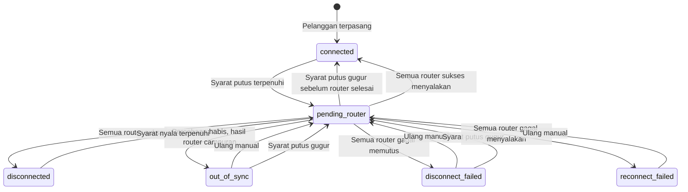

# Spesifikasi Logika Isolir

> Versi: 3.1 | Tanggal: 7 November 2026
> Sistem: pra-bayar
> Mekanisme: IP statis dimasukkan ke address-list Mikrotik. Semua pelanggan memakai IP statis. Kolom `connection_type` hanya catatan teknis dan tidak mengubah cara isolir.

Aturan di dokumen ini mengalahkan diagram atau kalimat lama yang masih memakai `isolir_enabled`, `bypass_until`, `isolir_sementara`, `masa_aktif_hingga`, `prepaid_30hari`, atau `hari_isolir`. Keputusan di `docs/decisions/` mengalahkan dokumen ini. Bila dua keputusan berbeda, nomor yang lebih besar yang dipakai. Identifier berbahasa Inggris. Padanan nama lama ada di `docs/glossary.md`.

## Dua pengaturan

Isolir hanya memutus atau menyalakan layanan. Prorata dan biaya pasang terbit sebagai tagihan `prorata` dan `installation_fee`. Keduanya piutang, tetapi tidak dihitung tunggakan isolir dan tidak mengubah `next_suspension_date`. Diskon dan biaya aktivasi diatur di `docs/cara-kerja.md` sebagai hutang mengendap dan juga tidak dihitung tunggakan. Bulan tanpa tagihan tidak punya kuitansi dan tidak membuka isolir.

Pelanggan baru: `arrears_limit = 2`, `billing_cycle = fixed_date`.

| Pengaturan | Nilai | Arti |
|---|---|---|
| `arrears_limit` | `null`, `1`, `2` | Hanya untuk `fixed_date`. `null` berarti scheduler tidak pernah memutus. `1` memutus pada jatuh tempo tagihan langganan pertama yang belum dibayar. `2` memutus pada jatuh tempo tagihan kedua yang belum dibayar. Bawaan `2`. |
| `billing_cycle` | `fixed_date`, `prepaid` | `fixed_date`: tagihan terbit tiap tanggal 1, isolir dihitung dari jatuh tempo tagihan. `prepaid`: tagihan terbit per periode 30 hari saat dibayar, layanan berlaku sampai `paid_through`. |

`arrears_limit = null` tampil di layar sebagai Tidak pernah. Isolir manual tetap menunggu nyala manual.

## Data masukan dan next_suspension_date

`next_suspension_date` adalah tanggal kalender Asia/Jakarta saat scheduler akan memutus bila tidak ada perubahan. Kolom ini hasil hitung. Pembayaran, penundaan, impor, dan admin tidak menulisnya langsung. Yang mereka ubah adalah data masukan berikut, lalu `CalculateNextSuspensionDate` menulis ulang `next_suspension_date` di transaksi yang sama.

| Masukan | Siklus | Diubah oleh |
|---|---|---|
| `paid_through` | `prepaid` | Instalasi, pembayaran yang membeli periode, pembalikan pembayaran, admin saat pindah ke `prepaid` |
| `suspension_effective_from` | `fixed_date` | Admin Global saat verifikasi, impor, admin saat pindah ke `fixed_date` |
| Tagihan `subscription` penuh beserta `due_date` | `fixed_date` | Generate bulanan, pembayaran, pembatalan dan koreksi tagihan |
| `suspension_deferrals` | keduanya | Toleransi, bypass, perpanjangan satu bulan |
| `customer_status_periods` cuti yang terbuka | keduanya | Mulai dan selesai cuti |
| `arrears_limit`, `billing_cycle`, `installed_at` | keduanya | Admin |

`paid_through` adalah tanggal pertama yang tidak lagi dibayar. Job harian pada tanggal itu memutus. Contoh: bayar 15 September untuk satu periode menghasilkan `paid_through` 15 Oktober. Layanan yang dibayar adalah 15 September sampai 14 Oktober.

`suspension_effective_from` adalah tanggal paling awal scheduler boleh memutus otomatis pelanggan `fixed_date`. Admin Global mengisinya saat verifikasi pelanggan baru. Persetujuan pelanggan `fixed_date` ditolak bila kolom ini kosong. Impor pelanggan lama juga mengisinya, supaya malam pertama setelah migrasi tidak mengisolir massal.

`suspension_deferrals` menyimpan satu baris per penundaan dan tidak menimpa baris lama. Penundaan yang berlaku adalah baris terbaru yang `starts_on`-nya sudah sampai dan `ends_on`-nya belum sampai. Pada tanggal `ends_on`, penundaan tidak berlaku lagi dan job harian boleh memutus.

`CalculateNextSuspensionDate` menghasilkan:

- `null` bila `installed_at` kosong.
- `prepaid`: `max(paid_through, active_deferral.ends_on)`, dengan `active_deferral` adalah penundaan yang berlaku.
- `fixed_date` dengan `arrears_limit = null`, atau `suspension_effective_from` kosong: `null`.
- `fixed_date` lainnya: `max(T, suspension_effective_from, active_deferral.ends_on)`. `T` adalah `due_date` tagihan penuh belum dibayar yang ke-`arrears_limit`, urut `due_date`, yaitu tanggal saat jumlah tunggakan mencapai batas. Bila tagihan seperti itu belum sebanyak batas, `T` adalah proyeksi jatuh tempo periode bulanan mendatang yang akan membuat jumlah mencapai batas, dengan anggapan tidak ada pembayaran.

Selama ada cuti terbuka, `next_suspension_date` tetap dihitung untuk tampilan, tetapi scheduler melewati pelanggan itu.

Fungsi ini dipanggil di transaksi yang sama dengan setiap perubahan masukan: pembayaran, pembalikan dan penolakan bukti, tagihan terbit, dibatalkan, atau diedit, penundaan, cuti mulai dan selesai, perubahan pengaturan, instalasi, dan impor. Job harian menghitung ulang semua pelanggan sebelum memutus. Bila hasilnya berbeda dengan `next_suspension_date` yang tersimpan, job menulis nilai baru dan mengirim alert Telegram internal, karena perbedaan itu berarti ada kejadian yang tidak memanggil fungsi ini.

## Job harian

Pada tanggal 1, urutannya: generate tagihan `fixed_date` dan autopay mulai pukul 00:01, lalu autopay `prepaid`, lalu hitung ulang `next_suspension_date`, lalu evaluasi isolir. Hari lain, urutan yang sama tanpa generate dimulai pukul 00:05. Seluruh rantai memakai `withoutOverlapping()`. Langkah berikutnya baru mulai setelah langkah sebelumnya commit.

Job membandingkan tanggal kalender Jakarta, bukan tanggal UTC.

Evaluasi isolir memilih pelanggan yang `next_suspension_date`-nya sudah sampai. Untuk setiap pelanggan, job mengunci baris pelanggan dengan `lockForUpdate`, menghitung ulang syarat putus, lalu menulis baris antrean router di transaksi yang sama. Pembayaran juga mengunci baris pelanggan. Dengan begitu pembayaran yang commit lebih dulu selalu terbaca, dan pembayaran yang datang kemudian menunggu lalu membatalkan antrean putus lewat `ReconnectService`.

Scheduler melewati pelanggan bila salah satu ini berlaku:

- `installed_at` masih kosong
- ada `customer_status_periods` berjenis `hold` yang `ended_at`-nya masih kosong. Pada saat itu `subscription_status` adalah `on_hold`. Baris isolir yang belum selesai tidak membuat scheduler melewati pelanggan.

Pada tanggal `next_suspension_date` sendiri, job memutus bila syarat terpenuhi. Pembayaran yang masuk kemudian pada hari yang sama tetap diproses dan dapat menyalakan layanan lagi.

## Status langganan dan riwayat

`subscription_status` menjadi `suspended` hanya saat `service_status` menjadi `disconnected`. `pending_router`, `disconnect_failed`, dan `out_of_sync` meninggalkan `subscription_status` pada `active`. Pada saat `disconnected`, `last_suspended_at` dan `last_suspended_note` diisi `suspended`, satu baris `customer_status_periods` berjenis `suspended` dibuat dengan `ended_at` kosong, dan satu baris `disconnections` dibuat. `ended_at` dan `reconnected_at` diisi saat `service_status` menjadi `connected`, bersama `last_activated_at` dan catatannya. `last_suspended_at` dan `last_activated_at` hanya salinan untuk tampilan. Tidak ada rumus yang membacanya.

Cuti membuat satu baris `customer_status_periods` berjenis `hold` saat cuti dimulai. `subscription_status` menjadi `on_hold`. `last_suspended_at` diisi dari `started_at` baris itu. Catatan dapat `cuti sementara` atau teks lain. Permintaan pelanggan dapat menyertakan `conversation_proof`. Cuti tidak menulis `disconnections` dan tidak mengubah `service_status`. Saat cuti berakhir, `ended_at` pada baris yang sama diisi. Bila layanan sedang `disconnected`, `subscription_status` kembali `suspended`. Bila layanan `connected`, `subscription_status` menjadi `active` dan `last_activated_at` diisi dengan catatan `selesai cuti`. Tidak ada kolom `cuti_mulai` atau `cuti_selesai`. Satu pelanggan hanya punya satu baris terbuka per `type`.

## Tiga fungsi

`CalculateNextSuspensionDate` hanya menghitung `next_suspension_date` dan jumlah tunggakan, dan satu-satunya fungsi yang menulis `next_suspension_date`. Fungsi ini tidak menghubungi Mikrotik. Tombol simulasi memanggilnya tanpa menyimpan hasil.

`AllocatePayment` adalah satu-satunya fungsi yang membagi uang ke tagihan. Satu penerimaan uang membuat satu baris `payments` dengan `idempotency_key` unik. `gateway_transaction_id` yang terisi juga unik. Baris `payment_allocations` mencatat nominal per tagihan. Tagihan, pembayaran, dan pelanggan dikunci `lockForUpdate` di transaksi yang sama. Petugas mengisi nominal. Sistem yang membagi.

Urutan pada `fixed_date`:

1. Tagihan `subscription` yang belum lunas, urut `due_date` terlama, lalu `service_starts_on`.
2. Tagihan lain yang masih bersisa (`prorata`, `installation_fee`, `conversion`, `manual`), urut `due_date`.

Sisa uang yang tidak menutup tagihan berikutnya tetap `partial` pada tagihan itu. Kelebihan di atas semua tagihan mengikuti aturan kelebihan bayar di kanal: kembalian atau dompet.

Urutan pada `prepaid`:

1. Tagihan `subscription` yang sudah terbit dan belum lunas, urut `due_date` terlama. Ini tagihan periode pertama saat instalasi dan tagihan lama dari masa `fixed_date`. Melunasinya tidak menambah hari.
2. Sisa uang membeli periode baru. `N` = sisa uang dibagi harga paket untuk lokasi pelanggan, dibulatkan ke bawah. Setiap periode menjadi satu tagihan `subscription` baru, `is_full_period = true`, dan langsung lunas.
3. Sisa uang berikutnya melunasi tagihan lain yang masih bersisa, urut `due_date`.
4. Sisa yang masih ada mengikuti aturan kelebihan bayar di kanal: kembalian atau dompet.

`N` hanya ada pada `prepaid` dan hanya dihitung oleh `AllocatePayment`. Tidak ada pilihan `N` di layar. Pembayaran dengan `N = 0` tidak mengubah `paid_through`.

`DisconnectService` dan `ReconnectService` adalah satu-satunya fungsi yang menulis address-list. Keduanya mencatat hasil per router. Status pelanggan menjadi `disconnected` atau `connected` hanya setelah semua router yang dituju sukses. `ReconnectService` membatalkan baris putus yang belum dijalankan untuk pelanggan dan router yang sama, supaya antrean lama tidak memutus lagi setelah pelanggan bayar.

## Status yang dihitung tunggakan

Bagian ini hanya untuk `fixed_date`. Siklus `prepaid` tidak membaca jumlah tunggakan.

Hanya tagihan `subscription` dengan `is_full_period = true` yang dihitung isolir. `is_full_period` ditetapkan saat tagihan terbit, yaitu bila nominalnya utuh sebesar harga paket untuk lokasi pelanggan pada saat itu. Edit nominal sesudahnya tidak mengubah `is_full_period`. Tagihan `conversion`, `prorata`, `installation_fee`, denda, dan invoice `manual` diperlakukan sama: piutang yang dapat ditagih dan tidak dihitung di `arrears_count`. Saldo mengendap tidak dihitung. Bulan yang tidak diterbitkan tidak dihitung lunas dan tidak menyalakan layanan.

Satu tagihan penuh dihitung tunggakan hanya bila `paid_amount = 0` dan statusnya `unpaid` atau `pending_verification`. Tagihan penuh yang sudah dibayar sebagian tidak dihitung, walaupun `outstanding_amount` masih ada. Status invoice tetap `partial`. Bukti transfer pada mode `not_required` membuat tagihan `paid` dan dapat menyalakan layanan. Pada `prepaid`, periode yang dibeli langsung masuk `N` walaupun tanda bukti masih `unverified`. Mode `required`, tanda pelanggan, atau kolektor level 2 membuat status `pending_verification`, belum membeli periode, dan belum menyalakan layanan.

Tanda `is_irregular_payer` dipasang manual oleh Admin Global, Admin Wilayah, kolektor, atau `finance_auditor`, bukan dihitung dari tagihan. Tanda itu tidak dibaca `CalculateNextSuspensionDate` dan tidak mengubah jadwal isolir. Bila siklusnya masih `fixed_date`, profil menampilkan rekomendasi untuk menjadikannya pelanggan `prepaid`. Rekomendasi tidak mengubah siklus.

## Siklus fixed_date

Tagihan `subscription` terbit tanggal 1. Jatuh tempo bawaan tanggal 11. Bila jatuh tempo melewati akhir bulan, dipakai hari terakhir bulan itu. Isolir terjadi pada jatuh tempo tagihan yang membuat jumlah tunggakan mencapai batas. Tidak ada tanggal isolir terpisah dari jatuh tempo.

```
arrears_count = jumlah invoices subscription dengan is_full_period = true, paid_amount = 0, dan due_date sudah sampai

Jika arrears_limit berisi 1 atau 2 dan hari ini >= next_suspension_date:
    Jika arrears_count >= arrears_limit dan service_status salah satu dari connected, disconnect_failed:
        DisconnectService
Jika arrears_count < arrears_limit dan disconnect_source = scheduler dan service_status bukan connected:
    ReconnectService
```

`arrears_limit = null` membuat scheduler melewati putus otomatis. Bila putus sebelumnya berasal dari scheduler, jalan berikutnya menyalakan layanan. Putus manual tidak ikut terbuka.

Pembayaran tidak menggeser tanggal apa pun. Pembayaran hanya mengubah tagihan, lalu `next_suspension_date` dihitung ulang. Tagihan penuh yang sudah dibayar sebagian tidak menambah `arrears_count`. Contoh tagihan Rp100.000 dibayar Rp50.000 tetap berstatus `partial`, tetapi untuk isolir dianggap tidak menunggak. Petugas dapat memasang tanda `is_irregular_payer` secara manual.

Admin Global dapat mengedit `due_date` tagihan yang belum dibayar sama sekali. Karena `T` dibaca dari `due_date`, edit itu menggeser tanggal putus dan memanggil `CalculateNextSuspensionDate` di transaksi yang sama. Audit menyimpan nilai sebelum dan sesudah beserta alasan. Kolektor tidak mengedit jatuh tempo. Kolektor mengajukan penundaan.

Contoh `arrears_limit = 2`, jatuh tempo tanggal 11. Pelanggan biasa membayar sekitar tanggal 18. November dibayar, Desember ditunda, Januari tidak dibayar.

```
1 Des    tagihan Desember terbit
11 Des   jumlah = 1 (Desember)            < 2, tetap nyala
1 Jan    tagihan Januari terbit
11 Jan   jumlah = 2 (Desember, Januari)   >= 2, putus pukul 00:05
15 Jan   bayar Desember                   jumlah = 1, nyala
11 Feb   jumlah = 2 (Januari, Februari)   putus lagi bila belum ada pembayaran
```

Dengan `arrears_limit = 1`, pelanggan yang sama diputus setiap tanggal 11 dan dinyalakan setiap kali membayar.

Satu tagihan September yang belum dibayar sama sekali memutus pelanggan dengan batas 1, walaupun tagihan bulan ini sudah lunas.

Tombol simulasi hanya pratinjau. Simulasi tidak mengubah `service_status` dan tidak menyimpan `next_suspension_date`.

## Siklus prabayar

Pelanggan `prepaid` tidak mendapat tagihan bulanan tanggal 1. Tagihan `subscription` terbit saat pembayaran membeli periode 30 hari kalender. 30 hari kalender bukan satu bulan: 31 Januari ditambah 30 hari menjadi 2 Maret.

Saat `installed_at` diisi, `paid_through` = `installed_at` + 30 hari. Sistem menerbitkan tagihan `subscription` periode pertama untuk rentang itu, berstatus `unpaid`, dengan jatuh tempo tanggal instalasi. Pembayaran pertama melunasi tagihan ini lebih dulu dan tidak menambah hari.

Saat pembayaran membeli `N` periode:

```
new_paid_through = max(old_paid_through, paid_at) + (N x 30 days) - unpaid_connected_days
```

`unpaid_connected_days` adalah jumlah tanggal mulai dari `old_paid_through` sampai sehari sebelum `paid_at` yang bukan hari putus dan bukan hari cuti. Hari putus adalah tanggal `disconnected_at` sampai sehari sebelum `reconnected_at` pada `disconnections`. Hari `pending_router`, `disconnect_failed`, dan `out_of_sync` dihitung nyala, karena layanan masih berjalan pada sedikitnya satu router. Bila `paid_at` belum melewati `old_paid_through`, nilainya 0.

Periode yang dibeli dimulai dari `new_paid_through - (N x 30 days)` dan berurutan per 30 hari. Setiap periode menjadi satu tagihan dengan `service_starts_on` dan `service_ends_on` itu. Rentang tagihan adalah hari yang dibayar, bukan salinan tanggal nyala yang sebenarnya.

```
Jika hari ini >= next_suspension_date dan service_status salah satu dari connected, disconnect_failed:
    DisconnectService

Jika pembayaran membeli N >= 1, disconnect_source bukan manual, service_status bukan connected, dan next_suspension_date baru sesudah hari ini:
    ReconnectService
```

Contoh:

```
15 September bayar 1 periode saat putus
    paid_through = 15 Oktober
    layanan dinyalakan

10 Oktober bayar 1 periode saat masih nyala
    paid_through = 15 Oktober + 30 = 14 November

14 November, job harian
    hari ini >= 14 November -> putus

20 November bayar 1 periode saat putus
    unpaid_connected_days = 0
    paid_through = 20 November + 30 = 20 Desember
    layanan dinyalakan
```

Autopay `prepaid` berjalan di job harian sebelum evaluasi isolir, untuk pelanggan yang `auto_pay_enabled` dan `next_suspension_date`-nya hari ini. Bila saldo dompet cukup untuk sisa tagihan `subscription` yang terbuka ditambah satu periode, autopay memanggil `AllocatePayment` sebesar jumlah itu. Bila tidak cukup, dompet tidak dipotong.

Penolakan bukti transfer membalik pembayaran itu lewat `reverses_id` dan membatalkan tagihan periode yang dibelinya. `paid_through` dihitung ulang dengan memutar ulang pembayaran sah sesudahnya secara urut, mulai dari `paid_through_before` yang tersimpan pada pembayaran yang ditolak. Tanggal periode pada tagihan pembayaran sesudahnya tidak diubah. Bila `next_suspension_date` baru sudah sampai, job harian berikutnya memutus.

Pelanggan `prepaid` tidak menumpuk tunggakan langganan baru. Yang tetap menjadi piutang adalah tagihan periode pertama yang belum dibayar, tagihan lama dari masa `fixed_date`, serta tagihan `prorata`, `installation_fee`, `conversion`, dan `manual`.

## Banyak Mikrotik

Setiap router pelanggan punya satu baris log. IP selalu diambil dari `customer_router.ip_address`. Perintah ke router idempotent. Nama address-list, misalnya `isolir`, harus sudah dipakai oleh aturan firewall di Mikrotik. Billing menyimpan nama itu di `address_list_name` dan tidak membuat aturan firewall. Entri ditulis tanpa timeout. Hanya billing yang menghapusnya.

## Antrian perintah

Job isolir hanya menulis baris antrian di database, satu baris per pelanggan per Mikrotik, lalu status pelanggan menjadi `pending_router`. Setiap baris menyimpan `disconnect_date`, yaitu tanggal Asia/Jakarta saat baris ditulis. Job itu tidak membuka koneksi API.

Setiap Mikrotik punya satu pekerja. Pekerja router yang berbeda boleh berjalan bersamaan. Pada satu router hanya ada satu koneksi API pada satu waktu. Perintah 1000 pelanggan di router yang sama tidak dibuka sebagai 1000 koneksi.

Pekerja mengambil 50 baris, membuka satu sesi ke IP utama, dan bila sesi itu gagal memakai IP cadangan untuk seluruh 50 baris itu. Entri ditulis di sesi yang sama. Entri yang sudah ada dihitung sukses. Sesi ditutup, lalu jeda 1 detik, lalu 50 baris berikutnya. Baris yang gagal kembali ke antrian dengan jeda 5 menit, paling banyak 10 percobaan termasuk percobaan pertama, tanpa mengulang baris yang sudah sukses.

Setelah 10 percobaan habis, baris itu berstatus gagal dan tidak dicoba lagi oleh jeda 5 menit. Status pelanggan menjadi `disconnect_failed`, `reconnect_failed`, atau `out_of_sync`. Bila kemudian IP utama atau cadangan router itu terpantau menjawab, sistem menjadwalkan satu percobaan ulang otomatis 5 menit setelah pantauan nyala. Percobaan ini di luar hitungan 10. Hanya baris gagal pada router itu yang dijalankan. Bila percobaan ini gagal, percobaan otomatis berikutnya menunggu router terpantau mati lalu nyala lagi. Satu router hanya boleh punya satu jadwal ulang ini. Router yang flapping tidak menambah jadwal baru sebelum jadwal yang ada dijalankan.

Perintah menyalakan layanan dari pembayaran, penundaan, atau admin berprioritas di atas putus massal. Prioritas dicek di antara dua batch, sehingga pembayaran tidak menunggu 1000 pelanggan selesai. Pembayaran hanya menunggu batch 50 yang sedang berjalan.

## Komentar address-list

Komentar setiap entri address-list berbentuk `customer_number` diikuti satu spasi dan nama pelanggan, contoh `CUST-00123 Budi Santoso`. Nomor pelanggan selalu utuh karena itu kunci audit. Nama memakai data terkini. Baris baru dan tanda kutip diganti spasi. Panjang komentar paling banyak 128 karakter. Bila tidak muat, hanya nama yang dipotong. Nomor telepon, alamat, dan NIK tidak ditulis. Bila nama berubah, entri yang sudah ada diperbarui komentarnya, bukan ditambah baru. Bila IP berubah, entri IP lama dihapus dan entri IP baru memakai komentar yang sama.

`service_status` pelanggan diturunkan dari log router yang dituju:

| Kondisi log | `service_status` |
|---|---|
| Masih ada router yang dicoba ulang | `pending_router` |
| Semua router sukses menambah IP | `disconnected` |
| Semua router sukses menghapus IP | `connected` |
| Sebagian router sukses dan percobaan habis | `out_of_sync` |
| Semua router gagal saat memutus dan percobaan habis | `disconnect_failed` |
| Semua router gagal saat menyalakan dan percobaan habis | `reconnect_failed` |

Pelanggan tidak ditandai `disconnected` atau `connected` sebelum semua router yang dituju sukses. Hari `out_of_sync` bukan hari putus, sehingga tidak mengurangi tagihan dan dihitung nyala pada `prepaid`. Sepuluh percobaan berkala hanya untuk router yang gagal. Router yang sudah sukses tidak diubah lagi. Percobaan setelah Mikrotik nyala kembali mengikuti bagian antrian perintah.

## Penundaan isolir

Ada tiga jenis penundaan. Semuanya menulis satu baris `suspension_deferrals` dan tidak mengubah `next_suspension_date` secara langsung.

| `reason` | Diajukan | Disetujui | `ends_on` |
|---|---|---|---|
| `tolerance` | Admin Global atau Admin Wilayah, langsung | Tanpa persetujuan kedua | Tanggal yang diisi admin |
| `tolerance` | Kolektor lewat pengajuan penundaan | Admin Global | Tanggal yang diminta kolektor |
| `bypass` | Admin Wilayah lewat pengajuan penundaan | Admin Global yang bukan pengaju | Tanggal yang diminta |
| `extension` | Kolektor lewat pengajuan perpanjangan satu bulan | Admin Global | 30 hari sejak tanggal setuju |

Penundaan baru menggantikan penundaan lama karena yang berlaku adalah baris terbaru. Baris lama tetap tersimpan sebagai audit. `approved_by` wajib untuk penundaan yang berasal dari pengajuan. Kolektor dan Admin Wilayah hanya mengajukan untuk pelanggan pada dusun di `user_areas`.

Bila pelanggan sedang putus oleh scheduler saat penundaan disetujui, `ReconnectService` dipanggil. Saat semua router sukses, baris `disconnections` yang terbuka ditutup dengan `reconnected_at` dan `reconnect_source` sesuai `reason`. Bila pada tanggal `ends_on` syarat putus masih terpenuhi, job harian memutus lagi dan membuat baris `disconnections` baru. Bila API gagal, penundaan tetap tersimpan dan `service_status` menjadi `pending_router` atau `reconnect_failed`. Layar tidak boleh mengaku layanan sudah nyala sebelum semua router sukses.

Pada `fixed_date`, penundaan hanya menunda tanggal putus. Pembayaran selama penundaan mengurangi `count` seperti biasa.

Pada `prepaid`, hari nyala selama penundaan dibayar oleh pembelian periode berikutnya lewat `unpaid_connected_days`. Contoh: `paid_through` 5 September, putus 5 September. Toleransi disetujui 7 September dengan batas 10 September. Putus lagi 10 September. Hari nyala yang belum dibayar adalah 7, 8, dan 9 September.

```
Bayar 1 periode 9 September    9 Sep + 30 - 2 = 7 Oktober
Bayar 1 periode 20 September   20 Sep + 30 - 3 = 17 Oktober
Bayar 2 periode 20 September   20 Sep + 60 - 3 = 16 November
Bayar 1 periode 8 Oktober      8 Okt + 30 - 3 = 4 November
```

Bila ada toleransi kedua 12 sampai 14 September dan bayar 1 periode 20 September, hari nyala yang belum dibayar adalah 5 hari, sehingga `paid_through` = 15 Oktober. Membayar lebih lambat tidak pernah menghasilkan `paid_through` yang lebih jauh dari membayar lebih cepat dengan `N` yang sama.

## Isolir manual

Admin Global dan Admin Wilayah boleh memutus manual walaupun `arrears_limit` kosong. Aksi ini menulis `disconnect_source = manual` dan wajib berisi keterangan. Modal konfirmasi menampilkan nama pelanggan, IP, dan setiap Mikrotik yang dituju. Pembayaran tidak menghapus putus manual. Pada `prepaid`, pembayaran selama putus manual tetap membeli periode dan memajukan `paid_through`. Yang menyalakan kembali adalah Admin Global, atau penundaan yang sudah disetujui.

## Pindah pengaturan

Pengaturan baru berlaku pada penyimpanan. Perubahan menulis audit, lalu `next_suspension_date` dihitung ulang.

- Ke `prepaid`: admin wajib mengisi `paid_through`. Generate bulanan berhenti untuk pelanggan itu. Tagihan `subscription` yang masih terbuka tetap piutang dan dilunasi lebih dulu oleh pembayaran berikutnya.
- Ke `fixed_date`: admin wajib mengisi `suspension_effective_from`. Hari dari `paid_through` sampai sebelum periode bulanan berikutnya ditagih sebagai `prorata`. Generate bulanan mulai pada periode berikutnya.
- Status yang sedang berjalan tidak dihapus diam-diam. Job harian berikutnya yang memutuskan.

## State



## Data

Tambahan pada `customers`:

| Field | Tipe | Keterangan |
|---|---|---|
| `arrears_limit` | integer atau null | `null`, `1`, atau `2`. Default `2`. Hanya untuk `fixed_date`. |
| `billing_cycle` | string | `fixed_date` atau `prepaid`. Default `fixed_date`. |
| `service_status` | string | `connected`, `pending_router`, `disconnected`, `out_of_sync`, `disconnect_failed`, `reconnect_failed` |
| `disconnect_source` | string atau null | `scheduler` atau `manual`. Null bila layanan nyala. |
| `paid_through` | date atau null | Hanya `prepaid`. Tanggal pertama yang tidak lagi dibayar. |
| `suspension_effective_from` | date atau null | Hanya `fixed_date`. Kosong berarti scheduler tidak memutus otomatis. |
| `next_suspension_date` | date atau null | Hasil `CalculateNextSuspensionDate`. Tidak ditulis oleh fungsi lain. |
| `registered_at` | datetime | Waktu pendaftaran. Terpisah dari `installed_at`. |

`suspension_deferrals` satu baris per penundaan: pelanggan, `reason` (`tolerance`, `bypass`, `extension`), `starts_on`, `ends_on`, `created_by`, `approved_by`, `deferral_request_id` (kosong untuk toleransi langsung), `description`, dan waktu dibuat. Baris tidak diedit setelah disetujui.

`disconnections` satu baris per periode putus nyata seorang pelanggan, bukan per router dan bukan per percobaan. Baris dibuat saat `service_status` menjadi `disconnected` dan ditutup saat menjadi `connected`. `disconnect_source` berisi `scheduler` atau `manual`. `reconnect_source` berisi `scheduler`, `payment`, `admin`, `tolerance`, `bypass`, atau `extension`. `suspension_deferral_id` terisi bila nyala berasal dari penundaan. Hanya boleh ada satu baris terbuka, yaitu yang `reconnected_at`-nya masih kosong. `out_of_sync` dan percobaan gagal tidak membuat baris baru. Cuti tidak menulis tabel ini. Rentang pada tabel ini adalah sumber hari putus untuk `unpaid_connected_days`.

Contoh pelanggan A:

```
disconnected_at 5 November,  reconnected_at 10 November
disconnected_at 5 Desember,  reconnected_at 15 Desember
```

`payments` pelanggan `prepaid` menyimpan `period_count` (`N`), `paid_through_before`, dan `paid_through_after`. Kolom ini dipakai untuk memutar ulang saat pembayaran ditolak.

`router_command_logs` satu baris per percobaan per Mikrotik: siklus saat itu, jumlah tunggakan, salinan `next_suspension_date`, IP yang ditulis, `api_status` (`pending`, `success`, `failed`), dan `attempt_count`.

`deferral_requests` menyimpan pengajuan toleransi, bypass, dan perpanjangan: pelanggan, `reason`, pengaju, tanggal yang diminta, keterangan, status `pending` / `approved` / `rejected`, pemroses, dan alasan tolak. Persetujuan menulis satu baris `suspension_deferrals` yang merujuk pengajuan itu.

## Kasus uji wajib

Unit test `CalculateNextSuspensionDate` dan `AllocatePayment` minimal mencakup:

1. `fixed_date`, batas 2: satu tagihan belum dibayar, `next_suspension_date` adalah proyeksi jatuh tempo bulan berikutnya.
2. `fixed_date`, batas 2: dua tagihan belum dibayar, `next_suspension_date` adalah jatuh tempo tagihan kedua.
3. `fixed_date`, batas 1: tagihan lama belum dibayar dan tagihan bulan ini lunas tetap memutus.
4. `fixed_date`: `suspension_effective_from` lebih lambat dari jatuh tempo menunda putus sampai tanggal itu. `suspension_effective_from` kosong menghasilkan `null`.
5. `fixed_date`: tagihan dibayar sebagian tidak dihitung tunggakan.
6. `prepaid`: instalasi menghasilkan `paid_through` = instalasi + 30 dan satu tagihan periode pertama `unpaid`. Pembayaran pertama melunasi tagihan itu tanpa menambah hari.
7. `prepaid`: bayar saat nyala sebelum `paid_through` menambah tepat `N x 30` dari `paid_through`.
8. `prepaid`: semua baris contoh pada bagian penundaan, termasuk toleransi kedua.
9. `prepaid`: untuk `N` yang sama, `paid_through` tidak pernah lebih jauh bila tanggal bayar lebih lambat.
10. `prepaid`: hari `out_of_sync` dan `disconnect_failed` dihitung nyala. Hari cuti tidak.
11. `prepaid`: uang di bawah harga paket tanpa tagihan terbuka tidak membeli periode.
12. `prepaid`: penolakan bukti pada pembayaran yang bukan terakhir menghasilkan `paid_through` yang sama dengan pemutaran ulang pembayaran sah.
13. Penundaan baru menggantikan penundaan lama. Batas penundaan lebih lambat dari `paid_through` atau `T` menjadi `next_suspension_date`.
14. Pembayaran yang commit saat job harian sedang mengevaluasi pelanggan yang sama tidak berakhir dengan pelanggan lunas yang diputus.
15. Bulan 31 hari dan Februari: jatuh tempo tanggal 31 menjadi hari terakhir bulan, dan 30 hari kalender dihitung lintas bulan.
