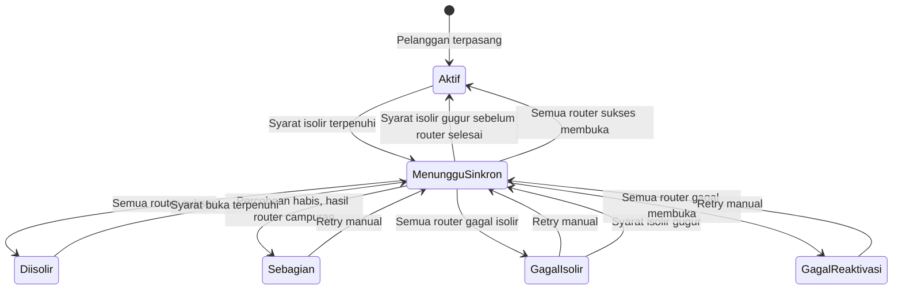

# Spesifikasi Logika Isolir

> Versi: 1.5 | Tanggal: 6 November 2026
> Sistem: pra-bayar
> Mekanisme: IP statis dimasukkan ke address-list Mikrotik. Semua pelanggan memakai IP statis. Kolom `tipe_koneksi` hanya catatan teknis dan tidak mengubah cara isolir.

Aturan di dokumen ini mengalahkan diagram atau kalimat lama yang masih membedakan PPPoE, Hotspot, dan IP sesi.

## Mode

Tidak ada mode bernama `default`. Pelanggan baru dibuat dengan `isolir_enabled = true` dan `mode_isolir = dua_tunggakan`.

| Mode | Kapan scheduler mengisolir | Kapan layanan dibuka lagi |
|---|---|---|
| `jatuh_tempo` | Tanggal hari ini di Asia/Jakarta sudah mencapai jatuh tempo tagihan langganan periode berjalan, dan status tagihan itu `belum_bayar`, `sebagian`, atau `menunggu_verifikasi` | Hanya setelah tagihan periode berjalan itu `lunas` |
| `tidak_isolir` | Tidak pernah | Isolir manual tetap menunggu reaktivasi manual |
| `dua_tunggakan` | Jumlah tagihan langganan yang belum lunas mencapai 2 atau lebih | Jumlah itu turun di bawah 2 |
| `prepaid_30hari` | Tanggal hari ini di Asia/Jakarta sudah mencapai `masa_aktif_hingga` | Pembayaran yang memperpanjang masa aktif, lalu reaktivasi pada saat yang sama |

`isolir_enabled = false` hanya menghentikan isolir otomatis oleh scheduler. Flag ini tidak memblokir isolir manual dan tidak memblokir reaktivasi. Pelanggan yang diisolir scheduler lalu flag-nya dimatikan dievaluasi pada jalan scheduler berikutnya: jika mode tidak lagi menuntut isolir, layanan dibuka.

Scheduler juga melewati pelanggan bila salah satu ini berlaku:

- `tanggal_instalasi` masih kosong
- hari ini masih sebelum `isolir_mulai_evaluasi` (dipakai setelah impor data lama)
- hari ini berada di antara `cuti_mulai` dan `cuti_selesai`, termasuk kedua tanggal itu
- `bypass_until` terisi dan tanggal hari ini di Asia/Jakarta masih sebelum atau sama dengan `bypass_until`

Job harian berjalan pukul 00:05 Asia/Jakarta. Tanggal yang dibandingkan adalah tanggal kalender Jakarta, bukan tanggal UTC.

## Status yang dihitung tunggakan

Hanya tagihan `tipe_invoice = langganan`. Biaya pasang, denda, dan invoice manual lain tidak menambah hitungan `jatuh_tempo` atau `dua_tunggakan` dan tidak memperpanjang `prepaid_30hari`.

Satu tagihan dihitung tunggakan bila statusnya `belum_bayar`, `sebagian`, atau `menunggu_verifikasi`. Status `sebagian` tetap satu tunggakan sampai `sisa = 0`. `menunggu_verifikasi` tetap tunggakan sampai admin menyetujui pembayaran. Unggah bukti tidak membuka isolir.

## jatuh_tempo

```
Jika tanggal hari ini >= jatuh_tempo tagihan langganan periode berjalan
   dan status tagihan itu belum lunas:
     isolir
Jika tagihan periode berjalan menjadi lunas dan pelanggan sedang terisolir oleh mode ini:
     reaktivasi
```

Tagihan periode lain tidak memicu `jatuh_tempo`. Pembayaran sebagian tidak membuka isolir.

Contoh, jatuh tempo tanggal 10:

```
10 Oktober, tagihan Oktober belum lunas -> isolir
15 Oktober, Oktober lunas -> reaktivasi
```

## dua_tunggakan

```
jumlah = jumlah tagihan langganan yang belum lunas

Jika jumlah >= 2 dan pelanggan belum terisolir:
    isolir
Jika jumlah < 2 dan pelanggan terisolir oleh mode ini:
    reaktivasi
```

Membayar satu dari dua tagihan sudah cukup untuk membuka isolir. Dua tagihan `sebagian` tetap dihitung dua.

## prepaid_30hari

`masa_aktif_hingga` adalah tanggal kalender terakhir layanan boleh nyala. Perpanjangan selalu `N x 30` hari kalender, bukan tambah satu bulan. Contoh: 31 Januari ditambah 30 hari menjadi 2 Maret. 15 Februari 2026 ditambah 30 hari menjadi 17 Maret 2026.

```
Jika tanggal hari ini >= masa_aktif_hingga dan pelanggan belum terisolir:
    isolir

Jika pelanggan masih aktif saat bayar:
    masa_aktif_hingga = masa_aktif_hingga + (N x 30 hari)
Jika pelanggan sedang terisolir saat bayar:
    masa_aktif_hingga = tanggal pembayaran (Asia/Jakarta) + (N x 30 hari)
    reaktivasi
```

Pada tanggal `masa_aktif_hingga` itu sendiri, job pukul 00:05 WIB sudah mengisolir. Simulasi lama yang memakai operator `>` salah. Contoh yang berlaku:

```
15 September bayar 1 bulan saat terisolir
    masa_aktif_hingga = 15 Oktober
    reaktivasi

10 Oktober bayar 1 bulan saat masih aktif
    masa_aktif_hingga = 14 November

14 November, job 00:05 WIB
    tanggal hari ini >= 14 November -> isolir

20 November bayar 1 bulan saat terisolir
    masa_aktif_hingga = 20 Desember
    reaktivasi
```

Jika nominal mencakup dua bulan atau lebih, admin atau kolektor memilih:

| Opsi | N | Alokasi uang |
|---|---|---|
| Cicil tunggakan | 1 | Satu bulan memperpanjang masa aktif. Sisa melunasi tagihan langganan terlama. |
| Bayar tagihan rutin | jumlah bulan yang dibayar | Setiap bulan memperpanjang masa aktif dan melunasi satu tagihan terlama. |

Tagihan yang tidak tertutup alokasi tetap menunggak. `prepaid_30hari` tidak mengisolir karena jumlah tunggakan. Saat mode pelanggan nanti diubah ke `dua_tunggakan`, tunggakan yang tersisa langsung dipakai.

## Banyak Mikrotik

Setiap router pelanggan punya satu baris log. IP selalu diambil dari `pelanggan_mikrotik.ip_address`. Perintah ke router idempotent: menambah IP yang sudah ada, atau menghapus IP yang sudah tidak ada, dihitung sukses.

`status_isolir` pelanggan diturunkan dari log router yang dituju:

| Kondisi log | `status_isolir` |
|---|---|
| Masih ada router yang dicoba ulang | `menunggu_sinkron` |
| Semua router sukses menambah IP | `diisolir` |
| Semua router sukses menghapus IP | `aktif` |
| Sebagian router sukses dan percobaan habis | `sebagian` |
| Semua router gagal saat isolir dan percobaan habis | `gagal_isolir` |
| Semua router gagal saat buka dan percobaan habis | `gagal_reaktivasi` |

Pelanggan tidak ditandai `diisolir` atau `aktif` sebelum semua router yang dituju sukses. Selama `menunggu_sinkron` atau `sebagian`, layar admin menunjukkan router mana yang belum sama dengan database.

Percobaan otomatis: 10 kali termasuk percobaan pertama, jeda 5 menit, hanya untuk router yang gagal. Setelah habis, kirim alert ke dashboard, email, dan Telegram. Tombol ulang ada di halaman pelanggan dan di daftar alert. Router yang sudah sukses tidak diubah lagi.

## Isolir manual dan bypass

Admin Global dan Admin Wilayah boleh mengisolir manual walaupun `isolir_enabled = false`. Aksi ini menulis `sumber_isolir = manual` dan wajib berisi keterangan. Modal konfirmasi menampilkan nama pelanggan, IP, dan setiap Mikrotik yang dituju.

Pembayaran tidak menghapus isolir manual. Yang membuka isolir manual adalah reaktivasi oleh Admin Global, atau bypass yang disetujui Admin Global. Pengaju tidak boleh menyetujui permintaannya sendiri.

Bypass menyimpan `bypass_until`, `bypass_approved_by`, dan `bypass_note`. Selama tanggal hari ini masih sebelum atau sama dengan `bypass_until`, scheduler tidak mengisolir. Besoknya mode berjalan normal. Jika API gagal saat bypass disetujui, status permintaan tetap `disetujui` dan `status_isolir` menjadi `menunggu_sinkron` atau `gagal_reaktivasi`. Layar tidak boleh mengaku layanan sudah nyala sebelum semua router sukses.

## Pindah mode

Mode baru berlaku pada penyimpanan. Perubahan menulis audit: mode lama, mode baru, tanggal lama, tanggal baru, dan pelaku.

- Ke `prepaid_30hari`: admin wajib mengisi `masa_aktif_hingga`. `next_isolir_at` dihitung ulang.
- Keluar dari `prepaid_30hari`: `masa_aktif_hingga` dikosongkan. `next_isolir_at` dihitung dari mode baru dan tagihan yang ada.
- Status isolir yang sedang berjalan tidak dihapus diam-diam. Scheduler berikutnya membuka atau mempertahankan isolir sesuai mode baru.

## State



## Data

Tambahan pada `pelanggan`:

| Field | Tipe | Keterangan |
|---|---|---|
| `mode_isolir` | string | `jatuh_tempo`, `tidak_isolir`, `dua_tunggakan`, `prepaid_30hari` |
| `isolir_enabled` | boolean | Default true. Hanya mengatur scheduler. |
| `status_isolir` | string | `aktif`, `menunggu_sinkron`, `diisolir`, `sebagian`, `gagal_isolir`, `gagal_reaktivasi` |
| `sumber_isolir` | string atau null | `scheduler` atau `manual`. Null bila tidak terisolir. |
| `masa_aktif_hingga` | date atau null | Dipakai `prepaid_30hari` |
| `isolir_mulai_evaluasi` | date atau null | Scheduler mengabaikan pelanggan sebelum tanggal ini |
| `bypass_until` | date atau null | Termasuk tanggal ini, scheduler tidak mengisolir |
| `bypass_approved_by` | bigint atau null | User Admin Global yang menyetujui |
| `bypass_note` | text atau null | Alasan bypass |
| `next_isolir_at` | date atau null | Proyeksi untuk layar admin, bukan pemicu job |

`log_isolir` satu baris per percobaan per Mikrotik: mode saat itu, jumlah tunggakan, salinan masa aktif, `status_api` (`pending`, `sukses`, `gagal`), dan `retry_count`.

`bypass_requests`: pelanggan, pengaju, `bypass_until`, keterangan, status `menunggu` / `disetujui` / `ditolak`, pemroses, waktu proses, dan alasan tolak.
