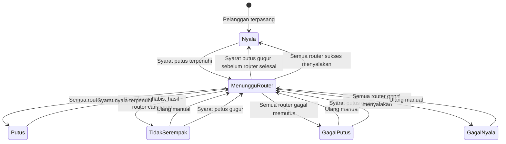

# Spesifikasi Logika Isolir

> Versi: 2.12 | Tanggal: 7 November 2026
> Sistem: pra-bayar
> Mekanisme: IP statis dimasukkan ke address-list Mikrotik. Semua pelanggan memakai IP statis. Kolom `tipe_koneksi` hanya catatan teknis dan tidak mengubah cara isolir.

Aturan di dokumen ini mengalahkan diagram atau kalimat lama yang masih memakai `isolir_enabled`, `bypass_until`, `isolir_sementara`, `masa_aktif_hingga`, atau `prepaid_30hari`.

## Dua pengaturan

Isolir hanya memutus atau menyalakan layanan. Prorata, diskon, biaya aktivasi, dan prorata aktivasi prabayar diatur di `docs/cara-kerja.md` sebagai hutang mengendap. Jumlah itu tidak dihitung sebagai tunggakan. Tagihan langganan yang dihitung isolir adalah periode penuh. Bulan tanpa tagihan tidak punya kuitansi dan tidak membuka isolir.

Pelanggan baru: `batas_tunggakan = 2`, `siklus_tagihan = tanggal_tetap`.

| Pengaturan | Nilai | Arti |
|---|---|---|
| `batas_tunggakan` | `null`, `1`, `2` | `null` berarti scheduler tidak pernah memutus. `1` memutus bila ada satu tagihan langganan lewat jatuh tempo. `2` adalah bawaan. |
| `siklus_tagihan` | `tanggal_tetap`, `prabayar` | `tanggal_tetap` tidak menggeser `hari_isolir`. `prabayar` mengisi `isolir_berikutnya` dari tanggal bayar ditambah 30 hari, kecuali pembayaran terjadi selama penundaan toleransi. |

`batas_tunggakan = null` tampil di layar sebagai Tidak pernah. Isolir manual tetap menunggu nyala manual.

Scheduler hanya memutus bila tanggal hari ini di Asia/Jakarta sudah mencapai `isolir_berikutnya` dan syarat siklus terpenuhi. `hari_isolir` adalah angka 1 sampai 31 yang dipakai untuk menghitung tanggal itu. Bila bulan tujuan lebih pendek, dipakai hari terakhir bulan itu. `isolir_berikutnya` adalah satu-satunya tanggal putus yang dibaca scheduler.

Scheduler melewati pelanggan bila salah satu ini berlaku:

- `tanggal_instalasi` masih kosong
- hari ini masih sebelum `isolir_mulai_evaluasi`
- hari ini berada di dalam cuti, termasuk `cuti_mulai` dan `cuti_selesai`
- `isolir_ditunda_hingga` terisi dan hari ini masih sebelum tanggal itu

Pada tanggal `isolir_ditunda_hingga` sendiri, job pukul 00:05 mengisolir bila pembayaran yang membatalkan penundaan belum tercatat. Pembayaran yang masuk kemudian pada hari yang sama tetap diproses dan dapat menyalakan layanan lagi.

Pada tanggal 1, generate tagihan dan autopay dompet mulai pukul 00:01 Asia/Jakarta dengan `withoutOverlapping()`. Job isolir tanggal 1 dimulai oleh job itu setelah autopay terakhir commit. Job isolir tidak memakai jam 00:05 pada tanggal 1. Hari lain, job isolir berjalan pukul 00:05 dengan `withoutOverlapping()`. Autopay yang membuat tagihan lunas selesai sebelum antrean putus ditulis.

Job isolir membandingkan tanggal kalender Jakarta, bukan tanggal UTC.

## Tiga fungsi

`hitung_isolir_berikutnya` hanya menghitung tanggal dan jumlah tunggakan. Pembayaran, cuti, toleransi, bypass, dan tombol simulasi memanggil fungsi ini. Fungsi ini tidak menghubungi Mikrotik.

`alokasi_pembayaran` adalah satu-satunya fungsi yang membagi uang ke tagihan. Satu penerimaan uang membuat satu baris `PEMBAYARAN` dengan `idempotency_key` unik. `gateway_transaction_id` yang terisi juga unik. Baris `ALOKASI_PEMBAYARAN` mencatat nominal per tagihan. Uang melunasi tagihan `langganan` yang belum lunas, urut `jatuh_tempo` terlama, lalu `layanan_mulai`. Sisa uang yang tidak menutup tagihan berikutnya tetap `sebagian` pada tagihan itu. `N` adalah jumlah tagihan langganan yang menjadi `lunas` oleh pembayaran ini. Tidak ada pilihan `N` di layar. Pembayaran yang tidak membuat satu tagihan pun lunas tidak menggeser `isolir_berikutnya` dan tidak menghapus penundaan toleransi. Tagihan, pembayaran, dan pelanggan dikunci `lockForUpdate` di transaksi yang sama.

`putuskan_layanan` dan `nyalakan_layanan` adalah satu-satunya fungsi yang menulis address-list. Keduanya mencatat hasil per router. Status pelanggan menjadi `putus` atau `nyala` hanya setelah semua router yang dituju sukses. `nyalakan_layanan` membatalkan baris putus yang belum dijalankan untuk pelanggan dan router yang sama, supaya antrean lama tidak memutus lagi setelah pelanggan bayar.

## Status yang dihitung tunggakan

Hanya tagihan `tipe_tagihan = langganan` yang tanggal jatuh temponya sudah sampai. Biaya pasang, denda, invoice manual, dan hutang mengendap tidak dihitung dan tidak memperpanjang siklus `prabayar`. Bulan yang tidak diterbitkan tidak dihitung lunas dan tidak menyalakan layanan.

Satu tagihan dihitung tunggakan bila statusnya `belum_bayar`, `sebagian`, atau `menunggu_verifikasi`. Status `sebagian` tetap satu tunggakan sampai `sisa = 0`. Unggah bukti tidak menyalakan layanan.

## Siklus tanggal_tetap

`batas_tunggakan = null` membuat scheduler melewati putus otomatis. Bila putus sebelumnya berasal dari scheduler, jalan berikutnya menyalakan layanan. Putus manual tidak ikut terbuka.

```
jumlah = jumlah tagihan langganan yang belum lunas dan jatuh temponya sudah sampai

Jika batas_tunggakan berisi 1 atau 2 dan hari ini >= isolir_berikutnya:
    Jika jumlah >= batas dan status_layanan salah satu dari nyala, gagal_putus:
        putuskan_layanan
    Jika jumlah < batas dan sumber_putus = scheduler dan status_layanan bukan nyala:
        nyalakan_layanan
```

Tagihan lama ikut dihitung. Satu tagihan September yang lewat jatuh tempo memutus pelanggan dengan batas 1, walaupun tagihan bulan ini sudah lunas. Pada batas 2, membayar satu dari dua tagihan sudah cukup untuk menyalakan layanan. `hari_isolir` tidak bergeser.

Tombol simulasi hanya pratinjau. Simulasi tidak mengubah `status_layanan` dan tidak menyimpan `isolir_berikutnya`.

## Siklus prabayar

Di luar penundaan toleransi, perpanjangan adalah `N x 30` hari kalender, bukan tambah satu bulan. Contoh: 31 Januari ditambah 30 hari menjadi 2 Maret. 15 Februari 2026 ditambah 30 hari menjadi 17 Maret 2026.

```
Jika hari ini >= isolir_berikutnya dan pelanggan belum putus:
    putuskan_layanan

Jika pelanggan masih nyala saat bayar dan N >= 1:
    isolir_berikutnya = isolir_berikutnya + (N x 30 hari)
Jika N >= 1 dan sumber_putus bukan manual dan status_layanan salah satu dari putus, tidak_serempak, gagal_putus, gagal_nyala, menunggu_router dan tidak sedang ditunda:
    isolir_berikutnya = tanggal pembayaran + (N x 30 hari)
    nyalakan_layanan
```

Pada tanggal `isolir_berikutnya` itu sendiri, job pukul 00:05 WIB sudah memutus. Contoh:

```
15 September bayar 1 bulan saat putus
    isolir_berikutnya = 15 Oktober
    layanan dinyalakan

10 Oktober bayar 1 bulan saat masih nyala
    isolir_berikutnya = 14 November

14 November, job 00:05 WIB
    hari ini >= 14 November -> putus

20 November bayar 1 bulan saat putus
    isolir_berikutnya = 20 Desember
    layanan dinyalakan
```

`N` hanya dihitung oleh `alokasi_pembayaran`. Sisa tagihan yang belum lunas tetap menunggak. `batas_tunggakan` tidak dibaca selama siklus ini. Bila siklus dikembalikan ke `tanggal_tetap`, tunggakan yang tersisa langsung dipakai.

Pembayaran selama penundaan beralasan `toleransi` tidak memakai rumus 30 hari. `isolir_berikutnya` diisi tanggal `hari_isolir` berikutnya.

## Banyak Mikrotik

Setiap router pelanggan punya satu baris log. IP selalu diambil dari `pelanggan_mikrotik.ip_address`. Perintah ke router idempotent. Nama address-list, misalnya `isolir`, harus sudah dipakai oleh aturan firewall di Mikrotik. Billing menyimpan nama itu di `nama_address_list` dan tidak membuat aturan firewall. Entri ditulis tanpa timeout. Hanya billing yang menghapusnya.

## Antrian perintah

Job isolir hanya menulis baris antrian di database, satu baris per pelanggan per Mikrotik, lalu status pelanggan menjadi `menunggu_router`. Setiap baris menyimpan `hari_mulai_putus`, yaitu tanggal Asia/Jakarta saat baris ditulis. Job itu tidak membuka koneksi API.

Setiap Mikrotik punya satu pekerja. Pekerja router yang berbeda boleh berjalan bersamaan. Pada satu router hanya ada satu koneksi API pada satu waktu. Perintah 1000 pelanggan di router yang sama tidak dibuka sebagai 1000 koneksi.

Pekerja mengambil 50 baris, membuka satu sesi ke IP utama, dan bila sesi itu gagal memakai IP cadangan untuk seluruh 50 baris itu. Entri ditulis di sesi yang sama. Entri yang sudah ada dihitung sukses. Sesi ditutup, lalu jeda 1 detik, lalu 50 baris berikutnya. Baris yang gagal kembali ke antrian dengan jeda 5 menit, paling banyak 10 percobaan termasuk percobaan pertama, tanpa mengulang baris yang sudah sukses.

Setelah 10 percobaan habis, baris itu berstatus gagal dan tidak dicoba lagi oleh jeda 5 menit. Status pelanggan menjadi `gagal_putus`, `gagal_nyala`, atau `tidak_serempak`. Bila kemudian IP utama atau cadangan router itu terpantau menjawab, sistem menjadwalkan satu percobaan ulang otomatis 5 menit setelah pantauan nyala. Percobaan ini di luar hitungan 10. Hanya baris gagal pada router itu yang dijalankan. Bila percobaan ini gagal, percobaan otomatis berikutnya menunggu router terpantau mati lalu nyala lagi. Satu router hanya boleh punya satu jadwal ulang ini. Router yang flapping tidak menambah jadwal baru sebelum jadwal yang ada dijalankan.

Perintah menyalakan layanan dari pembayaran atau admin berprioritas di atas putus massal. Prioritas dicek di antara dua batch, sehingga pembayaran tidak menunggu 1000 pelanggan selesai. Pembayaran hanya menunggu batch 50 yang sedang berjalan.

## Komentar address-list

Komentar setiap entri address-list berbentuk `no_pelanggan` diikuti satu spasi dan nama pelanggan, contoh `CUST-00123 Budi Santoso`. Nomor pelanggan selalu utuh karena itu kunci audit. Nama memakai data terkini. Baris baru dan tanda kutip diganti spasi. Panjang komentar paling banyak 128 karakter. Bila tidak muat, hanya nama yang dipotong. Nomor telepon, alamat, dan NIK tidak ditulis. Bila nama berubah, entri yang sudah ada diperbarui komentarnya, bukan ditambah baru. Bila IP berubah, entri IP lama dihapus dan entri IP baru memakai komentar yang sama.

`status_layanan` pelanggan diturunkan dari log router yang dituju:

| Kondisi log | `status_layanan` |
|---|---|
| Masih ada router yang dicoba ulang | `menunggu_router` |
| Semua router sukses menambah IP | `putus` |
| Semua router sukses menghapus IP | `nyala` |
| Sebagian router sukses dan percobaan habis | `tidak_serempak` |
| Semua router gagal saat memutus dan percobaan habis | `gagal_putus` |
| Semua router gagal saat menyalakan dan percobaan habis | `gagal_nyala` |

Pelanggan tidak ditandai `putus` atau `nyala` sebelum semua router yang dituju sukses. Hari `tidak_serempak` bukan hari putus, sehingga tidak mengurangi tagihan. Sepuluh percobaan berkala hanya untuk router yang gagal. Router yang sudah sukses tidak diubah lagi. Percobaan setelah Mikrotik nyala kembali mengikuti bagian antrian perintah.

## Penundaan isolir

`isolir_ditunda_hingga` adalah satu-satunya tanggal penundaan. `alasan_penundaan` berisi `toleransi` atau `bypass`. Penundaan baru menggantikan penundaan lama, dan audit menyimpan keduanya.

Toleransi dipakai saat pelanggan sudah `putus`. Admin mengisi jumlah hari dan keterangan, tanpa persetujuan kedua.

- `isolir_ditunda_hingga` = tanggal isolir terakhir ditambah jumlah hari kalender
- `nyalakan_layanan` dipanggil
- `hari_isolir` tidak diubah

Contoh: isolir terakhir 5 November, toleransi 5 hari. `isolir_ditunda_hingga` menjadi 10 November. 28 November ditambah 5 hari menjadi 3 Desember.

Bila pelanggan membayar 1 bulan pada atau sebelum tanggal itu, penundaan dihapus. `isolir_berikutnya` menjadi tanggal `hari_isolir` yang pertama sesudah tanggal bayar. Pembayaran 10 November dengan `hari_isolir` 5 menghasilkan 5 Desember, bukan 10 Desember dan bukan 10 November ditambah 30 hari. Dua bulan memajukan dua tanggal `hari_isolir`. Pembayaran pada tanggal 5 sendiri memajukan ke tanggal 5 bulan berikutnya. Aturan ini berlaku untuk semua batas dan kedua siklus. Sisa tagihan yang belum tertutup tetap tersimpan. Sesudah `isolir_berikutnya`, batas dan siklus berjalan seperti biasa.

Bypass diajukan Admin Wilayah dan disetujui Admin Global. Pengaju tidak boleh menyetujui permintaannya sendiri. Bila disetujui, `isolir_ditunda_hingga` diisi tanggal yang diminta dan `alasan_penundaan = bypass`, lalu `nyalakan_layanan` dipanggil bila pelanggan sedang putus. Bila API gagal, permintaan tetap `disetujui` dan `status_layanan` menjadi `menunggu_router` atau `gagal_nyala`. Layar tidak boleh mengaku layanan sudah nyala sebelum semua router sukses.

## Isolir manual

Admin Global dan Admin Wilayah boleh memutus manual walaupun `batas_tunggakan` kosong. Aksi ini menulis `sumber_putus = manual` dan wajib berisi keterangan. Modal konfirmasi menampilkan nama pelanggan, IP, dan setiap Mikrotik yang dituju. Pembayaran tidak menghapus putus manual. Yang menyalakan kembali adalah Admin Global, atau penundaan yang sudah disetujui.

## Pindah pengaturan

Pengaturan baru berlaku pada penyimpanan. Perubahan menulis audit.

- Ke `prabayar`: admin wajib mengisi `isolir_berikutnya`.
- Kembali ke `tanggal_tetap`: `isolir_berikutnya` dihitung dari `hari_isolir` dan tagihan yang ada.
- Status yang sedang berjalan tidak dihapus diam-diam. Scheduler berikutnya yang memutuskan.

## State



## Data

Tambahan pada `pelanggan`:

| Field | Tipe | Keterangan |
|---|---|---|
| `batas_tunggakan` | integer atau null | `null`, `1`, atau `2`. Default `2`. Hanya untuk `tanggal_tetap`. |
| `siklus_tagihan` | string | `tanggal_tetap` atau `prabayar`. Default `tanggal_tetap`. |
| `status_layanan` | string | `nyala`, `menunggu_router`, `putus`, `tidak_serempak`, `gagal_putus`, `gagal_nyala` |
| `sumber_putus` | string atau null | `scheduler` atau `manual`. Null bila layanan nyala. |
| `hari_isolir` | integer | Tanggal tetap, 1 sampai 31. Bulan yang lebih pendek memakai hari terakhir. |
| `isolir_berikutnya` | date atau null | Satu-satunya tanggal yang dibaca scheduler. |
| `isolir_ditunda_hingga` | date atau null | Sebelum tanggal ini scheduler tidak memutus. Pada tanggal ini job 00:05 boleh memutus. |
| `alasan_penundaan` | string atau null | `toleransi` atau `bypass`. |
| `penundaan_catatan` | text atau null | Keterangan toleransi atau bypass. |
| `penundaan_disetujui_oleh` | bigint atau null | Wajib bila alasan `bypass`. |
| `isolir_mulai_evaluasi` | date atau null | Scheduler mengabaikan pelanggan sebelum tanggal ini. |
| `tanggal_daftar` | datetime | Waktu pendaftaran. Terpisah dari `tanggal_instalasi`. |

`log_api_mikrotik` satu baris per percobaan per Mikrotik: siklus saat itu, jumlah tunggakan, salinan `isolir_berikutnya`, IP yang ditulis, `status_api` (`pending`, `sukses`, `gagal`), dan `jumlah_percobaan`.

`riwayat_isolir` satu baris per periode putus seorang pelanggan, bukan per router dan bukan per percobaan. Baris dibuat saat `status_layanan` menjadi `putus`. `nyala_kembali` tetap kosong sampai semua router berhasil menyala. `tidak_serempak` dan percobaan gagal tidak membuat baris baru. Hanya boleh ada satu baris terbuka, yaitu yang `nyala_kembali`-nya masih kosong. `sumber_putus` berisi `scheduler` atau `manual`. `sumber_nyala` berisi `scheduler`, `pembayaran`, atau `admin`.

Contoh pelanggan A:

```
mulai_putus 5 November,  nyala_kembali 10 November
mulai_putus 5 Desember,  nyala_kembali 15 Desember
```

Permintaan bypass menyimpan pelanggan, pengaju, tanggal yang diminta, keterangan, status `menunggu` / `disetujui` / `ditolak`, pemroses, dan alasan tolak. Tanggal yang disetujui disalin ke `isolir_ditunda_hingga`.
