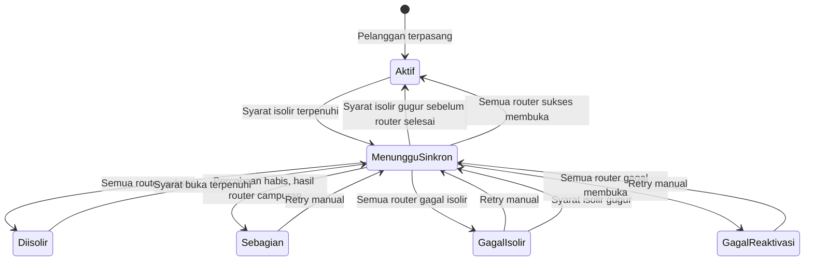

# Spesifikasi Logika Isolir

> Versi: 2.0 | Tanggal: 6 November 2026
> Sistem: pra-bayar
> Mekanisme: IP statis dimasukkan ke address-list Mikrotik. Semua pelanggan memakai IP statis. Kolom `tipe_koneksi` hanya catatan teknis dan tidak mengubah cara isolir.

Aturan di dokumen ini mengalahkan diagram atau kalimat lama yang masih membedakan PPPoE, Hotspot, dan IP sesi.

## Dua pengaturan

Isolir hanya memutus atau menyalakan layanan. Prorata, diskon, bulan tanpa tagihan, dan kuitansi diatur di `docs/cara-kerja.md`.

Pelanggan baru: `isolir_enabled = true`, `batas_tunggakan = 2`, `siklus_tagihan = tetap`.

| Pengaturan | Nilai | Arti |
|---|---|---|
| `batas_tunggakan` | `null`, `1`, `2` | `null` berarti tidak pernah diisolir scheduler. `1` memutus bila ada satu tagihan langganan lewat jatuh tempo. `2` adalah bawaan. |
| `siklus_tagihan` | `tetap`, `prepaid_30hari` | `tetap` tidak menggeser tanggal jatuh tempo. `prepaid_30hari` menggeser isolir berikutnya dari tanggal bayar ditambah 30 hari. |

`batas_tunggakan = null` tampil di layar sebagai Tidak pernah. Isolir manual tetap menunggu reaktivasi manual.

`isolir_enabled = false` hanya menghentikan isolir otomatis oleh scheduler. Flag ini tidak memblokir isolir manual dan tidak memblokir reaktivasi. Pelanggan yang diisolir scheduler lalu flag-nya dimatikan dievaluasi pada jalan scheduler berikutnya: jika mode tidak lagi menuntut isolir, layanan dibuka.

Scheduler juga melewati pelanggan bila salah satu ini berlaku:

- `tanggal_instalasi` masih kosong
- hari ini masih sebelum `isolir_mulai_evaluasi` (dipakai setelah impor data lama)
- hari ini berada di antara `cuti_mulai` dan `cuti_selesai`, termasuk kedua tanggal itu. Cuti memotong tagihan periode berjalan menjadi prorata dan, saat aktif kembali di tengah bulan, menambah satu tagihan prorata baru. Kedua tagihan itu tetap dihitung tunggakan. Aturan pemecahannya ada di `docs/cara-kerja.md`.
- `bypass_until` terisi dan tanggal hari ini di Asia/Jakarta masih sebelum atau sama dengan `bypass_until`

Job harian berjalan pukul 00:05 Asia/Jakarta. Tanggal yang dibandingkan adalah tanggal kalender Jakarta, bukan tanggal UTC.

## Status yang dihitung tunggakan

Hanya tagihan `tipe_invoice = langganan` yang tanggal jatuh temponya sudah sampai. Biaya pasang, denda, dan invoice manual tidak dihitung dan tidak memperpanjang `prepaid_30hari`. Bulan yang tidak diterbitkan tidak dihitung lunas dan tidak membuka isolir.

Satu tagihan dihitung tunggakan bila statusnya `belum_bayar`, `sebagian`, atau `menunggu_verifikasi`. Status `sebagian` tetap satu tunggakan sampai `sisa = 0`. `menunggu_verifikasi` tetap tunggakan sampai admin menyetujui pembayaran. Unggah bukti tidak membuka isolir.

## Siklus tetap

`batas_tunggakan = null` membuat scheduler melewati isolir otomatis. Bila isolir sebelumnya berasal dari scheduler, jalan berikutnya membuka layanan. Isolir manual tidak ikut terbuka.

```
jumlah = jumlah tagihan langganan yang belum lunas dan jatuh temponya sudah sampai

Jika batas_tunggakan berisi 1 atau 2:
    Jika jumlah >= batas dan pelanggan belum terisolir:
        isolir
    Jika jumlah < batas dan pelanggan terisolir oleh scheduler:
        reaktivasi
```

Tagihan lama ikut dihitung. Satu tagihan September yang lewat jatuh tempo memutus pelanggan dengan batas 1, walaupun tagihan bulan ini sudah lunas. Pada batas 2, membayar satu dari dua tagihan sudah cukup untuk membuka isolir. Tanggal jatuh tempo tidak bergeser.

`diskon_selama_isolir` hanya untuk siklus `tetap`. Default-nya mati. Bila menyala, hari tanpa layanan karena isolir mengurangi nominal tagihan langganan yang menaungi hari itu. Rumusnya sama dengan prorata. Hasilnya satu baris `diskon_isolir`, dihitung ulang, bukan ditambah berulang.

Hari diskon adalah tanggal `status_isolir = diisolir` sepanjang hari itu, termasuk hari isolir mulai. Hari reaktivasi tidak dihitung. Hari yang sudah dikeluarkan karena cuti tidak didiskon lagi. Nominal tidak turun di bawah nol. Kelebihan pembayaran masuk dompet. Diskon tidak memindahkan tanggal jatuh tempo.

Contoh, batas 1, jatuh tempo tanggal 10, harga Rp150.000, Oktober 31 hari, diskon menyala:

```
10 Oktober, satu tagihan lewat jatuh tempo -> isolir
15 Oktober, tagihan lunas -> reaktivasi
Hari diskon = 10-14 Oktober (5 hari)
Diskon = 150.000 x 5 / 31 = Rp24.194
Tagihan Oktober menjadi Rp125.806
Jatuh tempo November tetap tanggal 10
```

Tombol simulasi di halaman admin hanya pratinjau. Simulasi tidak mengubah `status_isolir` dan tidak menyimpan `masa_aktif_hingga`.

## prepaid_30hari

`masa_aktif_hingga` adalah tanggal kalender terakhir layanan boleh nyala. Perpanjangan selalu `N x 30` hari kalender, bukan tambah satu bulan. Contoh: 31 Januari ditambah 30 hari menjadi 2 Maret. 15 Februari 2026 ditambah 30 hari menjadi 17 Maret 2026.

```
Jika tanggal hari ini >= masa_aktif_hingga dan pelanggan belum terisolir:
    isolir

Jika pelanggan masih aktif saat bayar:
    masa_aktif_hingga = masa_aktif_hingga + (N x 30 hari)
Jika pelanggan sedang terisolir saat bayar:
    masa_aktif_hingga = tanggal pembayaran (Asia/Jakarta) + (N x 30 hari)
    reaktivasi
```

Pada tanggal `masa_aktif_hingga` itu sendiri, job pukul 00:05 WIB sudah mengisolir. Simulasi lama yang memakai operator `>` salah. Contoh yang berlaku:

```
15 September bayar 1 bulan saat terisolir
    masa_aktif_hingga = 15 Oktober
    reaktivasi

10 Oktober bayar 1 bulan saat masih aktif
    masa_aktif_hingga = 14 November

14 November, job 00:05 WIB
    tanggal hari ini >= 14 November -> isolir

20 November bayar 1 bulan saat terisolir
    masa_aktif_hingga = 20 Desember
    reaktivasi
```

Jika nominal mencakup dua bulan atau lebih, admin atau kolektor memilih:

| Opsi | N | Alokasi uang |
|---|---|---|
| Cicil tunggakan | 1 | Satu bulan memperpanjang masa aktif. Sisa melunasi tagihan langganan terlama. |
| Bayar tagihan rutin | jumlah bulan yang dibayar | Setiap bulan memperpanjang masa aktif dan melunasi satu tagihan terlama. |

Tagihan yang tidak tertutup alokasi tetap menunggak. `prepaid_30hari` tidak mengisolir karena jumlah tunggakan. `batas_tunggakan` tidak dibaca selama siklus ini. Bila siklus dikembalikan ke `tetap`, tunggakan yang tersisa langsung dipakai.

## Banyak Mikrotik

Setiap router pelanggan punya satu baris log. IP selalu diambil dari `pelanggan_mikrotik.ip_address`. Perintah ke router idempotent: menambah IP yang sudah ada, atau menghapus IP yang sudah tidak ada, dihitung sukses.

`status_isolir` pelanggan diturunkan dari log router yang dituju:

| Kondisi log | `status_isolir` |
|---|---|
| Masih ada router yang dicoba ulang | `menunggu_sinkron` |
| Semua router sukses menambah IP | `diisolir` |
| Semua router sukses menghapus IP | `aktif` |
| Sebagian router sukses dan percobaan habis | `sebagian` |
| Semua router gagal saat isolir dan percobaan habis | `gagal_isolir` |
| Semua router gagal saat buka dan percobaan habis | `gagal_reaktivasi` |

Pelanggan tidak ditandai `diisolir` atau `aktif` sebelum semua router yang dituju sukses. Selama `menunggu_sinkron` atau `sebagian`, layar admin menunjukkan router mana yang belum sama dengan database.

Percobaan otomatis: 10 kali termasuk percobaan pertama, jeda 5 menit, hanya untuk router yang gagal. Setelah habis, kirim alert ke dashboard, email, dan Telegram. Tombol ulang ada di halaman pelanggan dan di daftar alert. Router yang sudah sukses tidak diubah lagi.

## Isolir manual dan bypass

Admin Global dan Admin Wilayah boleh mengisolir manual walaupun `isolir_enabled = false`. Aksi ini menulis `sumber_isolir = manual` dan wajib berisi keterangan. Modal konfirmasi menampilkan nama pelanggan, IP, dan setiap Mikrotik yang dituju.

Pembayaran tidak menghapus isolir manual. Yang membuka isolir manual adalah reaktivasi oleh Admin Global, atau bypass yang disetujui Admin Global. Pengaju tidak boleh menyetujui permintaannya sendiri.

Bypass menyimpan `bypass_until`, `bypass_approved_by`, dan `bypass_note`. Selama tanggal hari ini masih sebelum atau sama dengan `bypass_until`, scheduler tidak mengisolir. Besoknya mode berjalan normal. Jika API gagal saat bypass disetujui, status permintaan tetap `disetujui` dan `status_isolir` menjadi `menunggu_sinkron` atau `gagal_reaktivasi`. Layar tidak boleh mengaku layanan sudah nyala sebelum semua router sukses.

## Pindah pengaturan

Pengaturan baru berlaku pada penyimpanan. Perubahan menulis audit: nilai lama, nilai baru, dan pelaku.

- Ke `prepaid_30hari`: admin wajib mengisi `masa_aktif_hingga`. `next_isolir_at` dihitung ulang. `diskon_selama_isolir` tidak dipakai.
- Kembali ke `tetap`: `masa_aktif_hingga` dikosongkan. `next_isolir_at` dihitung dari `batas_tunggakan` dan tagihan yang ada.
- Status isolir yang sedang berjalan tidak dihapus diam-diam. Scheduler berikutnya membuka atau mempertahankan isolir sesuai pengaturan baru.

## State



## Data

Tambahan pada `pelanggan`:

| Field | Tipe | Keterangan |
|---|---|---|
| `batas_tunggakan` | integer atau null | `null`, `1`, atau `2`. Default `2`. Hanya untuk siklus `tetap`. |
| `siklus_tagihan` | string | `tetap` atau `prepaid_30hari`. Default `tetap`. |
| `isolir_enabled` | boolean | Default true. Hanya menahan scheduler sementara, tanpa mengubah batas. |
| `status_isolir` | string | `aktif`, `menunggu_sinkron`, `diisolir`, `sebagian`, `gagal_isolir`, `gagal_reaktivasi` |
| `sumber_isolir` | string atau null | `scheduler` atau `manual`. Null bila tidak terisolir. |
| `masa_aktif_hingga` | date atau null | Dipakai `prepaid_30hari` |
| `isolir_mulai_evaluasi` | date atau null | Scheduler mengabaikan pelanggan sebelum tanggal ini |
| `bypass_until` | date atau null | Termasuk tanggal ini, scheduler tidak mengisolir |
| `bypass_approved_by` | bigint atau null | User Admin Global yang menyetujui |
| `bypass_note` | text atau null | Alasan bypass |
| `next_isolir_at` | date atau null | Proyeksi untuk layar admin, bukan pemicu job |
| `diskon_selama_isolir` | boolean | Default false. Hanya dipakai siklus `tetap`. |

`log_isolir` satu baris per percobaan per Mikrotik: mode saat itu, jumlah tunggakan, salinan masa aktif, `status_api` (`pending`, `sukses`, `gagal`), dan `retry_count`.

`bypass_requests`: pelanggan, pengaju, `bypass_until`, keterangan, status `menunggu` / `disetujui` / `ditolak`, pemroses, waktu proses, dan alasan tolak.
