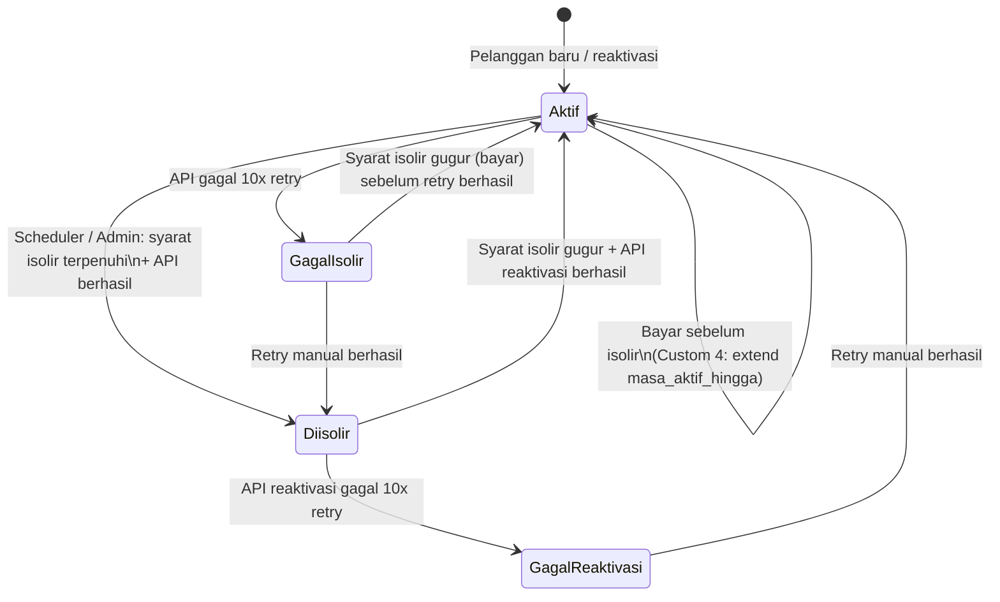
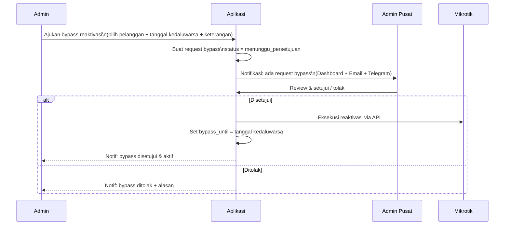
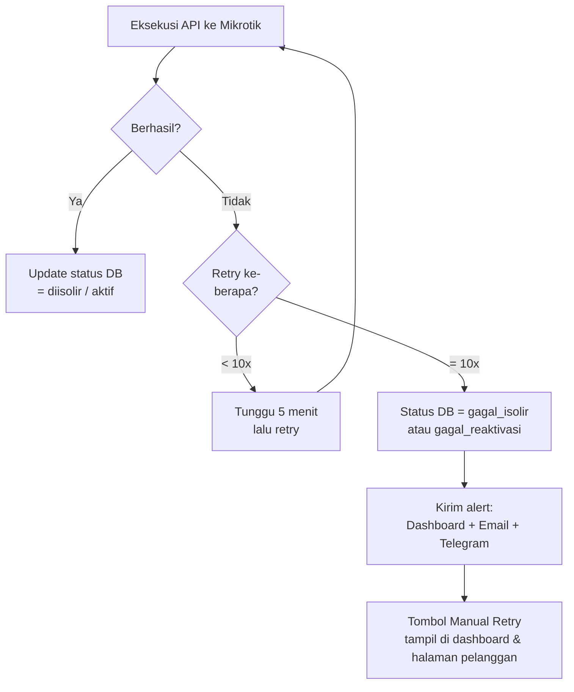

# 🚫 Spesifikasi Logika Isolir — Detail Teknis

> Versi: 1.2 | Tanggal: 6 November 2026
> Sistem: **Pra-bayar**
> Mekanisme isolir: **IP Static → Address-List Mikrotik** (semua tipe koneksi)

---

## 📊 Ringkasan 4 Mode Isolir

| Mode | Nama | Deskripsi Singkat |
|---|---|---|
| **Default** | Tidak Isolir Global | Isolir tidak diaktifkan. Berlaku untuk semua pelanggan kecuali dikustomisasi |
| **Custom 1** | Isolir Tepat Jatuh Tempo | Diisolir jika tagihan bulan ini belum lunas saat jatuh tempo |
| **Custom 2** | Tidak Isolir (Override) | Pelanggan VIP / khusus — tidak pernah diisolir sama sekali |
| **Custom 3** | Toleransi 1 Tagihan | Diisolir hanya jika ada **2 tagihan atau lebih** yang belum lunas |
| **Custom 4** | Masa Aktif Berbasis Bayar | Pembayaran memberikan masa aktif **+30 hari** dari titik tertentu |

> [!NOTE]
> `mode_isolir` disimpan per pelanggan. Semua mode hanya berlaku jika `isolir_enabled = true` pada data pelanggan. **Namun admin tetap bisa melakukan isolir manual meski `isolir_enabled = false`** (lihat bagian Isolir Manual).

---

## ⚙️ Detail Algoritma Per Mode

### 🔵 Default & Custom 2 — Tidak Isolir

```
Tidak ada aksi ke Mikrotik.
Scheduler skip pelanggan ini.
```

---

### 🟡 Custom 1 — Isolir Tepat Jatuh Tempo

```
Setiap hari scheduler berjalan:
  Jika hari ini >= jatuh_tempo DAN tagihan bulan ini status = belum_bayar:
    → ISOLIR

Saat tagihan dibayar:
  Jika pelanggan sedang diisolir:
    → REAKTIVASI
```

**Contoh (jatuh tempo tgl 10):**

```
10 Oktober  → belum bayar → ISOLIR
15 Oktober  → bayar tagihan Oktober → REAKTIVASI
```

---

### 🟠 Custom 3 — Toleransi 1 Tagihan (2+ Tunggakan = Isolir)

> Pelanggan "baik-baik saja" selama tunggakan maksimal 1 bulan.
> Isolir baru terjadi ketika tunggakan mencapai 2 bulan atau lebih.

#### Algoritma Scheduler

```
Hitung: jumlah_tagihan_belum_bayar = COUNT(tagihan WHERE status = belum_bayar)

Jika jumlah_tagihan_belum_bayar >= 2 DAN pelanggan tidak sedang diisolir:
  → ISOLIR

Jika jumlah_tagihan_belum_bayar < 2 DAN pelanggan sedang diisolir:
  → REAKTIVASI
```

#### Algoritma saat Pembayaran Masuk

```
Setelah pembayaran disimpan:
  Hitung ulang jumlah_tagihan_belum_bayar

  Jika jumlah_tagihan_belum_bayar >= 2: tetap terisolir
  Jika jumlah_tagihan_belum_bayar < 2:  → REAKTIVASI
```

#### Simulasi Timeline (jatuh tempo tgl 10)

```
Okt tgl 10  → tagihan Sep + Okt belum bayar (2 tagihan) → ISOLIR
              tagihan Sep belum bayar: 1  ✓
              tagihan Okt belum bayar: 1  ✓

Okt tgl 15  → bayar 1 tagihan (Sep) → sisa tunggakan: 1 (Okt) → REAKTIVASI

Nov tgl 10  → tagihan Okt + Nov belum bayar (2 tagihan) → ISOLIR lagi

Nov tgl 20  → bayar SEMUA tunggakan (Okt + Nov) → REAKTIVASI
              → sisa tunggakan: 0
              
Des tgl 10  → tagihan Des belum bayar: 1 → tidak isolir
Jan tgl 10  → tagihan Des + Jan belum bayar: 2 → ISOLIR
```

> [!NOTE]
> Pembayaran yang efektif untuk reaktivasi adalah yang membuat total tunggakan turun **di bawah 2**. Admin/kolektor perlu diberi tahu ini — bayar **minimal 1 tagihan** sudah bisa membuka isolir jika total tinggal 1.

---

### 🔴 Custom 4 — Masa Aktif Berbasis Tanggal Bayar (+30 Hari)

> Cocok untuk pelanggan bermasalah / tunggakan besar. Pembayaran memberikan "kredit waktu" 30 hari, bukan melunasi tagihan bulan tertentu.

#### Konsep Utama

Pelanggan punya field: **`masa_aktif_hingga`** — tanggal sampai kapan internet boleh aktif.

```
Scheduler harian:
  Jika hari ini > masa_aktif_hingga DAN pelanggan tidak sedang diisolir:
    → ISOLIR

Saat ada pembayaran:
  Jika pelanggan SEDANG AKTIF (tidak terisolir):
    masa_aktif_hingga = masa_aktif_hingga + 30 hari

  Jika pelanggan SEDANG TERISOLIR:
    masa_aktif_hingga = tanggal_pembayaran + 30 hari
    → REAKTIVASI segera
```

#### Simulasi Timeline

```
[Kondisi awal: sudah terisolir sejak lama]

15 Sep  → bayar 1 bulan → REAKTIVASI
          masa_aktif_hingga = 15 Sep + 30 = 15 Okt

10 Okt  → bayar 1 bulan (sebelum terisolir lagi)
          masa_aktif_hingga = 15 Okt + 30 = 14 Nov

[Tidak ada pembayaran sampai 14 Nov]

14 Nov  → scheduler jalan → hari ini > masa_aktif_hingga → ISOLIR

20 Nov  → bayar 1 bulan (sedang terisolir)
          masa_aktif_hingga = 20 Nov + 30 = 20 Des
          → REAKTIVASI segera
```

#### Jika Bayar Lebih dari 1 Bulan Sekaligus

Saat pelanggan Custom 4 membayar 2 bulan atau lebih sekaligus, admin/kolektor **wajib memilih tujuan pembayaran**:

| Opsi | Tujuan | Efek ke `masa_aktif_hingga` |
|---|---|---|
| **Cicil Tunggakan** | 1 bulan untuk extend masa aktif, sisanya melunasi tagihan lama | +30 hari saja |
| **Bayar Tagihan Rutin** | Semua bulan untuk extend masa aktif | +N × 30 hari |

> [!NOTE]
> Pilihan ini muncul sebagai opsi saat admin/kolektor menginput pembayaran untuk pelanggan Custom 4 dengan nominal ≥ 2 bulan. Tagihan lama tetap dimarkir lunas sesuai alokasi yang dipilih.

**Simulasi — Bayar 2 Bulan:**

```
Kondisi: pelanggan terisolir, ada 3 tagihan menunggak
Bayar 2 bulan pada 20 Okt

  Opsi A — Cicil Tunggakan:
    1 bulan → extend masa aktif → masa_aktif_hingga = 20 Okt + 30 = 19 Nov
    1 bulan → lunas tagihan terlama (misal tagihan Agustus)
    Sisa tunggakan: 2 tagihan (Sep, Okt)

  Opsi B — Bayar Tagihan Rutin:
    2 bulan → extend masa aktif → masa_aktif_hingga = 20 Okt + 60 = 19 Des
    2 tagihan terlama dilunas (Agustus + September)
    Sisa tunggakan: 1 tagihan (Okt)
```

---

## 🔄 State Machine Status Isolir

> [!NOTE]
> Karena semua pelanggan menggunakan **IP statis**, IP selalu diketahui dari data pelanggan — tidak ada state `pending_isolir`. Isolir dan reaktivasi selalu bisa dieksekusi kapan saja.



---

## 🖐️ Isolir Manual oleh Admin

### Aturan Dasar

| Aksi | Ketentuan |
|---|---|
| **Isolir manual** | Admin boleh mengisolir pelanggan meski `isolir_enabled = false` — ini adalah override eksplisit |
| **Konfirmasi modal** | Sebelum eksekusi, selalu muncul modal konfirmasi berisi nama pelanggan, IP, dan Mikrotik yang terdampak |
| **Reaktivasi / Bypass** | Admin bisa mengaktifkan kembali hingga tanggal tertentu (bypass sementara), tetapi **butuh persetujuan Admin Pusat** |
| **Catatan wajib** | Setiap aksi manual (isolir / reaktivasi / bypass) wajib mengisi keterangan — untuk audit trail |

### Alur Reaktivasi / Bypass oleh Admin



### State Tambahan: Bypass Aktif

Saat bypass aktif, scheduler **tidak akan mengisolir** pelanggan meski syarat isolir terpenuhi — sampai `bypass_until` terlewati.

```
Scheduler harian:
  Jika pelanggan punya bypass_until >= hari ini:
    → SKIP (tidak diproses isolir)
  Jika bypass_until < hari ini:
    → Evaluasi normal sesuai mode_isolir
```

### Field Tambahan untuk Bypass

| Field | Tipe | Keterangan |
|---|---|---|
| `bypass_until` | date\|null | Tanggal kedaluwarsa bypass. Null = tidak ada bypass aktif |
| `bypass_approved_by` | int\|null | ID Admin Pusat yang menyetujui |
| `bypass_note` | text | Keterangan alasan bypass |

### Tabel `bypass_requests`

| Field | Keterangan |
|---|---|
| `pelanggan_id` | Pelanggan yang diajukan bypass |
| `requested_by` | Admin yang mengajukan |
| `bypass_until` | Sampai kapan bypass berlaku |
| `keterangan` | Alasan pengajuan |
| `status` | `menunggu` / `disetujui` / `ditolak` |
| `approved_by` | Admin Pusat yang memproses |
| `approved_at` | Waktu persetujuan / penolakan |
| `rejection_note` | Alasan penolakan (jika ditolak) |

---

## 🗃️ Implikasi Data Model

> [!NOTE]
> Karena semua pelanggan **static IP**, kolom `tipe_koneksi` di tabel `pelanggan_mikrotik` tetap ada untuk keperluan informasi teknis, namun **tidak mempengaruhi logika isolir**. IP yang digunakan untuk address-list selalu diambil dari kolom `ip_address` di tabel `pelanggan_mikrotik`.

### Field tambahan di tabel `pelanggan`

| Field | Tipe | Keterangan |
|---|---|---|
| `mode_isolir` | enum | `default`, `custom1`, `custom2`, `custom3`, `custom4` |
| `masa_aktif_hingga` | date\|null | Hanya relevan untuk Custom 4 |
| `status_isolir` | enum | `aktif`, `diisolir`, `gagal_isolir`, `gagal_reaktivasi` |
| `bypass_until` | date\|null | Tanggal bypass aktif (disetujui Admin Pusat). Null = tidak ada bypass |
| `bypass_approved_by` | int\|null | ID Admin Pusat yang menyetujui bypass |
| `next_isolir_at` | date\|null | Proyeksi tanggal isolir berikutnya (kalkulasi, tampil di UI admin) |

### Tabel `log_isolir` (diperluas)

| Field | Keterangan |
|---|---|
| `mode_isolir_saat_itu` | Mode isolir pelanggan saat event terjadi |
| `jumlah_tunggakan` | Snapshot jumlah tagihan belum bayar (Custom 3) |
| `masa_aktif_dari` / `masa_aktif_hingga` | Snapshot masa aktif (Custom 4) |
| `status_api` | `sukses`, `gagal`, `pending` |
| `retry_count` | Berapa kali sudah dicoba |

---

## ⚠️ Edge Cases & Pertanyaan Terbuka

> [!NOTE]
> Edge case **PPPoE/Hotspot offline** sudah dieliminasi. Semua pelanggan menggunakan IP statis sehingga isolir dan reaktivasi selalu bisa dieksekusi kapan saja tanpa bergantung pada status koneksi pelanggan.

### ❓ A — Custom 4: Pembayaran Lebih dari 1 Bulan

> Jika pelanggan Custom 4 bayar 2 atau 3 bulan sekaligus, apakah `masa_aktif_hingga` diperpanjang **N × 30 hari**?

---

### ✅ B — Gagal API ke Mikrotik

Koneksi WireGuard bisa putus, Mikrotik restart, dll. Karena IP selalu diketahui (static), retry bisa dilakukan kapan saja.

| Komponen | Keputusan |
|---|---|
| **Retry otomatis** | 10x, interval 5 menit per percobaan |
| **Status DB jika semua gagal** | `gagal_isolir` / `gagal_reaktivasi` |
| **Alert jika retry habis** | Dashboard, Email, dan Telegram |
| **Trigger manual** | Tombol "Retry Isolir" / "Retry Buka Isolir" di halaman pelanggan & dashboard alert |

#### Flow Retry



| Pertanyaan | Perlu keputusan |
|---|---|
| Berapa kali retry otomatis? | Misal: 3x retry, interval 10 menit |
| Jika semua retry gagal → alert admin? | Via dashboard notifikasi / email |
| Status di DB saat gagal? | `gagal_isolir` / `gagal_reaktivasi` |
| Admin bisa trigger ulang manual? | Tombol "Retry" / "Eksekusi Manual" |

---

### ❓ C — Perpindahan Mode Isolir

Jika admin **mengubah mode** pelanggan dari Custom 3 ke Custom 4 (atau lainnya):

> Apakah status isolir saat ini langsung dievaluasi ulang dengan mode baru, atau baru berlaku di siklus berikutnya?

---

### ✅ D — Custom 4: Tagihan Bulanan Tetap Dibuat

Tagihan bulanan tetap dibuat untuk keperluan pembukuan dan rekap piutang. Custom 4 hanya mempengaruhi **kapan diisolir**, bukan apakah tagihan ada atau tidak.

---

### ✅ C — Perpindahan Mode Isolir

Saat admin mengubah mode isolir pelanggan (misal Custom 3 → Custom 4):

- Tanggal / data isolir lama **dihapus / direset**
- Admin **wajib mengisi tanggal baru** sebagai `masa_aktif_hingga` (khusus saat berpindah ke Custom 4)
- Mode baru **berlaku langsung** setelah disimpan
- Scheduler pada run berikutnya sudah menggunakan mode & tanggal baru

**Alur UI saat ganti mode ke Custom 4:**

```
Admin buka halaman pelanggan → ubah mode → pilih Custom 4
  → Form muncul field: "Masa Aktif Hingga" (date picker, wajib diisi)
  → Simpan
  → Sistem: reset next_isolir_at lama, set masa_aktif_hingga = input admin
  → Catat di log: perubahan mode, tanggal lama, tanggal baru, oleh siapa
```

**Alur UI saat ganti mode dari Custom 4 → mode lain:**

```
Admin ubah mode → pilih Custom 1 / Custom 3 / dll
  → Sistem: kosongkan masa_aktif_hingga
  → next_isolir_at dihitung ulang berdasarkan mode baru + data tagihan
  → Catat di log
```


## 📋 Ringkasan Keputusan — SEMUA SELESAI ✅

| # | Pertanyaan | Keputusan |
|---|---|---|
| 1 | IP PPPoE statis atau dinamis? | Dieliminasi — semua static IP |
| 2 | Custom 4: bayar N bulan | 2 opsi: cicil tunggakan (+30 hari) vs bayar rutin (+N×30 hari) |
| 3 | Retry gagal API | 10x retry, interval 5 menit |
| 4 | Alert jika retry habis | Dashboard + Email + Telegram |
| 5 | Isolir manual oleh admin | Boleh override `isolir_enabled`. Bypass perlu approval Admin Pusat |
| 6 | Custom 4: tetap generate tagihan bulanan? | Ya |
| 7 | Custom 3: reaktivasi jika tunggakan < 2? | Ya |
| 8 | Perpindahan mode isolir | Reset tanggal lama, admin input tanggal baru, berlaku langsung |
